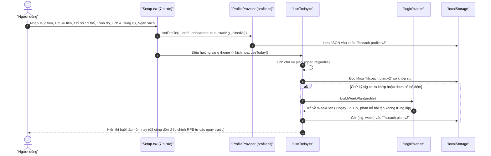
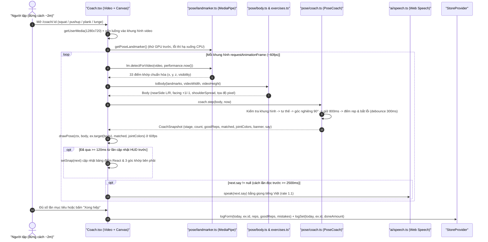
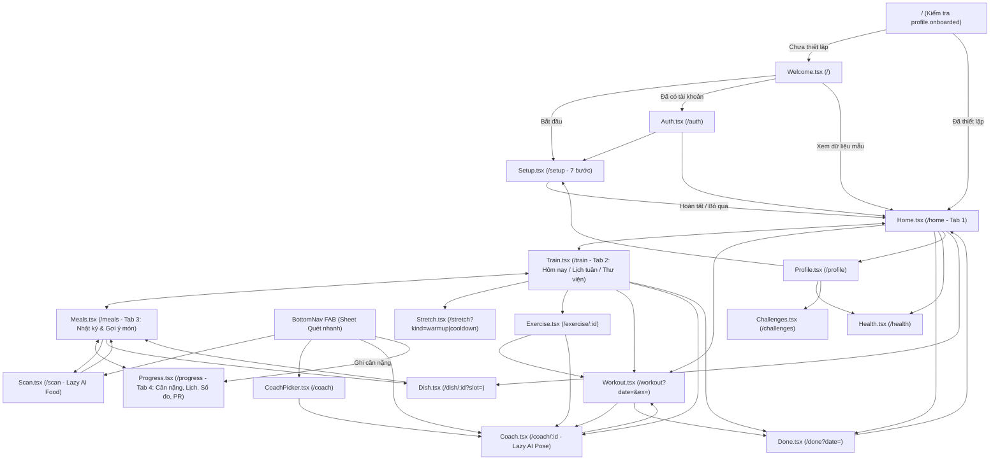

# TÀI LIỆU KIẾN TRÚC & THAM CHIẾU MÃ NGUỒN TOÀN DIỆN — FITCOACH (`fitness-app`)

> **Phiên bản tài liệu:** `1.0.0` (Khởi tạo từ phân tích mã nguồn toàn phần)
> **Kho mã nguồn:** `https://github.com/Tthanh2k6/fitness-app.git` (nhánh `main`, commit `af1242f`)
> **Kiến trúc cốt lõi:** Ứng dụng Web đơn trang (SPA) ưu tiên ngoại tuyến (Offline-First, Zero-Backend), tích hợp Thị giác Máy tính chạy trực tiếp trên trình duyệt (On-Device Edge AI với MediaPipe WASM/WebGL).

---

## 1. Tổng quan Dự án (Project Overview)

### 1.1. Bài toán Thực tế, Đối tượng Sử dụng & Bối cảnh Vận hành

**FitCoach** giải quyết ba rào cản lớn nhất của người mới bắt đầu tập thể dục tại Việt Nam — đặc biệt là sinh viên, nhân viên văn phòng tự tập ở nhà với không gian hẹp hoặc mới làm quen phòng gym:

1. **Không biết hôm nay tập gì, bao nhiêu là vừa sức:** Người mới thường sao chép lịch tập quá nặng hoặc mất cân đối nhóm cơ dẫn đến bỏ cuộc sớm. FitCoach sinh lịch tập cá nhân hóa theo 4 mục tiêu (`lose` giảm cân, `muscle` tăng cơ, `gain` tăng cân, `health` khỏe hơn mỗi ngày), 4 trình độ, quỹ thời gian (`15`/`30`/`45`/`60` phút), số buổi/tuần (`2..6` buổi, Chủ nhật luôn nghỉ), nơi tập (`home`/`gym`), dụng cụ sẵn có, và tự động điều chỉnh khối lượng buổi sau dựa trên cảm nhận mức độ nặng (`RPE 0..3`) cũng như điểm sẵn sàng sinh học (`readiness 0..100`).
2. **Tập ở nhà không có huấn luyện viên sửa tư thế:** Đặt điện thoại cách 2 mét, màn hình **Camera AI (`Coach`)** sử dụng `PoseLandmarker` trích xuất 33 khớp xương theo thời gian thực ngay trên thiết bị, tự động nhận diện bên cơ thể gần camera hơn (`nearSide`), đo góc khớp và độ nghiêng thân, vẽ khung xương mục tiêu màu vàng khớp đúng tỷ lệ chiều dài xương của từng người tập, đếm số lần lặp (`reps`) hoặc giây giữ (`hold`), đồng thời phát giọng nhắc nhở tiếng Việt khi lưng gù, gối vượt mũi chân, nhón gót hay võng hông.
3. **Khó tính calo món ăn Việt Nam và giới hạn ngân sách ăn uống hàng ngày:** Các ứng dụng quốc tế thiếu dữ liệu món ăn đường phố/cơm nhà Việt Nam và thường gợi ý thực đơn đắt đỏ. FitCoach tích hợp mô hình học chuyển giao (`MobileNetV3-Large` + tầng phân loại tuyến tính tự huấn luyện trên bộ ảnh `30VNFoods`) nhận diện **28 món ăn truyền thống Việt Nam** qua camera, kết hợp cơ sở dữ liệu **50 món ăn/thực phẩm Việt** (tính toán từ Bảng thành phần thực phẩm Việt Nam — Viện Dinh dưỡng Quốc gia 2007), lọc gợi ý theo đúng ngân sách tiền ăn mỗi ngày (mặc định `120.000đ/ngày`) và xuất nguyên liệu ra danh sách đi chợ.

**Bối cảnh vận hành đặc thù:**
- **100% Client-Side & Quyền riêng tư Tuyệt đối:** Không có máy chủ backend, không yêu cầu đăng ký tài khoản đám mây thực tế, không gửi bất kỳ khung hình video hay ảnh chụp món ăn nào ra khỏi thiết bị. Mọi trạng thái cá nhân và nhật ký tập luyện lưu bền vững trong `localStorage`.
- **Triển khai linh hoạt:** Chạy trực tiếp dưới dạng ứng dụng web tĩnh (SPA) trên Vercel, mạng nội bộ LAN hoặc qua đường hầm HTTPS `Tailscale Funnel` (`*.ts.net`) để cấp quyền camera trên điện thoại di động.

### 1.2. Bảng Tech Stack Chi tiết

Dự án bao gồm ứng dụng Web chính (`src/`) và 3 bộ công cụ ngoại tuyến phục vụ huấn luyện AI (`training/food/`), dựng hình minh họa người mẫu 3D (`tools/human/`), và xuất thiết kế chuẩn Figma (`redesign/`).

| Phân hệ | Công nghệ / Thư viện | Phiên bản cấu hình | Nguồn khai báo & Vai trò cụ thể |
| :--- | :--- | :--- | :--- |
| **Frontend Core** | `react` / `react-dom` | `^19.1.0` | `package.json` — Thư viện dựng giao diện người dùng và quản lý trạng thái qua Context/Hooks. |
| **Định tuyến SPA** | `react-router-dom` | `^7.6.0` | `package.json` — Định tuyến phía client (`BrowserRouter`), chuyển hướng route cũ, lazy-loading màn camera. |
| **On-Device AI** | `@mediapipe/tasks-vision` | `^0.10.35` | `package.json` — Cung cấp `PoseLandmarker` (33 điểm khớp) và `ImageEmbedder` (`MobileNetV3-Large` 1280 chiều) chạy qua WebAssembly/WebGL. |
| **Biểu tượng & UI** | `lucide-react` | `^0.511.0` | `package.json` — Bộ icon nét mảnh đồng nhất (`stroke-width: 2`). |
| **Bản đồ Cơ thể** | `react-body-highlighter` | `^2.0.5` | `package.json` — Hiển thị sơ đồ giải phẫu mặt trước (`anterior`) và mặt sau (`posterior`) trong `BodyMap.tsx`. |
| **Ngôn ngữ & Kiểu** | `typescript` | `~5.8.3` | `package.json` (`strict: true`, `erasableSyntaxOnly: true`, `verbatimModuleSyntax: true`). |
| **Bundler & Dev** | `vite` + `@vitejs/plugin-react` | `^6.3.5` / `^4.4.1` | `package.json` — Máy chủ phát triển HMR, đóng gói ESM, tách chunk tự động cho module AI. |
| **CSS Engine** | `tailwindcss` + `@tailwindcss/vite` | `^4.1.7` | `package.json` — Xử lý `@import "tailwindcss"` kết hợp hệ thống biến CSS thiết kế riêng trong `src/index.css`. |
| **Kiểm thử Đơn vị** | `vitest` | `^3.2.4` | `package.json` — Chạy 53 bài kiểm thử đơn vị cho thuật toán lập lịch, dinh dưỡng, thử thách, chấm dáng và phân loại món ăn. |
| **Kiểm tra Mã nguồn** | `eslint` + `typescript-eslint` | `^9.25.0` / `^8.30.1` | `package.json` — Cấu hình Flat Config (`eslint.config.js`) kèm `eslint-plugin-react-hooks` (`^5.2.0`) và `eslint-plugin-react-refresh` (`^0.4.19`). |
| **Web APIs Nội sinh** | `MediaDevices`, `SpeechSynthesis`, `Notification`, `Web Share` | Chuẩn trình duyệt | Truy cập luồng camera trước/sau, đọc hướng dẫn giọng tiếng Việt (`vi-VN`), thông báo hệ thống, chia sẻ thành tích. |
| **Offline ML (Python)** | `mediapipe`, `scikit-learn`, `numpy`, `huggingface_hub` | `0.10.35`, `1.6.1`, `>=1.26,<2.3`, `0.30.2` | `training/food/requirements.txt` — Tải bộ ảnh `30VNFoods`, trích vector đặc trưng `MobileNetV3` và huấn luyện `LogisticRegression` xuất ra `public/models/food-head.json`. |
| **Offline 3D Render** | `Blender` (Cycles GPU) + `MPFB` (MakeHuman) + `Pillow` | Blender `4.2+` (`4.5.14`), MPFB `2.0.18` | `tools/human/` — Dựng người mẫu 3D nữ gốc Á (tài sản CC0), đặt 36 tư thế kèm dụng cụ, render PNG trong suốt và nén sang 72 ảnh `.webp`. |
| **Offline Figma Tool** | `puppeteer-core` + Headless Chrome | `^23.11.1` | `redesign/tools/package.json` — Đóng gói bản mẫu HTML tương tác và chuyển đổi DOM/CSS đã render thành tệp vector `.svg` giữ nguyên lớp chữ cho Figma. |

### 1.3. Thông tin Kho Mã nguồn Git & Lịch sử Phát triển

- **Remote URL (`origin`):** `https://github.com/Tthanh2k6/fitness-app.git` (`fetch` & `push`).
- **Nhánh hiện tại:** `main`.
- **Trạng thái cây làm việc:** Sạch hoàn toàn đối với mọi tệp được theo dõi (chỉ có thư mục công cụ cục bộ `.claude/` không nằm trong Git).
- **Lịch sử Commit:**
  - `af1242f` — `FitCoach: giao diện mới theo redesign, ảnh người mẫu 3D cho động tác` (commit tổng hợp bản thiết kế mới *"Phấn, cao su và đĩa tạ"*, toàn bộ hệ thống AI Pose/Food, 3D Poses và bộ kiểm thử).
- **Bản sao lưu lịch sử trong kho:** Thư mục `_backup/` lưu giữ nguyên trạng phiên bản giao diện cũ trước đợt thiết kế lại ngày 23/10/2026 (`_backup/index-truoc-redesign.html` và `_backup/src-truoc-redesign-2026-10-23/`). Thư mục này đã được loại trừ khỏi trình biên dịch, kiểm thử (`vite.config.ts`) và bộ kiểm tra lỗi (`eslint.config.js`).

---

## 2. Kiến trúc Tổng thể & Luồng Dữ liệu (Architecture & End-to-End Data Flow)

### 2.1. Sơ đồ Kiến trúc Tổng thể

```mermaid
flowchart TD
  subgraph OfflinePipelines["Công cụ & Pipeline Ngoại tuyến (Build-time / Offline)"]
    HF["Bộ ảnh 30VNFoods (HuggingFace)"] --> TrainPy["training/food/train_head.py (MobileNetV3 + LogisticRegression)"]
    TrainPy --> FoodHeadJSON["public/models/food-head.json (28 lớp, 1280 chiều)"]
    Blender["tools/human/*.py (Blender Cycles + MPFB CC0)"] --> PoseWebP["public/poses/*.webp (36 tư thế x 2 kích cỡ)"]
    WasmCopy["scripts/copy-mediapipe-wasm.mjs (predev / prebuild)"] --> PublicWasm["public/mediapipe/wasm/* (Runtime WASM tự chủ)"]
    RedesignSrc["redesign/src/app.html + redesign/tools/*.mjs"] --> FigmaSVG["redesign/svg/* & redesign/demo/* (Đặc tả UI)"]
  end

  subgraph BrowserRuntime["Ứng dụng Web FitCoach trên Trình duyệt (100% Client-Side)"]
    IndexHTML["index.html (Inline FOUC Theme Script + Google Fonts)"] --> MainTSX["src/main.tsx (Cây Context Providers)"]
    MainTSX --> RouterApp["src/App.tsx (React Router v7 + Lazy AI Chunks)"]

    subgraph Presentation["Tầng Giao diện (Presentation Layer)"]
      Pages16["16 Màn hình Tải sẵn (Home, Train, Workout, Meals, Progress, Health...)"]
      LazyPages["2 Màn hình Lazy-Load (Coach.tsx, Scan.tsx)"]
      SharedUI["Components Dùng chung (Barbell, Pose, DishArt, Sheet, BottomNav, ui)"]
    end

    subgraph StateContext["Tầng Trạng thái & Hooks (State & Context Layer)"]
      ProfCtx["ProfileProvider (profile.ts + TDEE/Macros)"]
      StoreCtx["StoreProvider (store.ts + Actions bất biến)"]
      TodayHook["useToday (Bộ đệm lịch tuần theo chữ ký hồ sơ)"]
      ThemeVoice["useTheme (theme.ts) & useVietnameseVoice (speech.ts)"]
    end

    subgraph DomainAndAI["Tầng Nghiệp vụ Thuần & Trí tuệ Nhân tạo (Pure Domain & Edge AI)"]
      LogicMods["src/logic/* (plan, adjust, daily, health, meals, progress, records, challenges, demo)"]
      PoseAI["src/ai/pose/* (landmarker, body, geometry, exercises, coach, draw)"]
      FoodAI["src/ai/food/* (classifier, head, dishes, advice)"]
      StaticData["src/data/* (120 exercises, 120 videos, 12 recipes, 10 stretches, 13 muscles)"]
    end

    subgraph StorageAndAPIs["Lưu trữ Cục bộ & Giao diện Phần cứng / CDN"]
      LocalStore["window.localStorage (5 khóa fitcoach.*)"]
      WebAPIs["Web APIs (getUserMedia, SpeechSynthesis, Notification, Share)"]
      GoogleCDN["Google Storage CDN (pose_landmarker_lite.task, mobilenet_v3_large.tflite)"]
      YT["YouTube Nocookie Embed & Thumbnail CDN"]
    end
  end

  RouterApp --> Pages16
  RouterApp --> LazyPages
  Pages16 --> SharedUI
  LazyPages --> SharedUI
  Pages16 --> StateContext
  LazyPages --> StateContext
  StateContext --> LogicMods
  LogicMods --> StaticData
  LazyPages --> PoseAI
  LazyPages --> FoodAI
  PoseAI --> PublicWasm
  PoseAI --> GoogleCDN
  FoodAI --> PublicWasm
  FoodAI --> GoogleCDN
  FoodAI --> FoodHeadJSON
  SharedUI --> PoseWebP
  SharedUI --> YT
  StateContext <--> LocalStore
  LazyPages --> WebAPIs
  ThemeVoice --> WebAPIs
```



### 2.2. Phân tích Các Tầng Kiến trúc & Cơ chế Giao tiếp

Kiến trúc của `src/` tuân thủ nghiêm ngặt nguyên tắc **tách biệt hoàn toàn hàm tính toán thuần (pure domain logic) khỏi vòng đời giao diện React**:

1. **Tầng Lưu trữ & Cấu hình Môi trường (`index.html`, `src/theme.ts`, `src/profile.ts`, `src/store.ts`):**
   - Mọi thao tác đọc/ghi `localStorage` đều bọc trong `try / catch` để không bao giờ làm sập ứng dụng ở chế độ ẩn danh hạn chế bộ nhớ hoặc môi trường kiểm thử Node/Vitest (nơi không có `window`).
   - Không sử dụng Redux hay cơ sở dữ liệu phức tạp; trạng thái toàn cục được chia đúng thành 2 miền độc lập: **Hồ sơ cấu hình người tập** (`Profile` — ít thay đổi) và **Nhật ký hoạt động theo thời gian** (`Logs` — thay đổi liên tục mỗi lần uống nước, xong hiệp tập, ghi bữa ăn).
2. **Tầng Dữ liệu Tĩnh Định danh (`src/data/*`, `src/ai/food/dishes.ts`):**
   - Chứa danh mục bất biến có kiểm tra kiểu chặt chẽ: `LIBRARY` (120 bài tập), `VIDEOS` (120 mã video hướng dẫn đối xứng 1:1 với `LIBRARY`), `WARMUP`/`COOLDOWN` (10 động tác khởi động & giãn cơ), `MUSCLES` (13 nhóm cơ chi tiết gom về 4 nhóm màu đĩa tạ `Group`), `DISHES` (28 món ăn AI nhận diện) và `RECIPES` (12 công thức nấu chi tiết).
3. **Tầng Nghiệp vụ Thuần (`src/logic/*`):**
   - Hoàn toàn không phụ thuộc vào React (ngoại trừ hook điều phối mỏng `useToday.ts`). Tất cả các module `plan.ts`, `adjust.ts`, `daily.ts`, `health.ts`, `meals.ts`, `progress.ts`, `records.ts`, `challenges.ts`, `demo.ts` đều nhận đầu vào là dữ liệu thuần (`Profile`, `Logs`, chuỗi ngày `YYYY-MM-DD`) và trả về kết quả tất định (deterministic). Nhờ vậy toàn bộ tầng này được kiểm thử đơn vị cực nhanh mà không cần giả lập DOM.
4. **Tầng Edge AI Độc lập Giao diện (`src/ai/*`):**
   - Tách bạch rõ phần nạp mô hình singleton có cơ chế tự động hạ cấp `GPU` → `CPU` (`vision.ts`, `pose/landmarker.ts`, `food/classifier.ts`) khỏi phần toán học hình học và máy trạng thái (`pose/geometry.ts`, `pose/body.ts`, `pose/exercises.ts`, `pose/coach.ts`, `food/head.ts`, `food/advice.ts`).
   - Đặc biệt, `PoseCoach` (`src/ai/pose/coach.ts`) nhận mốc thời gian `now` (ms) làm tham số tường minh thay vì tự gọi `performance.now()`, cho phép `coach.test.ts` tua nhanh thời gian giả lập để kiểm thử chính xác độ trễ vào tư thế (`800ms`), chống rung lỗi (`300ms`) và giãn cách giọng nói (`2500ms`).
5. **Tầng Điều phối Context & Hooks (`ProfileProvider`, `StoreProvider`, `ToastProvider`, `useToday`, `useCountdown`):**
   - Cung cấp dữ liệu và các hàm cập nhật bất biến (`patch`, `logSet`, `logForm`, `addWater`, `addMeal`...) xuống cây component.
   - `useToday()` đóng vai trò cầu nối thông minh: kết hợp `Profile` + bộ đệm `fitcoach.plan.v2` + hàm tự điều chỉnh `adjustBefore(logs, date)` để xuất ra buổi tập thực tế của ngày bất kỳ mà không phải tính lại lịch tuần mỗi lần render.
6. **Tầng Màn hình & Thành phần Trực quan (`src/pages/*`, `src/components/*`):**
   - Gồm 18 trang trong `src/pages/` và hệ thống component đặc trưng mang ngôn ngữ thiết kế *"Phấn, cao su và đĩa tạ"* (`Barbell.tsx`, `Pose.tsx`, `DishArt.tsx`, `FocusPicker.tsx`, `Sheet.tsx`).

### 2.3. Luồng Khởi động Ứng dụng (Startup Lifecycle)

1. **Nạp `index.html` & Chống chớp giao diện (Anti-FOUC):**
   - Trước khi tải bundle JavaScript, đoạn `<script>` đồng bộ ngay trong `<head>` đọc `localStorage.getItem('fitcoach.theme')`. Nếu giá trị là `'light'` hoặc `'dark'`, nó gán ngay `document.documentElement.dataset.theme = t` để CSS áp dụng đúng bảng màu từ khung hình đầu tiên; nếu vắng mặt (`'auto'`), CSS tự động theo `@media (prefers-color-scheme: dark)`.
2. **Khởi tạo Cây React (`src/main.tsx`):**
   - Mount `<StrictMode>` vào `#root`, bọc lần lượt: `<BrowserRouter>` → `<ProfileProvider>` → `<StoreProvider>` → `<ToastProvider>` → `<App />`.
   - Khi `ProfileProvider` khởi chạy lần đầu, hàm `loadProfile()` đọc khóa `fitcoach.profile.v3`. Nếu chưa có, trả về `DEFAULT_PROFILE` (`onboarded: false`). Nếu có dữ liệu từ phiên bản cũ thiếu `startKg`, `targetKg` hoặc `joinedAt`, hàm tự động suy diễn giá trị hợp lý để tương thích ngược.
   - Khi `StoreProvider` khởi chạy lần đầu, hàm `loadLogs()` đọc khóa `fitcoach.logs.v1` và hợp nhất an toàn với `EMPTY_LOGS`.
3. **Phân giải Route & Tách gói Tải lười (`src/App.tsx`):**
   - Route gốc `/` kiểm tra `profile.onboarded`: nếu `true` thì `<Navigate to="/home" replace />`, nếu `false` thì hiển thị màn chào mừng `<Welcome />`.
   - Hai màn hình sử dụng `@mediapipe/tasks-vision` là `/coach/:id` (`Coach.tsx`) và `/scan` (`Scan.tsx`) được khai báo qua `lazy(() => import(...))` bọc trong `<Suspense fallback={<div className="page cam" />}>`. Nhờ đó người dùng mở trang chủ hay nhật ký bữa ăn không phải tải thư viện thị giác máy tính nặng nề cho tới khi thực sự bật camera.

### 2.4. Các Luồng Nghiệp vụ Chính từ Đầu đến Cuối (End-to-End Business Flows)

#### Luồng 1: Thiết lập Hồ sơ 7 bước & Sinh Lịch Tập Tuần Cá nhân hóa



- **Chi tiết kỹ thuật quan trọng:** Hàm `planSignature(p)` chỉ băm 7 thuộc tính ảnh hưởng đến cấu trúc bài tập (`goal`, `level`, `minutes`, `days`, `place`, `equipment` đã sắp xếp, `focus` đã sắp xếp). Khi người dùng cập nhật cân nặng hàng tuần, đổi tên hay bật/tắt thông báo, chữ ký `sig` giữ nguyên nên lịch tập trong tuần không bị xáo trộn đột ngột.

#### Luồng 2: Tập luyện có Hướng dẫn, Ghi nhận Kỷ lục & Tự điều chỉnh Khối lượng (Autoregulation)

1. Từ `/home` hoặc `/train`, người dùng mở bài khởi động `/stretch?kind=warmup` (`Stretch.tsx`). Đếm ngược tự động qua 5 động tác; hoàn thành xong gọi `setDayFlag(today, 'warmup', true)`.
2. Bấm vào buổi tập mở `/workout` (`Workout.tsx`, hỗ trợ `?date=YYYY-MM-DD` và `?ex=<id>`):
   - Khi mở màn hình lần đầu trong ngày, gọi `startWorkout(date)` lưu mốc `startedAt = Date.now()`.
   - Với bài đếm lần (`unit === 'lần'`), nhịp giả lập tăng tự động mỗi `2400ms` kèm hiệu ứng nảy số `.pop` để giữ nhịp độ tập; với bài tính giờ (`unit === 'giây'`), bộ đếm ngược tự động chạy mỗi `1000ms` và tự động gọi `completeSet()` khi về `0`.
   - Mỗi lần bấm **Xong hiệp**, `completeSet()` gọi `logSet(date, ex.id, targetAmount)` (tăng số hiệp đã làm `sets[exId]` thêm 1 và cập nhật thành tích cao nhất `reps[exId] = Math.max(...)`), phát giọng đọc tiếng Việt nhắc nghỉ, và chuyển sang pha nghỉ (`phase = 'rest'`) đếm ngược thời gian nghỉ.
3. Khi hoàn tất hiệp cuối của bài cuối cùng, ứng dụng gọi `finishWorkout(date)` (ghi `finishedAt`) và chuyển sang `/done` (`Done.tsx`):
   - `Done.tsx` gọi `newRecords(logs, date)` so sánh `logs.days[date]` với toàn bộ lịch sử trước `date` để vinh danh **Kỷ lục cá nhân mới** (nhiều lần/giây hơn trong 1 hiệp hoặc nhiều hiệp hơn).
   - Người dùng chọn cảm nhận buổi tập (`Nhẹ = 0`, `Vừa sức = 1`, `Khá nặng = 2`, `Quá sức = 3`) → gọi `setRpe(date, rpe)`.
   - Từ **ngày hôm sau trở đi**, `adjustBefore(logs, nextDate)` cộng dồn giá trị `rpe` này để tự động tăng/giảm số lần lặp (`-4..+6`), số hiệp (`-1..0`) hoặc thời gian nghỉ (`0..+30s`) cho buổi kế tiếp.

#### Luồng 3: Huấn luyện viên Tư thế Camera AI Thời gian thực (`Coach.tsx`)



#### Luồng 4: Chụp & Nhận diện Món ăn Việt qua Camera AI (`Scan.tsx` → `Meals.tsx`)

1. Người dùng bấm nút FAB quét ở giữa thanh điều hướng dưới (`BottomNav`) → chọn **Chụp món ăn** → mở `/scan` (`Scan.tsx`).
2. `Scan.tsx` mở camera sau (`facingMode: 'environment'`) hoặc cho phép chọn ảnh từ thư viện máy (`<input type="file" accept="image/*">`). Khi bấm chụp, khung hình được vẽ lên `<canvas>` ẩn kích thước tối đa `640px` và xuất thành Data URL JPEG (`0.88`) hiển thị cố định trên khung ngắm.
3. Gọi `classifyFood(imgElement)` (`src/ai/food/classifier.ts`):
   - Tải song song `ImageEmbedder` (`mobilenet_v3_large.tflite`, bật `l2Normalize: true`) và tệp trọng số `/models/food-head.json` (`28` nhãn × `1280` chiều).
   - Trích vector đặc trưng `1280` chiều từ ảnh → nhân ma trận `logits = W·x + b` → biến đổi `softmax` (`src/ai/food/head.ts`) → ánh xạ từng `datasetClass` sang đối tượng `DishInfo` trong `src/ai/food/dishes.ts`.
   - Nếu thiếu tệp `food-head.json` hoặc mất mạng lần đầu chưa tải được `.tflite`, hàm trả về `{ status: 'no-head' }` hoặc `{ status: 'error' }` và giao diện tự động mở hộp tìm kiếm chọn tay 28 món để không bao giờ chặn luồng ghi nhật ký của người dùng.
4. Người dùng chọn khẩu phần (`Nhỏ 0.75x`, `Vừa 1.0x`, `Lớn 1.35x`) và bữa ăn (`Sáng`/`Trưa`/`Bữa phụ`/`Tối`, mặc định tự đoán theo giờ hiện tại `currentSlot()`). Hàm `mealAdvice()` đối chiếu calo/đạm của món với ngân sách calo còn lại trong ngày để đưa ra lời khuyên sát ngữ cảnh (an toàn / gần hết ngân sách / vượt ngân sách / thiếu đạm cho mục tiêu tăng cơ).
5. Bấm **Thêm vào bữa ...** gọi `addMeal()` lưu vào `logs.meals` rồi điều hướng sang `/meals` cập nhật ngay lập tức thanh năng lượng, 3 thanh macro (Đạm/Tinh bột/Chất béo) và ví tiền ăn còn lại trong ngày.

#### Luồng 5: Theo dõi Sức khỏe, Điểm Sẵn sàng (`Readiness`) & Thử thách Cộng đồng

- **Điểm Sẵn sàng (`src/logic/health.ts`):** Màn `/home` và `/health` tính điểm `readiness` (`0..100`) từ 4 thành phần có trọng số: Giấc ngủ đêm qua (`35%`, xử lý cả giờ đi ngủ qua nửa đêm như `23:15 → 06:30`), Tâm trạng trong ngày (`25%`), Nhịp tim lúc nghỉ so với đường cơ sở 7 ngày (`20%`), và Mức độ hồi phục nhóm cơ dựa trên lịch sử tập 2 ngày gần nhất (`20%`). Điểm này trực tiếp sinh câu nhận xét và lời khuyên của HLV trên Trang chủ (`coachTip`).
- **Thử thách & Huy hiệu (`src/logic/challenges.ts`):** Màn `/challenges` cho phép tham gia 4 thử thách thực tế (`8.000 bước/ngày`, `Plank tăng 5s/ngày`, `Ngủ trước 23h`, `Không trà sữa 7 ngày`). Tiến độ mỗi ngày được chấm tự động từ nhật ký thật trong `Logs`; bảng xếp hạng so sánh chỉ số thực của người dùng với 3 người bạn mẫu ổn định, đồng thời tự động mở khóa 6 huy hiệu hình đĩa tạ khi đạt mốc.

#### Luồng 6: Chế độ Dữ liệu Mẫu Thuyết trình (`Demo Mode`)

- Ở màn `/welcome` (nút *"Xem thử với dữ liệu mẫu"*) hoặc cuối màn `/profile` (nút *"Nạp dữ liệu mẫu"*), hàm `seedDemo()` (`src/logic/demo.ts`) tạo lập tức hồ sơ mẫu **Nguyễn Minh Anh** (`61,4 kg`, giảm cân, tập ở nhà) cùng **52 ngày lịch sử liên tục** có nhiễu giả ngẫu nhiên tất định (cân nặng giảm dần từ `64,0 kg` xuống `61,4 kg`, số đo eo/mông/mỡ giảm, 3 tuần lịch tập hoàn chỉnh kèm dữ liệu chấm dáng AI, giấc ngủ, nhịp tim, bước chân, 3 bữa ăn trong ngày và thử thách ngày thứ 12/30). Khi đang ở chế độ mẫu (`logs.demo === true`), đầu màn `/profile` hiện thẻ cảnh báo cho phép bấm **Xóa dữ liệu mẫu** (`clearDemo()`) để quay về trạng thái trắng ban đầu.

---

## 3. Cấu trúc Thư mục & Bản đồ Toàn bộ Tệp nguồn (Complete Directory & File Map)

### 3.1. Cây Thư mục Trực quan

```text
fitness-app/
├── index.html                        # Trang HTML gốc + inline script chống FOUC giao diện Sáng/Tối
├── package.json                      # Khai báo dependencies, scripts (dev, build, test, lint)
├── vite.config.ts                    # Cấu hình Vite 6, Tailwind v4, LAN/Tailscale host, loại trừ test
├── tsconfig.json                     # Cấu hình TypeScript gốc tham chiếu app & node
├── tsconfig.app.json                 # Cấu hình TS nghiêm ngặt cho src/ (strict, erasableSyntaxOnly)
├── tsconfig.node.json                # Cấu hình TS cho vite.config.ts
├── eslint.config.js                  # Cấu hình ESLint 9 Flat Config
├── vercel.json                       # Quy tắc rewrite SPA cho triển khai Vercel
├── README.md                         # Hướng dẫn tổng quan dự án & lệnh chạy nhanh
├── CODEBASE.md                       # Tài liệu kiến trúc & tham chiếu mã nguồn toàn diện (tệp này)
├── agent.md                          # Giao thức làm việc & đồng bộ tài liệu bắt buộc cho AI Agent
│
├── scripts/
│   └── copy-mediapipe-wasm.mjs       # Script predev/prebuild chép WASM từ node_modules sang public/
│
├── docs/
│   └── food-research.md              # Nghiên cứu học thuật về bộ ảnh món Việt & dinh dưỡng Viện Dinh dưỡng
│
├── public/                           # Tài sản tĩnh phục vụ trực tiếp ở đường dẫn gốc "/"
│   ├── favicon.svg                   # Biểu tượng thanh đòn 4 màu đĩa tạ
│   ├── models/
│   │   └── food-head.json            # Trọng số LogisticRegression (28 món x 1280 chiều, ~302 KB)
│   ├── poses/                        # 72 ảnh người mẫu 3D nền trong suốt (36 tư thế: <tên>.webp & <tên>-sm.webp)
│   └── mediapipe/wasm/               # (Sinh tự động bởi predev/prebuild, gitignore) 6 tệp WASM/JS MediaPipe
│
├── src/                              # MÃ NGUỒN CHÍNH CỦA ỨNG DỤNG REACT + TYPESCRIPT
│   ├── main.tsx                      # Điểm vào React, bọc BrowserRouter + 3 Providers
│   ├── App.tsx                       # Khai báo toàn bộ 18 routes + 5 redirects + lazy chunks
│   ├── index.css                     # Hệ thống thiết kế CSS "Phấn, cao su và đĩa tạ" (437 dòng)
│   ├── profile.ts                    # Kiểu Profile, lưu trữ v3, công thức Mifflin-St Jeor TDEE/Macro/BMI
│   ├── store.ts                      # Kiểu Logs, DayLog, MealLog, lưu trữ v1, chuẩn hóa ngày ISO cục bộ
│   ├── theme.ts                      # Quản lý giao diện Sáng / Tối / Tự động (fitcoach.theme)
│   ├── vite-env.d.ts                 # Khai báo kiểu tài sản Vite
│   │
│   ├── lib/                          # Tiện ích định dạng & hook hạ tầng nhỏ
│   │   ├── format.ts                 # Định dạng số tiếng Việt, tiền đồng, đồng hồ mm:ss, chữ tắt tên
│   │   └── useCountdown.ts           # Hook đếm ngược giây có tạm dừng/tiếp tục/cộng thêm thời gian
│   │
│   ├── data/                         # Danh mục dữ liệu tĩnh bất biến
│   │   ├── muscles.ts                # 13 nhóm cơ chi tiết, ánh xạ sang 4 nhóm màu đĩa tạ & SVG cơ thể
│   │   ├── exercises.ts              # Thư viện 120 bài tập đầy đủ thông số MET, pattern, hướng dẫn, lỗi sai
│   │   ├── videos.ts                 # 120 mã video YouTube hướng dẫn khớp 1:1 với 120 bài tập
│   │   ├── stretches.ts              # 5 động tác khởi động (WARMUP) & 5 động tác giãn cơ (COOLDOWN)
│   │   └── recipes.ts                # 12 công thức nấu ăn chi tiết cho 1 người + nguyên liệu đi chợ
│   │
│   ├── logic/                        # Tầng nghiệp vụ thuần & kiểm thử đơn vị
│   │   ├── plan.ts                   # Thuật toán sinh lịch tập tuần cá nhân hóa (buildWeekPlan)
│   │   ├── adjust.ts                 # Thuật toán tự điều chỉnh khối lượng buổi sau theo RPE (adjustBefore)
│   │   ├── useToday.ts               # Hook kết hợp bộ đệm lịch tuần fitcoach.plan.v2 + điều chỉnh RPE
│   │   ├── session.ts                # Tính thời lượng buổi tập và lượng calo đốt dự kiến theo MET
│   │   ├── daily.ts                  # Tính calo thực đốt, 4 đĩa tạ chỉ số ngày, chuỗi buổi tập (streak)
│   │   ├── health.ts                 # Tính giờ ngủ, đường cơ sở nhịp tim, điểm sẵn sàng 0-100 & lời nhắc HLV
│   │   ├── meals.ts                  # Danh mục 50 món ăn Việt, phân bổ calo 4 bữa & gợi ý theo ngân sách
│   │   ├── progress.ts               # Thống kê cân bằng hiệp theo nhóm cơ & kiểm tra mục tiêu tuần
│   │   ├── records.ts                # Tổng hợp kỷ lục cá nhân (PR) và phát hiện kỷ lục mới sau buổi tập
│   │   ├── challenges.ts             # Định nghĩa 4 thử thách, chấm tiến độ tự động, bảng xếp hạng & 6 huy hiệu
│   │   ├── demo.ts                   # Sinh dữ liệu mẫu 52 ngày (Minh Anh) để trình diễn đầy đủ tính năng
│   │   ├── logic.test.ts             # 17 ca kiểm thử cho TDEE, lập lịch tập, khóa khớp LIBRARY-VIDEOS, gợi ý món
│   │   ├── metrics.test.ts           # 13 ca kiểm thử cho điều chỉnh RPE, calo đốt, điểm sẵn sàng, kỷ lục PR
│   │   └── challenges.test.ts        # 4 ca kiểm thử cho tiến độ thử thách và mở khóa huy hiệu
│   │
│   ├── ai/                           # Tầng Trí tuệ Nhân tạo chạy trên thiết bị (Edge AI)
│   │   ├── assets.ts                 # Đường dẫn WASM nội bộ & URL model MediaPipe chính thức
│   │   ├── vision.ts                 # Singleton nạp FilesetResolver WASM dùng chung cho Pose & Food
│   │   ├── speech.ts                 # Tổng hợp giọng đọc hướng dẫn tiếng Việt (Web Speech API)
│   │   ├── pose/                     # Phân hệ Camera AI Chấm dáng & Đếm lần
│   │   │   ├── landmarker.ts         # Singleton PoseLandmarker (VIDEO mode, GPU -> CPU fallback)
│   │   │   ├── geometry.ts           # Toán học vector 2D: góc khớp, độ nghiêng, khoảng cách có dấu
│   │   │   ├── body.ts               # Chuyển 33 landmarks sang đối tượng Body (nearSide, facing, inFrame)
│   │   │   ├── exercises.ts          # Luật chấm dáng, góc đo & bộ khung xương mục tiêu cho 4 bài AI
│   │   │   ├── coach.ts              # Máy trạng thái PoseCoach (lọc EMA, bắt lỗi, đếm lần sạch, nhắc thoại)
│   │   │   ├── draw.ts               # Vẽ khung xương người tập & khung mục tiêu lên Canvas 2D 60fps
│   │   │   └── coach.test.ts         # 10 ca kiểm thử máy trạng thái PoseCoach và hình học cơ thể
│   │   └── food/                     # Phân hệ Camera AI Nhận diện Món ăn Việt
│   │       ├── dishes.ts             # Bảng chuẩn hóa dinh dưỡng, giá tiền & khẩu phần cho 28 món Việt
│   │       ├── head.ts               # Phép nhân ma trận tuyến tính W*x + b, softmax & top-K
│   │       ├── classifier.ts         # Kết nối ImageEmbedder MobileNetV3 + food-head.json
│   │       ├── advice.ts             # Sinh lời khuyên bữa ăn theo ngân sách calo còn lại & mục tiêu
│   │       └── food.test.ts          # 9 ca kiểm thử cho softmax, khẩu phần, dữ liệu 28 món & lời khuyên
│   │
│   ├── components/                   # Các thành phần giao diện tái sử dụng
│   │   ├── ProfileProvider.tsx       # React Context cung cấp hồ sơ người tập
│   │   ├── StoreProvider.tsx         # React Context cung cấp kho nhật ký và 16 hành động ghi dữ liệu
│   │   ├── ui.tsx                    # BackButton, Toggle, Segmented, GROUP_COLOR, ToastProvider
│   │   ├── BottomNav.tsx             # Thanh điều hướng 4 tab + nút nổi FAB mở Sheet chọn Camera
│   │   ├── Sheet.tsx                 # Ngăn kéo trượt từ đáy màn hình (Bottom Sheet modal)
│   │   ├── Barbell.tsx               # Biểu tượng thanh đòn lắp đĩa tạ Olympic SVG có hoạt ảnh dâng màu
│   │   ├── Pose.tsx                  # Hiển thị ảnh 3D WebP động tác tập kèm dự phòng hình người que SVG
│   │   ├── DishArt.tsx               # Minh họa 34 kiểu món ăn Việt nhìn từ trên xuống bằng SVG thủ tục
│   │   ├── FocusPicker.tsx           # Sơ đồ chọn vùng cơ ưu tiên mặt trước/sau bằng SVG giải phẫu riêng
│   │   ├── BodyMap.tsx               # Sơ đồ tô sáng cơ chính/phụ bằng react-body-highlighter
│   │   └── VideoPlayer.tsx           # Khung xem ảnh bìa & nhúng video hướng dẫn YouTube nocookie
│   │
│   └── pages/                        # 18 màn hình ứng dụng
│       ├── Welcome.tsx               # Màn chào mừng (/)
│       ├── Auth.tsx                  # Màn nhập tên/email nhanh (/auth)
│       ├── Setup.tsx                 # Luồng thiết lập hồ sơ 7 bước (/setup)
│       ├── Home.tsx                  # Trang chủ: Thanh đòn ngày, buổi tập, nước, ngủ, nhịp tim, bữa ăn (/home)
│       ├── Train.tsx                 # Trung tâm tập luyện 3 tab: Hôm nay, Lịch tuần, Thư viện 120 bài (/train)
│       ├── Exercise.tsx              # Chi tiết bài tập: minh họa 3D, video, cơ tác động, các bước, lỗi sai (/exercise/:id)
│       ├── Workout.tsx               # Màn dẫn tập tối màu cỡ chữ lớn, đếm nhịp & đếm ngược nghỉ (/workout)
│       ├── Stretch.tsx               # Màn dẫn tập khởi động & giãn cơ tự động chuyển bài (/stretch)
│       ├── CoachPicker.tsx           # Màn chọn 1 trong 4 bài tập hỗ trợ Camera AI (/coach)
│       ├── Coach.tsx                 # Màn Camera AI chỉnh dáng thời gian thực (/coach/:id)
│       ├── Done.tsx                  # Tổng kết buổi tập, vinh danh PR mới & hỏi mức độ nặng RPE (/done)
│       ├── Meals.tsx                 # Quản lý calo, dòng thời gian 4 bữa, gợi ý món Việt & đi chợ (/meals)
│       ├── Dish.tsx                  # Chi tiết món ăn, tỷ lệ năng lượng, nguyên liệu & cách nấu (/dish/:id)
│       ├── Scan.tsx                  # Màn chụp/tải ảnh nhận diện món ăn Việt bằng AI (/scan)
│       ├── Progress.tsx              # Biểu đồ cân nặng, lịch tháng, cân bằng nhóm cơ, số đo & PR (/progress)
│       ├── Health.tsx                # Điểm sẵn sàng 0-100, biểu đồ giấc ngủ, nước, nhịp tim & thiết bị (/health)
│       ├── Challenges.tsx            # Thử thách cộng đồng, bảng xếp hạng nhóm bạn & 6 huy hiệu (/challenges)
│       └── Profile.tsx               # Hồ sơ cá nhân, BMI, chỉnh sửa kế hoạch, giao diện Sáng/Tối (/profile)
│
├── training/food/                    # Pipeline Python huấn luyện AI nhận diện 28 món ăn Việt
│   ├── README.md                     # Hướng dẫn tải dữ liệu, huấn luyện và kết quả thực nghiệm (75,9% / 91,5%)
│   ├── requirements.txt              # Danh sách gói Python (mediapipe, scikit-learn, numpy, huggingface_hub)
│   ├── download_30vnfoods.py         # Script tải & giải nén bộ ảnh 30VNFoods (~4,5 GB) từ HuggingFace
│   ├── train_head.py                 # Script trích đặc trưng có bộ đệm .npz & huấn luyện LogisticRegression
│   ├── report.json                   # Kết quả chấm điểm chi tiết từng món và 10 cặp món hay nhầm nhất
│   ├── cache/                        # Bộ đệm vector đặc trưng nén (.npz, ~110 MB)
│   └── models/                       # Nơi lưu mobilenet_v3_large.tflite phục vụ huấn luyện
│
├── tools/human/                      # Pipeline Blender + MakeHuman dựng 36 tư thế người mẫu 3D
│   ├── README.md                     # Quy trình cài MPFB CC0, render bằng GPU Cycles và xuất WebP
│   ├── build_human.py                # Script Blender dựng người mẫu nữ gốc Á mặc đồ thể thao -> human.blend
│   ├── poses.py                      # Đặc tả vector hướng xương, dụng cụ và góc máy cho 36 tư thế
│   ├── render_poses.py               # Script Blender đặt tư thế, dựng dụng cụ 3D, căn khung tự động & render PNG
│   ├── export_webp.py                # Script Pillow làm mờ bóng mép ảnh và xuất 72 tệp WebP (512px & 192px)
│   ├── human.blend                   # Tệp cảnh gốc người mẫu 3D (~10,8 MB)
│   └── out/                          # 36 ảnh PNG gốc nền trong suốt đã render từ Cycles
│
├── redesign/                         # Bản mẫu thiết kế độc lập & Bộ công cụ xuất SVG cho Figma
│   ├── README.md                     # Triết lý thiết kế, danh sách 15 màn và cách nhập vào Figma
│   ├── src/app.html                  # Mã nguồn duy nhất của bản mẫu tương tác + trang Hệ thống thiết kế (1524 dòng)
│   ├── tools/                        # Bộ script Node.js + Puppeteer
│   │   ├── package.json              # Khai báo puppeteer-core
│   │   ├── build.mjs                 # Nhúng icon Lucide từ ../node_modules vào demo/index.html & artifact.html
│   │   ├── export-svg.mjs            # Chuyển đổi DOM đã render thành tệp vector SVG Sáng/Tối cho Figma
│   │   ├── shoot.mjs                 # Chụp nhanh ảnh PNG độ phân giải 2x từng màn hình
│   │   └── check-svg.mjs             # Mở lại tệp SVG độc lập và chụp ảnh đối chiếu kiểm tra lỗi hiển thị
│   ├── demo/                         # Bản dựng HTML tự chứa (index.html, artifact.html)
│   ├── svg/                          # Các tệp vector xuất sẵn cho Figma (sang/, toi/, tat-ca-man-*.svg)
│   └── png/                          # Ảnh chụp đối chiếu 2x (sang/, toi/, light/)
│
└── _backup/                          # Bản sao lưu lịch sử trước đợt thiết kế lại (KHÔNG DÙNG TRONG RUNTIME)
    ├── index-truoc-redesign.html     # Tệp index.html cũ dùng font Nunito
    └── src-truoc-redesign-2026-10-23/# Cây mã nguồn cũ chỉ lưu để tham khảo lịch sử
```

### 3.2. Bảng Kê khai Toàn bộ Tệp Nguồn, Cấu hình, Script, Kiểm thử & Công cụ

Bảng dưới đây liệt kê **đầy đủ 100%** mọi tệp văn bản/mã nguồn hiện hành của dự án (bỏ qua `node_modules`, `dist`, `.git`, `.venv`, `.claude/worktrees` và cây mã cũ trong `_backup/src-truoc-redesign-2026-10-23`).

#### A. Cấu hình Gốc, Tài liệu & Tài sản Tĩnh (`Root`, `scripts/`, `docs/`, `public/`)

| Đường dẫn tương đối | Số dòng | Vai trò chi tiết | Thành phần xuất ra / Khóa chính |
| :--- | :---: | :--- | :--- |
| `.gitignore` | 43 | Loại trừ `node_modules`, `dist`, `public/mediapipe`, mô hình `.tflite`/`.task`/`.npz`, dữ liệu huấn luyện và các thư mục tạm khỏi Git. | Quy tắc Git ignore |
| `README.md` | 59 | Tài liệu giới thiệu dự án, 5 nhóm tính năng chính, hướng dẫn chạy thử trên điện thoại/máy tính và cách huấn luyện lại AI. | Tài liệu Markdown |
| `package.json` | 41 | Cấu hình gói dự án, danh sách thư viện runtime/dev và 6 script CLI (`predev`, `dev`, `prebuild`, `build`, `lint`, `test`, `preview`). | NPM Manifest |
| `package-lock.json` | 4583 | Khóa cứng cây phiên bản phụ thuộc của npm ở thư mục gốc. | Lockfile v3 |
| `vite.config.ts` | 12 | Cấu hình plugin `react()`, `tailwindcss()`, mở `host: true`, cho phép tên miền `.ts.net` và loại trừ `_backup/**`, `redesign/**` khỏi Vitest. | `default defineConfig` |
| `tsconfig.json` | 8 | Tệp cấu hình TypeScript gốc kết nối Project References tới `tsconfig.app.json` và `tsconfig.node.json`. | TS Solution Config |
| `tsconfig.app.json` | 28 | Cấu hình biên dịch TypeScript nghiêm ngặt cho `src/` (`ES2020`, `react-jsx`, `strict`, `noUnusedLocals`, `erasableSyntaxOnly`, `verbatimModuleSyntax`). | TS App Config |
| `tsconfig.node.json` | 26 | Cấu hình biên dịch TypeScript cho môi trường Node (`vite.config.ts`, `ES2022`). | TS Node Config |
| `eslint.config.js` | 29 | Cấu hình ESLint 9 cho tệp `**/*.{ts,tsx}`, bỏ qua `dist`, `_backup`, `redesign`. | `default tseslint.config` |
| `vercel.json` | 4 | Định tuyến lại mọi đường dẫn không phải `/api/` về `/index.html` để hỗ trợ làm mới trang (F5) trên SPA. | `rewrites` |
| `index.html` | 26 | Khung HTML tiếng Việt (`lang="vi"`), nạp font `Be Vietnam Pro` & `Barlow Condensed`, chạy inline script gán `data-theme` chống FOUC trước khi mount `/src/main.tsx`. | `#root`, anti-FOUC script |
| `scripts/copy-mediapipe-wasm.mjs` | 9 | Chép thư mục `wasm` từ `node_modules/@mediapipe/tasks-vision/wasm` sang `public/mediapipe/wasm` trước khi chạy `dev` hoặc `build`. | Node ESM Script |
| `docs/food-research.md` | 238 | Báo cáo khảo sát các bộ ảnh món ăn Việt (`30VNFoods`, `VinaFood21`), giấy phép `CC BY-NC-SA 4.0`, lý do loại 2 lớp nhiễu và bảng tính calo/macro chi tiết cho 28 món. | Tài liệu Nghiên cứu |
| `public/favicon.svg` | 2 | Biểu tượng ứng dụng nền cao su đen `#14161A` mang hình thanh đòn và 3 đĩa tạ Đỏ, Xanh dương, Vàng. | SVG Asset |
| `public/models/food-head.json` | 1 | Tệp JSON nén (~302 KB) chứa ma trận trọng số `W` (`35.840` số thực = `28 × 1280`), độ chệch `b` (`28` số), danh sách 28 nhãn món Việt và độ chính xác kiểm thử (`top1: 0.7589`, `top3: 0.9146`). | JSON Model Weights |
| `public/poses/*.webp` *(72 tệp)* | Nhị phân | Bộ 36 tư thế người mẫu 3D nền trong suốt, mỗi tư thế gồm bản lớn `<tên>.webp` (`512×512`) và bản thu nhỏ `<tên>-sm.webp` (`192×192`). | Static WebP Assets |

#### B. Lõi Ứng dụng, Trạng thái & Tiện ích (`src/` gốc & `src/lib/`)

| Đường dẫn tương đối | Số dòng | Vai trò chi tiết | Thành phần xuất ra (`exports`) |
| :--- | :---: | :--- | :--- |
| `src/vite-env.d.ts` | 2 | Nạp định nghĩa kiểu môi trường `vite/client` cho TypeScript. | Triple-slash reference |
| `src/main.tsx` | 23 | Điểm khởi chạy React, bọc `StrictMode`, `BrowserRouter`, `ProfileProvider`, `StoreProvider`, `ToastProvider` quanh `App`. | Side-effect mount `#root` |
| `src/App.tsx` | 60 | Định nghĩa toàn bộ sơ đồ điều hướng SPA gồm 18 route màn hình (trong đó `Coach` và `Scan` dùng `React.lazy`) và 6 route điều hướng lại. | `default App` |
| `src/index.css` | 438 | Toàn bộ hệ thống thiết kế CSS *"Phấn, cao su và đĩa tạ"*: biến màu Sáng/Tối/Camera, reset trong `@layer base`, hệ thống class component và keyframes. | CSS Design System |
| `src/profile.ts` | 121 | Định nghĩa kiểu `Profile`, hằng số nhãn mục tiêu/trình độ, hàm đọc/lưu `fitcoach.profile.v3` kèm tương thích ngược, công thức Mifflin-St Jeor TDEE, Macro, BMI và ngày dự kiến đạt cân. | `Goal`, `Level`, `Place`, `Sex`, `Profile`, `GOAL_LABEL`, `GOAL_DESC`, `LEVEL_LABEL`, `DEFAULT_PROFILE`, `loadProfile`, `saveProfile`, `dailyCalories`, `dailyMacros`, `bmi`, `bmiLabel`, `targetEta`, `ProfileContext` |
| `src/store.ts` | 111 | Định nghĩa toàn bộ cấu trúc nhật ký `Logs` (`DayLog`, `MealLog`, `Measure`, `ShoppingItem`), đọc/lưu `fitcoach.logs.v1`, và các hàm xử lý ngày tháng theo múi giờ địa phương. | `MealSlot`, `MEAL_SLOTS`, `MEAL_TIME`, `MealLog`, `FormSummary`, `SleepLog`, `DayLog`, `Measure`, `ShoppingItem`, `Logs`, `EMPTY_LOGS`, `loadLogs`, `saveLogs`, `isoDate`, `shiftDate`, `parseIso`, `mondayOf`, `StoreValue`, `StoreContext`, `useStore` |
| `src/theme.ts` | 49 | Đọc/ghi chế độ giao diện (`light` / `dark` / `auto`) vào `fitcoach.theme`, đồng bộ `document.documentElement.dataset.theme` và lắng nghe sự kiện đổi màu hệ điều hành. | `ThemePref`, `getThemePref`, `setThemePref`, `isDarkNow`, `useTheme` |
| `src/lib/format.ts` | 26 | Các hàm định dạng chuỗi hiển thị chuẩn Việt Nam: số có dấu chấm phân cách hàng nghìn, tiền `đ`, đồng hồ `MM:SS`, ngày ngắn `D/M`, chữ cái đầu tên đại diện. | `vn`, `money`, `clock`, `shortDate`, `initials`, `WEEKDAY_SHORT`, `WEEKDAY_LONG` |
| `src/lib/useCountdown.ts` | 25 | Custom hook đếm ngược từng giây có tự động kích hoạt callback `onDone` qua `useRef` ổn định khi chạm `0`. | `useCountdown` |

#### C. Danh mục Dữ liệu Tĩnh (`src/data/`)

| Đường dẫn tương đối | Số dòng | Vai trò chi tiết | Thành phần xuất ra (`exports`) |
| :--- | :---: | :--- | :--- |
| `src/data/muscles.ts` | 65 | Khai báo 4 nhóm cơ lớn (`Group`) và 13 cơ giải phẫu chi tiết (`Muscle`), kèm nhãn tiếng Việt và ánh xạ sang tên cơ tiếng Anh của `react-body-highlighter`. | `Group`, `Muscle`, `MUSCLES`, `GROUP_LABEL`, `MUSCLE_TO_GROUP`, `toHighlighterMuscles` |
| `src/data/exercises.ts` | 794 | Thư viện đồ sộ gồm **120 bài tập** phân loại theo 22 kiểu chuyển động (`Pattern`), loại dụng cụ (`Gear`), độ khó (`1..3`), chỉ số `MET`, cơ chính/phụ, các bước thực hiện, lỗi thường gặp và liên kết `ai`. | `Gear`, `Unit`, `Difficulty`, `AiId`, `Pattern`, `Ex`, `GEAR_LABEL`, `DIFF_LABEL`, `LIBRARY`, `byId` |
| `src/data/videos.ts` | 133 | Bảng ánh xạ **120 mã bài tập** sang mã video YouTube (`11` ký tự) cùng hàm sinh URL nhúng ẩn danh `youtube-nocookie.com` và ảnh thu nhỏ `hqdefault.jpg`. | `VIDEOS`, `embedUrl`, `thumbUrl` |
| `src/data/stretches.ts` | 30 | Danh sách 5 động tác khởi động làm nóng khớp (`WARMUP`) và 5 động tác giãn cơ thả lỏng sau tập (`COOLDOWN`). | `StretchItem`, `WARMUP`, `COOLDOWN` |
| `src/data/recipes.ts` | 139 | Công thức nấu chi tiết cho 1 người ăn (thời gian nấu, danh sách nguyên liệu định lượng, các bước chế biến) cho 12 món ăn phổ biến. | `Recipe`, `RECIPES` |

#### D. Tầng Nghiệp vụ Cốt lõi & Kiểm thử (`src/logic/`)

| Đường dẫn tương đối | Số dòng | Vai trò chi tiết | Thành phần xuất ra (`exports`) |
| :--- | :---: | :--- | :--- |
| `src/logic/plan.ts` | 196 | Bộ máy sinh lịch tập cả tuần (`buildWeekPlan`): chia lịch nghỉ đều (Chủ nhật nghỉ), chọn mẫu chuyển động (`TEMPLATES`), chấm điểm bài tập chống lặp lại trong tuần, kê đơn hiệp/lần/nghỉ (`prescribe`) vừa khít quỹ phút tập. | `PlanItem`, `DayPlan`, `WeekPlan`, `prescribe`, `itemSeconds`, `buildWeekPlan`, `totalExercises`, `swapCandidates` |
| `src/logic/adjust.ts` | 58 | Bộ máy tự điều chỉnh độ nặng buổi tập (`Autoregulation`): cộng dồn phản hồi `rpe` của các ngày trước đó để tinh chỉnh `sets`, `reps`, `rest` và giải thích bằng lời tiếng Việt. | `Adjust`, `ZERO_ADJUST`, `adjustBefore`, `applyAdjust`, `rpePreview` |
| `src/logic/useToday.ts` | 57 | Hook trung tâm trả về lịch tuần (có lưu đệm `fitcoach.plan.v2` theo chữ ký hồ sơ), buổi tập hôm nay và hàm `dayAt(date)` đã áp dụng điều chỉnh RPE. | `planSignature`, `useToday` |
| `src/logic/session.ts` | 26 | Ước tính thời lượng thực tế của buổi tập (phút) và tổng năng lượng tiêu hao dự kiến (kcal) dựa trên hệ số `MET` và cân nặng người tập. | `sessionMinutes`, `sessionKcal` |
| `src/logic/daily.ts` | 81 | Tính năng lượng thực đốt trong ngày (`dayWork` tính cả hiệp làm dở và khởi động/giãn cơ), tiến độ 4 đĩa tạ trên thanh đòn (`dailyPlates`), gợi ý đĩa còn thiếu nhiều nhất (`weakestPlate`) và đếm chuỗi ngày tập liên tiếp (`workoutStreak`). | `STEPS_GOAL`, `WATER_GOAL`, `PlateMetric`, `dayWork`, `dailyPlates`, `dailyPercent`, `weakestPlate`, `workoutStreak` |
| `src/logic/health.ts` | 115 | Xử lý chỉ số sinh học: tính phút ngủ qua đêm (`sleepMinutes`), đường cơ sở nhịp tim 7 ngày (`hrBaseline`), chấm điểm sẵn sàng tập `0..100` (`readiness`) và sinh lời khuyên HLV trên trang chủ (`coachTip`). | `DEFAULT_SLEEP`, `sleepMinutes`, `formatSleep`, `hrBaseline`, `ReadinessResult`, `readiness`, `coachTip` |
| `src/logic/meals.ts` | 121 | Hợp nhất 28 món AI + 22 món bổ sung thành danh mục **50 món ăn** (`FOODS`), phân bổ tỷ lệ calo/ngân sách cho 4 bữa và chấm điểm gợi ý món phù hợp nhất (`suggestMeals`). | `FoodItem`, `FOODS`, `foodById`, `MEAL_SHARE`, `currentSlot`, `slotTargetKcal`, `SuggestedFood`, `suggestMeals` |
| `src/logic/progress.ts` | 58 | Thống kê tổng số hiệp theo 4 nhóm cơ lớn trong khoảng ngày bất kỳ (`setsByGroup`), phát hiện nhóm cơ bị bỏ quên (`neglectedGroup`) và kiểm tra ngày tập đạt chuẩn. | `setsByGroup`, `neglectedGroup`, `trainedDaysInWeek` |
| `src/logic/records.ts` | 59 | Quét toàn bộ lịch sử để lập bảng Kỷ lục Cá nhân (`personalRecords`) và phát hiện các bài vừa phá kỷ lục ngay trong buổi tập hôm nay (`newRecords`). | `PersonalRecord`, `personalRecords`, `NewRecord`, `newRecords` |
| `src/logic/challenges.ts` | 184 | Quản lý 4 thử thách cộng đồng (`CHALLENGES`), chấm tiến độ từng ngày từ nhật ký thực, dựng bảng xếp hạng 4 người (`leaderboard`) và xét duyệt 6 huy hiệu (`badges`). | `ChallengeDef`, `CHALLENGES`, `ChallengeProgress`, `challengeProgress`, `RankRow`, `leaderboard`, `Badge`, `badges` |
| `src/logic/demo.ts` | 116 | Trình tạo dữ liệu mẫu tất định (`DEMO_PROFILE` + `buildDemoLogs`) trải dài 52 ngày phục vụ trải nghiệm thử và thuyết trình. | `DEMO_PROFILE`, `buildDemoLogs`, `seedDemo`, `clearDemo` |
| `src/logic/logic.test.ts` | 152 | Bộ 17 bài kiểm thử đơn vị xác minh công thức TDEE/Macro, toàn bộ ràng buộc của `buildWeekPlan`, độ phủ 100% của `LIBRARY`↔`VIDEOS` và gợi ý bữa ăn theo ngân sách. | Vitest Suite (17 tests) |
| `src/logic/metrics.test.ts` | 127 | Bộ 13 bài kiểm thử đơn vị xác minh quy tắc tự điều chỉnh `adjustBefore`, tính calo `dayWork`, giờ ngủ qua đêm, điểm `readiness` và phát hiện kỷ lục `newRecords`. | Vitest Suite (13 tests) |
| `src/logic/challenges.test.ts` | 56 | Bộ 4 bài kiểm thử đơn vị xác minh chấm điểm thử thách bước chân, không trà sữa, thử thách plank tăng dần và mở khóa huy hiệu. | Vitest Suite (4 tests) |

#### E. Tầng Trí tuệ Nhân tạo (`src/ai/`, `src/ai/pose/`, `src/ai/food/`)

| Đường dẫn tương đối | Số dòng | Vai trò chi tiết | Thành phần xuất ra (`exports`) |
| :--- | :---: | :--- | :--- |
| `src/ai/assets.ts` | 7 | Khai báo hằng số đường dẫn `/mediapipe/wasm`, URL model `pose_landmarker_lite.task`, `mobilenet_v3_large.tflite` và `/models/food-head.json`. | `MEDIAPIPE_WASM`, `POSE_MODEL_URL`, `EMBEDDER_MODEL_URL`, `FOOD_HEAD_URL` |
| `src/ai/vision.ts` | 12 | Singleton nạp bộ giải mã WebAssembly `FilesetResolver.forVisionTasks` một lần duy nhất cho toàn phiên làm việc. | `getVision` |
| `src/ai/speech.ts` | 56 | Chọn giọng đọc tiếng Việt (`lang.startsWith('vi')`) trên trình duyệt, quản lý trạng thái bật/tắt trong `fitcoach.voice` và cung cấp hook `useVietnameseVoice`. | `useVietnameseVoice` |
| `src/ai/pose/landmarker.ts` | 28 | Singleton khởi tạo `PoseLandmarker` ở chế độ `VIDEO` (`numPoses: 1`), thử delegate `GPU` trước và tự động chuyển sang `CPU` nếu thiết bị không hỗ trợ WebGL2. | `getPoseLandmarker` |
| `src/ai/pose/geometry.ts` | 45 | Các hàm hình học phẳng 2D tính khoảng cách, góc tạo bởi 3 điểm `angle(a,b,c)`, góc nghiêng so với trục thẳng đứng, khoảng cách có dấu dưới đoạn thẳng và nội suy tuyến tính. | `Pt`, `dist`, `mid`, `angle`, `tiltFromVertical`, `signedDistanceBelow`, `lerp` |
| `src/ai/pose/body.ts` | 85 | Ánh xạ 33 điểm chuẩn hóa của MediaPipe sang hệ tọa độ pixel, tự động chọn bên gần camera (`nearSide`), xác định hướng mặt (`facing`), độ mở hai vai (`shoulderSpread`) và kiểm tra đủ khớp trong khung hình (`inFrame`). | `Joint`, `Side`, `SideJoints`, `Body`, `toBody`, `inFrame` |
| `src/ai/pose/exercises.ts` | 241 | Định nghĩa chi tiết 4 bài tập AI (`squat`, `pushup`, `plank`, `lunge`): khớp bắt buộc, điều kiện tư thế, phép đo góc chính, ngưỡng xuống/lên, hàm bắt lỗi tư thế và hàm dựng bộ xương mục tiêu theo đúng chiều dài xương người tập. | `JointKey`, `Issue`, `PoseExercise`, `POSE_EXERCISES` |
| `src/ai/pose/coach.ts` | 191 | Máy trạng thái hữu hạn `PoseCoach`: kiểm tra vào khung & quay nghiêng `90°`, giữ ổn định `800ms`, làm mượt góc bằng EMA (`0.45`), đếm lần lặp/giây giữ, phát hiện hạ chưa đủ sâu, chống rung lỗi (`300ms`) và điều tiết câu nhắc thoại (`2500ms`). | `Stage`, `CoachSnapshot`, `PoseCoach` |
| `src/ai/pose/draw.ts` | 113 | Vẽ khung xương mục tiêu nét đứt (làm mượt EMA `0.3`, đổi từ vàng sang xanh khi khớp dáng) và khung xương người tập có tô màu khớp lỗi lên `<canvas>` 2D. | `drawPose` |
| `src/ai/pose/coach.test.ts` | 160 | Bộ 10 bài kiểm thử đơn vị dựng bộ xương giả lập để kiểm tra toàn bộ chu trình đếm `squat`, bắt lỗi lưng gù, bắt lỗi hạ nông, yêu cầu quay nghiêng, tính giờ `plank` và nhận diện chân trước `lunge`. | Vitest Suite (10 tests) |
| `src/ai/food/dishes.ts` | 48 | Cơ sở dữ liệu chuẩn hóa của **28 món ăn Việt Nam** ánh xạ trực tiếp từ nhãn tập dữ liệu `30VNFoods` sang tên tiếng Việt, đơn vị gọi món, calo/đạm/tinh bột/béo, khoảng giá VND và mẹo ăn lành mạnh. | `Portion`, `DishInfo`, `PORTION_LABEL`, `PORTION_SCALE`, `DISHES`, `BY_CLASS`, `portionMacros`, `kcalRange` |
| `src/ai/food/head.ts` | 41 | Bộ phân loại tuyến tính thuần TypeScript thực hiện phép tính `logits = W·x + b`, chuẩn hóa xác suất `softmax` ổn định số học và lấy `topK` nhãn cao nhất. | `LinearHead`, `softmax`, `predictHead`, `topK` |
| `src/ai/food/classifier.ts` | 57 | Điều phối quy trình nhận diện món ăn từ phần tử ảnh HTML/Canvas: nạp `ImageEmbedder` (`l2Normalize: true`) + `food-head.json`, trả về top-K dự đoán kèm độ chính xác của mô hình. | `Prediction`, `ClassifyResult`, `preloadFoodModel`, `classifyFood` |
| `src/ai/food/advice.ts` | 56 | Đánh giá món ăn vừa chụp so với mục tiêu cá nhân và lượng calo còn lại trong ngày, phân loại thành 3 mức (`good`, `ok`, `over`) kèm lời khuyên cụ thể. | `AdviceTone`, `Advice`, `mealAdvice` |
| `src/ai/food/food.test.ts` | 66 | Bộ 9 bài kiểm thử đơn vị xác minh tính đúng đắn của `softmax`, dự đoán `LinearHead`, kiểm tra tính hợp lệ của cả 28 món ăn (công thức `4P+4C+9F`) và các nhánh logic của `mealAdvice`. | Vitest Suite (9 tests) |

#### F. Thành phần Giao diện Dùng chung (`src/components/`)

| Đường dẫn tương đối | Số dòng | Vai trò chi tiết | Thành phần xuất ra (`exports`) |
| :--- | :---: | :--- | :--- |
| `src/components/ProfileProvider.tsx` | 39 | Context Provider quản lý trạng thái `profile`, tự động ghi xuống `localStorage` mỗi khi `setProfile`, `patch` hoặc `reset` được gọi. | `ProfileProvider` |
| `src/components/StoreProvider.tsx` | 90 | Context Provider quản lý toàn bộ `logs` và cung cấp 16 phương thức cập nhật bất biến cho buổi tập, AI form, cân nặng, số đo, bữa ăn, nước, giấc ngủ, nhịp tim, bước chân, thử thách, yêu thích và đi chợ. | `StoreProvider` |
| `src/components/ui.tsx` | 118 | Tập hợp các nguyên tử UI cốt lõi: nút quay lại `BackButton`, công tắc `Toggle`, thanh phân đoạn `Segmented`, bảng màu nhóm cơ `GROUP_COLOR`, và hệ thống thông báo nổi `ToastProvider` / `useToast`. | `BackButton`, `Toggle`, `Segmented`, `GROUP_COLOR`, `ToastProvider`, `useToast` |
| `src/components/BottomNav.tsx` | 54 | Thanh điều hướng cố định dưới đáy gồm 4 tab (`Trang chủ`, `Tập luyện`, `Bữa ăn`, `Tiến độ`) và nút tròn nổi ở giữa mở `Sheet` truy cập nhanh 3 tính năng Camera/Cân nặng. | `default BottomNav` |
| `src/components/Sheet.tsx` | 29 | Thành phần hộp thoại trượt từ dưới lên (`Bottom Sheet`) có lớp nền mờ đóng khi chạm ra ngoài hoặc bấm phím `Escape`. | `default Sheet` |
| `src/components/Barbell.tsx` | 53 | Thành phần đồ họa nhận diện thương hiệu: vẽ thanh đòn tạ lắp các đĩa tạ Olympic, hỗ trợ cả chế độ dâng mực màu theo `%` tiến độ và chế độ viền nét đứt cho bài tập chưa làm. | `PlateColor`, `BarbellPlate`, `default Barbell` |
| `src/components/Pose.tsx` | 140 | Hiển thị minh họa động tác bằng ảnh người mẫu 3D (`/poses/<name>[-sm].webp`), tự động chuyển sang vẽ người que SVG (`LinePose`) nếu mất ảnh hoặc truyền `line={true}`, kèm hàm ánh xạ `poseOf` và `stretchPose`. | `PoseName`, `default Pose`, `poseOf`, `stretchPose` |
| `src/components/DishArt.tsx` | 286 | Trình vẽ SVG thủ tục nhìn từ trên xuống cho **34 kiểu món ăn Việt** (phở, bún bò, bánh mì, cơm tấm, bún đậu, canh chua, yến mạch...) hoàn toàn bằng hình học vector nhẹ mượt. | `DishKind`, `dishKind`, `dishBackdrop`, `default DishArt` |
| `src/components/FocusPicker.tsx` | 138 | Bộ chọn vùng cơ ưu tiên trực quan gồm hình cơ thể mặt trước và mặt sau tự vẽ bằng SVG, đồng bộ hai chiều với các nút chọn nhanh nhóm cơ. | `default FocusPicker` |
| `src/components/BodyMap.tsx` | 29 | Bọc thư viện `react-body-highlighter` để tô màu cơ chính (mức độ 2) và cơ phụ (mức độ 1) ở cả mặt trước và mặt sau. | `default BodyMap` |
| `src/components/VideoPlayer.tsx` | 58 | Hiển thị ảnh bìa video bài tập có nút phát; chỉ khi người dùng bấm mới nhúng `<iframe>` từ `youtube-nocookie.com` để tiết kiệm băng thông và bảo vệ quyền riêng tư. | `default VideoPlayer` |

#### G. 18 Màn hình Ứng dụng (`src/pages/`)

| Đường dẫn tương đối | Số dòng | Route tương ứng | Vai trò chi tiết |
| :--- | :---: | :--- | :--- |
| `src/pages/Welcome.tsx` | 58 | `/` | Màn giới thiệu thương hiệu thanh đòn 4 màu đĩa tạ, 3 lợi ích cốt lõi, lối vào thiết lập mới, đã có tài khoản và nạp dữ liệu mẫu. |
| `src/pages/Auth.tsx` | 91 | `/auth` | Màn nhập tên & email lưu cục bộ trên máy; thông minh điều hướng về `/home` nếu đã thiết lập xong hoặc sang `/setup` nếu là người mới. |
| `src/pages/Setup.tsx` | 355 | `/setup` | Trình thuật sĩ 7 bước cá nhân hóa toàn bộ hồ sơ tập luyện & dinh dưỡng, tính trực tiếp ngày dự kiến đạt cân nặng mục tiêu và TDEE đầu ra. |
| `src/pages/Home.tsx` | 417 | `/home` | Bảng điều khiển trung tâm trong ngày: lịch tuần rút gọn, thẻ Hero Thanh đòn 4 đĩa tạ, thẻ buổi tập hôm nay, 4 ô chỉ số (Nước, Ngủ, Nhịp tim, Cân nặng), tóm tắt bữa ăn + gợi ý món kế tiếp, lời nhắc HLV và Sheet thông báo. |
| `src/pages/Train.tsx` | 347 | `/train` | Trung tâm tập luyện gồm 3 phân trang: `Hôm nay` (chia 3 phần Khởi động / Bài chính / Giãn cơ, đổi bài thay thế tương đương), `Lịch tuần` (7 ngày chi tiết), và `Thư viện` (lọc/tìm kiếm 120 bài tập). |
| `src/pages/Exercise.tsx` | 178 | `/exercise/:id` | Trang chi tiết bài tập: ảnh người mẫu 3D cỡ lớn, trình phát video YouTube, 4 ô thông số kê đơn, biểu đồ thanh `%` cơ tác động, hướng dẫn từng bước và cảnh báo lỗi sai. |
| `src/pages/Workout.tsx` | 363 | `/workout` | Màn hình dẫn tập nền tối chống chói: bộ đếm số lần/giây cỡ `112px` đọc rõ từ xa 2m, tự động nhịp đếm, phát giọng đọc mẹo tập tiếng Việt, đếm ngược nghỉ chuyển hiệp và xem trước bài kế tiếp. |
| `src/pages/Stretch.tsx` | 131 | `/stretch` | Màn hình dẫn tập tự động cho chuỗi 5 bài Khởi động (`?kind=warmup`) hoặc 5 bài Giãn cơ (`?kind=cooldown`) với đồng hồ đếm ngược và giọng nhắc tiếng Việt. |
| `src/pages/CoachPicker.tsx` | 60 | `/coach` | Màn hình danh mục chọn nhanh 1 trong 4 bài tập hỗ trợ Camera AI (`Squat`, `Chống đẩy`, `Plank`, `Lunge`) kèm hướng dẫn đặt máy. |
| `src/pages/Coach.tsx` | 527 | `/coach/:id` | Màn hình Camera AI chấm dáng thời gian thực: luồng video trực tiếp, lớp phủ khung xương người tập & khung mục tiêu 60fps, 3 ô góc khớp thời gian thực, biểu ngữ phản hồi tức thì, bảng điểm dáng chuẩn 3 tiêu chí (`/10`) và đồng bộ hiệp tập. |
| `src/pages/Done.tsx` | 194 | `/done` | Màn hình ăn mừng hoàn thành buổi tập: thanh đòn lắp đủ đĩa tạ, chuỗi buổi liên tiếp, thống kê thời gian/calo/số hiệp/% dáng chuẩn, huy chương Kỷ lục mới, chọn mức RPE tự điều chỉnh buổi sau và chia sẻ thành tích. |
| `src/pages/Meals.tsx` | 292 | `/meals` | Quản lý dinh dưỡng theo ngày (lùi/tiến ngày): calo còn lại, thanh phân bổ 4 bữa, 3 thanh macro, ví tiền ăn đã chi/còn lại, lối vào chụp món AI, dòng thời gian 4 bữa, băng chuyền gợi ý món vừa túi tiền, 8 ly nước và Sheet danh sách đi chợ + thêm món thủ công. |
| `src/pages/Dish.tsx` | 198 | `/dish/:id` | Chi tiết món ăn Việt: minh họa `DishArt` cỡ lớn, cơ cấu `%` năng lượng từ Đạm/Tinh bột/Béo, nhận xét mức độ phù hợp với ngân sách calo hôm nay, nguyên liệu + các bước nấu (nếu có trong `RECIPES`) và nút thêm vào danh sách đi chợ. |
| `src/pages/Scan.tsx` | 274 | `/scan` | Màn hình Camera AI nhận diện món ăn Việt: chụp trực tiếp hoặc tải ảnh, bật đèn flash (`torch`), hiển thị nhãn độ tin cậy, chọn khẩu phần Nhỏ/Vừa/Lớn, lời khuyên theo mục tiêu và chọn lại từ top-3 gợi ý hoặc toàn bộ 28 món. |
| `src/pages/Progress.tsx` | 430 | `/progress` | Phân tích tiến độ dài hạn (7 / 30 / 90 ngày): chuỗi buổi liền, biểu đồ đường cân nặng có vạch đích nét đứt, lịch tháng tô màu nhóm cơ, biểu đồ cân bằng số hiệp giữa 4 nhóm cơ, số đo vòng eo/mông/% mỡ và bảng Kỷ lục cá nhân. |
| `src/pages/Health.tsx` | 252 | `/health` | Trung tâm sức khỏe sinh học: đồng hồ bán nguyệt Điểm sẵn sàng `0..100` kèm 3 yếu tố cấu thành, biểu đồ các giai đoạn ngủ giả lập từ giờ ngủ thực, bước chân, nước uống, biểu đồ cột nhịp tim nghỉ 7 ngày, tâm trạng và kết nối thiết bị. |
| `src/pages/Challenges.tsx` | 175 | `/challenges` | Sân chơi động lực: thẻ Hero tiến độ từng ngày của thử thách đang tham gia, nút đánh dấu cho thử thách thủ công (`Không trà sữa`), bảng xếp hạng 4 người, lưới 6 huy hiệu đĩa tạ và danh sách tham gia/rời thử thách. |
| `src/pages/Profile.tsx` | 263 | `/profile` | Quản lý tài khoản & cài đặt: thông tin cá nhân, chỉ số BMI, thẻ giới thiệu FitCoach Pro, chỉnh sửa nhanh Mục tiêu/Lịch tập/Dụng cụ/Ngân sách ăn qua Sheet, bật nhắc giờ tập, bật/tắt giọng đọc tiếng Việt, chuyển đổi giao diện Sáng/Tối/Hệ thống, nạp/xóa dữ liệu mẫu và đặt lại dữ liệu. |

#### H. Các Pipeline Ngoại tuyến: Huấn luyện AI (`training/food/`), Dựng 3D (`tools/human/`) & Công cụ Thiết kế (`redesign/`)

| Đường dẫn tương đối | Số dòng | Vai trò chi tiết |
| :--- | :---: | :--- |
| `training/food/README.md` | 52 | Tài liệu quy trình huấn luyện bộ phân loại món ăn Việt và báo cáo kết quả thực nghiệm ngày `16/10/2026`. |
| `training/food/requirements.txt` | 5 | Khóa phiên bản thư viện Python (`mediapipe==0.10.35` khớp tuyệt đối với bản JS `^0.10.35` trên trình duyệt). |
| `training/food/download_30vnfoods.py` | 41 | Tải tự động `train.zip`, `validation.zip`, `test.zip` từ dataset `vuongnhathien/30VNFoods` trên Hugging Face và giải nén. |
| `training/food/train_head.py` | 172 | Trích vector đặc trưng `MobileNetV3-Large` (kèm tăng cường dữ liệu lật ngang ảnh và lưu cache `.npz` theo mã băm SHA-1), huấn luyện `LogisticRegression(C=2.0)` và xuất `public/models/food-head.json` + `report.json`. |
| `training/food/report.json` | 88 | Lưu kết quả kiểm định độc lập trên `2.800` ảnh test: `top1 = 75,89%`, `top3 = 91,46%`, độ chính xác từng lớp và 10 cặp món hay nhầm nhất. |
| `tools/human/README.md` | 37 | Hướng dẫn thiết lập môi trường Blender + add-on MPFB độc lập và các lệnh dựng/render người mẫu 3D. |
| `tools/human/build_human.py` | 62 | Script chạy trong Blender khởi tạo người mẫu nữ gốc Á 24 tuổi (`rig: game_engine`, trang phục thể thao, da `ENHANCED_SSS`) và lưu thành `human.blend`. |
| `tools/human/poses.py` | 287 | Khai báo toán học hướng từng đoạn xương (`torso`, `chest`, `neck`, `dirs`, `twist`, `level`, `lift`), dụng cụ đi kèm (`props`) và góc máy (`yaw`, `elev`) cho **36 tư thế**. |
| `tools/human/render_poses.py` | 454 | Script Blender Cycles (ưu tiên GPU `OPTIX`/`CUDA`, tông màu `AgX`), nhuộm tóc đen nâu hợp người Việt, xoay khớp xương, dựng dụng cụ 3D thủ tục (tạ đơn lục giác, ghế bench, bục gỗ, xà đơn, tường, ghế tựa, xe đạp tập, thảm), lặp 6 vòng căn khung máy quay tự động và xuất PNG nền trong suốt. |
| `tools/human/export_webp.py` | 38 | Đọc `tools/human/out/*.png`, nhân mặt nạ làm mờ biên `8%` (`edge_mask`) để bóng đổ trên sàn không bị cắt vuông, rồi nén ra cặp tệp `512px` và `192px` WebP trong `public/poses/`. |
| `redesign/README.md` | 76 | Thuyết minh ngôn ngữ thiết kế mới, bảng mã hóa 4 màu đĩa tạ và hướng dẫn kéo thả tệp SVG vào Figma. |
| `redesign/src/app.html` | 1524 | Nguyên mẫu HTML/CSS/JS thuần chứa trọn vẹn 15 màn hình mẫu + trang tham chiếu Hệ thống thiết kế và chế độ dàn trang `?export=1` cho công cụ xuất SVG. |
| `redesign/tools/package.json` | 17 | Cấu hình gói công cụ thiết kế sử dụng `puppeteer-core`. |
| `redesign/tools/package-lock.json` | 1001 | Lockfile của gói công cụ `redesign/tools`. |
| `redesign/tools/build.mjs` | 33 | Quét mã `redesign/src/app.html` tìm tên icon Lucide, trích dữ liệu vector từ `../node_modules/lucide-react` và đóng gói thành `demo/index.html` + `demo/artifact.html`. |
| `redesign/tools/export-svg.mjs` | 277 | Khởi chạy Chrome không giao diện, duyệt cây DOM đã tính toán bố cục (`getBoundingClientRect` + `getComputedStyle`) để sinh các tệp `.svg` giữ nguyên văn bản `<text><tspan>` sửa được trong Figma cho cả giao diện Sáng và Tối. |
| `redesign/tools/shoot.mjs` | 27 | Chụp nhanh ảnh màn hình `.png` tỷ lệ `2x` cho từng khung màn hình trong bản mẫu thiết kế. |
| `redesign/tools/check-svg.mjs` | 20 | Tải ngược tệp `.svg` độc lập vào trình duyệt để chụp ảnh kiểm chứng độ khớp so với bản render HTML gốc. |
| `_backup/index-truoc-redesign.html` | 18 | *(Lưu trữ lịch sử)* Tệp `index.html` của phiên bản cũ trước đợt thiết kế lại ngày 23/10/2026 (cùng cây thư mục `_backup/src-truoc-redesign-2026-10-23/`). |

---
## 4. Phân tích Chi tiết Từng Module & Tệp Mã nguồn (Deep-Dive Source Reference)

### 4.1. Cấu hình Gốc, Entry Point & Hạ tầng Tiện ích

#### 1) `index.html` & `src/theme.ts` — Quản lý Giao diện Sáng/Tối Không Chớp Trắng
- Trong `index.html` (dòng `14–16`), một IIFE chạy đồng bộ trước khi dựng `<body>`:
  ```js
  try { const t = localStorage.getItem('fitcoach.theme'); if (t === 'light' || t === 'dark') document.documentElement.dataset.theme = t } catch {}
  ```
- Module `src/theme.ts` quản lý khóa `KEY = 'fitcoach.theme'` với kiểu `ThemePref = 'light' | 'dark' | 'auto'`:
  - `getThemePref(): ThemePref`: Trả về `'light'` hoặc `'dark'` nếu có lưu trong `localStorage`, ngược lại trả về `'auto'`.
  - `setThemePref(p: ThemePref): void`: Nếu `p === 'auto'`, xóa thuộc tính `data-theme` trên `<html>` và xóa khóa khỏi `localStorage`; nếu `'light'` hoặc `'dark'` thì gán `dataset.theme = p` và lưu lại.
  - `isDarkNow(): boolean`: Kiểm tra trạng thái tối thực tế tại thời điểm gọi bằng cách xét `dataset.theme` trước, nếu không có thì truy vấn `matchMedia('(prefers-color-scheme: dark)').matches`.
  - `useTheme()`: Custom hook trả về `{ pref, dark, set }` và đăng ký `addEventListener('change', ...)` trên `matchMedia('(prefers-color-scheme: dark)')` để giao diện tự đổi màu tức thì khi người dùng chuyển chế độ Sáng/Tối của Windows/iOS/Android.

#### 2) `scripts/copy-mediapipe-wasm.mjs` & `vite.config.ts` — Tự chủ WASM & Mạng Nội bộ
- `scripts/copy-mediapipe-wasm.mjs` dùng `cpSync(..., { recursive: true })` sao chép toàn bộ 6 tệp runtime từ `node_modules/@mediapipe/tasks-vision/wasm` sang `public/mediapipe/wasm`. Script này được gắn tự động vào vòng đời npm `predev` và `prebuild`, đảm bảo trình duyệt tải bộ giải mã WebAssembly ngay từ cùng máy chủ ứng dụng thay vì phụ thuộc vào mạng CDN `jsdelivr` bên thứ ba.
- `vite.config.ts`:
  - Bật `server: { host: true, allowedHosts: ['.ts.net'] }` và `preview: { allowedHosts: ['.ts.net'] }`: cho phép điện thoại cùng mạng Wi-Fi truy cập qua IP LAN và cho phép chạy qua đường hầm HTTPS của **Tailscale Funnel** (`*.ts.net`) mà không bị bộ lọc DNS rebinding của Vite 6 chặn.
  - Cấu hình `test: { exclude: [...configDefaults.exclude, '_backup/**', 'redesign/**'] }` để Vitest bỏ qua thư mục sao lưu và bản mẫu thiết kế.

#### 3) `src/main.tsx` & `src/App.tsx` — Khởi tạo & Định tuyến
- `src/main.tsx` lồng các Context theo đúng thứ tự phụ thuộc: `ProfileProvider` nằm ngoài cùng, tiếp đến `StoreProvider`, rồi `ToastProvider` để mọi trang trong `App` đều có thể vừa đọc hồ sơ, vừa ghi nhật ký, vừa bắn thông báo nổi (`toast`).
- `src/App.tsx` định nghĩa 18 route chính và 6 luật chuyển hướng tương thích ngược:
  - `/today` → `/home`, `/plan` → `/train?tab=week`, `/library` → `/train?tab=library`, `/nutrition` → `/meals`, `/after` → `/done`, và `*` → `/`.
  - Riêng `Coach` (`/coach/:id`) và `Scan` (`/scan`) dùng `React.lazy` nằm trong `<Suspense fallback={<div className="page cam" />}>` giữ nền tối `#0C0D0F` mượt mà trong lúc nạp chunk AI.

#### 4) `src/lib/format.ts` & `src/lib/useCountdown.ts` — Định dạng & Bộ đếm Thời gian
- `src/lib/format.ts`:
  - `vn(n: number, digits = 0): string`: Định dạng số theo chuẩn `vi-VN` (dấu chấm tách hàng nghìn, dấu phẩy thập phân, ví dụ `6842` → `'6.842'`, `61.4` → `'61,4'`).
  - `money(n: number): string`: Ghép `vn(Math.round(n)) + 'đ'` (ví dụ `'45.000đ'`).
  - `clock(sec: number): string`: Định dạng giây không âm thành `MM:SS` có đệm số `0` ở đầu (`padStart(2, '0')`).
  - `shortDate(iso: string): string`: Chuyển `'2026-10-22'` thành `'22/10'`.
  - `initials(name: string): string`: Lấy chữ cái đầu của từ đầu tiên và từ cuối cùng trong họ tên tiếng Việt rồi viết hoa (`toLocaleUpperCase('vi')`, ví dụ `'Nguyễn Minh Anh'` → `'NA'`; nếu 1 từ lấy tối đa 2 ký tự; nếu rỗng trả về `'FC'`).
  - `WEEKDAY_SHORT = ['T2', 'T3', 'T4', 'T5', 'T6', 'T7', 'CN']` và `WEEKDAY_LONG` (quy ước chỉ số `0 = Thứ Hai` .. `6 = Chủ Nhật` dùng xuyên suốt toàn dự án).
- `src/lib/useCountdown.ts`:
  - `useCountdown(onDone: () => void)` quản lý hai state `seconds` và `running`.
  - Lưu `onDone` vào `doneRef` cập nhật trong `useEffect` để tránh tạo lại `setInterval` mỗi lần hàm callback ở component cha thay đổi tham chiếu.
  - Khi `running && seconds > 0`, thiết lập `setInterval(..., 1000)` trừ dần 1 giây; ngay khi chạm `<= 1`, dừng `running = false`, đặt `seconds = 0` và gọi `queueMicrotask(() => doneRef.current())` để kích hoạt hành động chuyển hiệp/chuyển bài ngoài pha cập nhật state của React.
  - Xuất ra `{ seconds, running, start, pause, resume, stop, add }`, trong đó `add(delta)` cho phép cộng/trừ nhanh thời gian nghỉ (ví dụ nút `+15 giây` ở `Workout.tsx`).

---

### 4.2. Quản lý Hồ sơ, Công thức Dinh dưỡng & Kho Nhật ký Toàn cục

#### 1) `src/profile.ts` & `src/components/ProfileProvider.tsx`
- **Cấu trúc `Profile` (21 trường):**
  - Định danh & trạng thái: `onboarded: boolean`, `name: string`, `email: string`, `joinedAt: string` (`YYYY-MM-DD`).
  - Nhân trắc học: `sex: 'female' | 'male'`, `age: number`, `heightCm: number`, `weightKg: number`, `targetKg: number`, `startKg: number`.
  - Kế hoạch tập luyện: `goal: 'lose' | 'gain' | 'muscle' | 'health'`, `focus: Muscle[]`, `level: 'beginner' | 'basic' | 'intermediate' | 'advanced'`, `minutes: 15 | 30 | 45 | 60`, `days: number` (`2..6`), `place: 'home' | 'gym'`, `equipment: string[]`.
  - Dinh dưỡng & Nhắc nhở: `budget: number` (VND/ngày, mặc định `120000`), `remind: boolean`, `remindAt: string` (`'19:00'`), `waterRemind: boolean`.
- **Cơ chế tương thích ngược trong `loadProfile()` (`KEY = 'fitcoach.profile.v3'`):**
  - Hợp nhất dữ liệu đọc được với `DEFAULT_PROFILE`.
  - Nếu thiếu `startKg`: gán bằng `weightKg` hiện tại.
  - Nếu thiếu `targetKg`: tự động tính `weightKg - 4` (tối thiểu `42 kg`) khi `goal === 'lose'`, `weightKg + 3` khi `'gain'` hoặc `'muscle'`, và giữ nguyên `weightKg` khi `'health'`.
  - Nếu thiếu `joinedAt`: gán ngày hôm nay theo múi giờ máy.
- **Các công thức sinh lý học chính xác:**
  - `dailyCalories(p: Profile): number` — Công thức **Mifflin-St Jeor**:
    - `BMR = 10 * weightKg + 6.25 * heightCm - 5 * age + (sex === 'male' ? 5 : -161)`.
    - Hệ số vận động `mult`: `days >= 5 ? 1.55 : days >= 3 ? 1.375 : 1.2`.
    - Độ lệch mục tiêu `delta`: `lose: -400`, `gain: +400`, `muscle: +200`, `health: 0`.
    - Kết quả làm tròn tới bội số `10 kcal`: `Math.round((BMR * mult + delta) / 10) * 10`.
  - `dailyMacros(p: Profile)`:
    - Đạm (`protein`): `Math.round(weightKg * (goal === 'muscle' ? 1.8 : goal === 'health' ? 1.2 : 1.6))` gam (`4 kcal/g`).
    - Chất béo (`fat`): chiếm `27%` tổng calo = `Math.round((kcal * 0.27) / 9)` gam (`9 kcal/g`).
    - Tinh bột (`carb`): phần calo còn lại = `Math.max(0, Math.round((kcal - protein * 4 - fat * 9) / 4))` gam (`4 kcal/g`).
  - `bmi(p)` & `bmiLabel(v)`: `weightKg / (heightCm / 100)^2`; phân loại theo ngưỡng châu Á/WHO (`< 18.5`: `'Thiếu cân'`, `< 23`: `'Bình thường'`, `< 25`: `'Hơi thừa cân'`, `>= 25`: `'Thừa cân'`).
  - `targetEta(p, fromDate)`: Tính tốc độ thay đổi cân nặng an toàn (`rate = diff < 0 ? 0.5 : 0.25` kg/tuần); nếu `|targetKg - weightKg| < 0.2` hoặc `goal === 'health'` trả về `null`, ngược lại trả về `{ weeks: Math.max(1, Math.ceil(|diff| / rate)), date }`.

#### 2) `src/store.ts` & `src/components/StoreProvider.tsx`
- **Xử lý ngày tháng theo giờ địa phương (Tránh lỗi lệch múi giờ UTC+7):**
  - `isoDate(d = new Date())`: Ghép `getFullYear() + '-' + (getMonth() + 1) + '-' + getDate()` thay vì dùng `toISOString().slice(0, 10)` (vốn tính theo giờ UTC dễ bị lùi mất 1 ngày vào buổi sáng tại Việt Nam).
  - `parseIso(iso)`: Đặt giờ cố định lúc `12:00:00` trưa (`new Date(y, m - 1, d, 12)`) để khi cộng/trừ ngày trong `shiftDate(iso, deltaDays)` và `mondayOf(d)` không bao giờ bị sai số bởi quy ước giờ mùa hè (DST).
- **16 Hành động Cập nhật Bất biến trong `StoreProvider.tsx`:**
  1. `logSet(date, exId, repsDone?)`: Tăng `day.sets[exId]` thêm `1`. Nếu có truyền `repsDone`, lưu kỷ lục tốt nhất trong ngày bằng `Math.max(cur.reps?.[exId] ?? 0, repsDone)`.
  2. `setSetsDone(date, exId, sets)`: Ghi đè trực tiếp số hiệp đã làm (dùng khi người dùng tích nhanh hoàn thành cả bài tập ở `Train.tsx`).
  3. `logForm(date, exId, reps, good, issues)`: Cộng dồn tổng số lần đã chấm camera AI (`prev.reps + reps`), tổng số lần chuẩn (`prev.good + good`) và cộng dồn tần suất từng mã lỗi trong từ điển `issues: Record<string, number>`.
  4. `setDayFlag(date, flag, value)`: Đánh dấu hoàn thành `'warmup'` hoặc `'cooldown'`.
  5. `startWorkout(date)` / `finishWorkout(date)`: Ghi mốc `startedAt` (chỉ ghi lần đầu nếu chưa có: `d.startedAt ?? Date.now()`) và `finishedAt = Date.now()`.
  6. `setRpe(date, rpe)`: Lưu mức cảm nhận độ nặng `0..3` sau buổi tập.
  7. `addWater(date, delta)` / `setWater(date, glasses)`: Chặn biên an toàn trong đoạn `[0, 16]` ly (`0` đến `4` lít).
  8. `setSteps(date, steps)`: Chặn không âm `Math.max(0, Math.round(steps))`.
  9. `setSleep(date, sleep)` / `setHr(date, bpm)` / `setMood(date, mood)`: Cập nhật chỉ số sức khỏe của ngày `date`.
  10. `toggleCheck(date, id)`: Đảo trạng thái đánh dấu hoàn thành thử thách thủ công trong mảng `day.checks`.
  11. `logWeight(kg, date)`: Xóa bản ghi cũ cùng ngày (`.filter((w) => w.date !== date)`), chèn bản ghi mới làm tròn 1 chữ số thập phân (`Math.round(kg * 10) / 10`) và sắp xếp tăng dần theo ngày.
  12. `logMeasure(m)`: Hợp nhất thông minh (`{ ...old, ...m }`) nếu ngày `m.date` đã có số đo trước đó, giữ nguyên các trường không nhập lại.
  13. `addMeal(meal)` / `removeMeal(id)`: Sinh mã định danh duy nhất `${Date.now()}-${Math.random().toString(36).slice(2, 7)}` và thêm/xóa khỏi `logs.meals`.
  14. `joinChallenge(id, date)` / `leaveChallenge(id)`: Thêm hoặc xóa cặp `challengeId -> startIsoDate` trong `logs.challenges`.
  15. `toggleFavorite(id)`: Bật/tắt mã bài tập hoặc mã món ăn trong mảng `logs.favorites`.
  16. `addShopping(items)` / `toggleShopping(idx)` / `clearShopping(doneOnly?)`: Khi thêm nguyên liệu đi chợ mới, hàm kiểm tra trùng tên với các mục **chưa mua** (`!x.done`) bằng tập hợp `seen` để không bị nhân đôi nguyên liệu khi người dùng bấm thêm nhiều lần.

---

### 4.3. Danh mục Dữ liệu Tĩnh (`src/data/`)

1. **`src/data/muscles.ts`:**
   - Gồm 4 nhóm lớn `Group = 'legs' | 'upper' | 'core' | 'cardio'` và 13 cơ chi tiết `Muscle`: `quads`, `hamstrings`, `glutes`, `calves`, `chest`, `back`, `lats`, `shoulders`, `biceps`, `triceps`, `abs`, `obliques`, `full`.
   - `MUSCLE_TO_GROUP` gom 13 cơ về 4 nhóm lớn phục vụ tô màu đĩa tạ; `toHighlighterMuscles` chuyển sang danh sách slug của `react-body-highlighter` (ví dụ `back` → `['upper-back', 'lower-back', 'trapezius']`, `shoulders` → `['front-deltoids', 'back-deltoids']`).
2. **`src/data/exercises.ts` (794 dòng, 120 bài tập):**
   - Giao diện `Ex`: `{ id, name, group, pattern, primary: Muscle[], secondary: Muscle[], gear: Gear, homeOnly?: boolean, difficulty: 1|2|3, unit: 'lần'|'giây', perSide?: boolean, met: number, steps: string[], mistakes: string[], cue: string, ai?: AiId }`.
   - Có 22 mẫu chuyển động `Pattern`:
     - Thân dưới (`6`): `squat`, `hinge`, `lunge`, `glute`, `calf`, `leg-iso`.
     - Thân trên (`9`): `push`, `chest-fly`, `press`, `shoulder`, `row`, `pulldown`, `back`, `biceps`, `triceps`.
     - Bụng (`3`): `core-hold`, `core-move`, `core-rotate`.
     - Cardio (`4`): `jump`, `run`, `mixed`, `machine`.
   - Có 2 bài đánh dấu `homeOnly: true` là `inverted-row` (Kéo thân dưới gầm bàn) và `door-row` (Kéo mép tường/khăn) để thuật toán lập lịch không xếp các bài dã chiến này khi người dùng chọn tập ở phòng gym (`place === 'gym'`).
   - Có 4 bài liên kết trực tiếp với Camera AI qua thuộc tính `ai`: `squat` (`'squat'`), `lunge` (`'lunge'`), `pushup` (`'pushup'`), `plank` (`'plank'`).
3. **`src/data/videos.ts`:**
   - Đối tượng `VIDEOS: Record<string, string>` chứa đúng **120 cặp khóa** đối xứng 1:1 với 120 `Ex.id` trong `LIBRARY` (bất biến này được kiểm tra tự động trong `logic.test.ts`).
   - `embedUrl(youtubeId)`: Sinh URL `https://www.youtube-nocookie.com/embed/${youtubeId}?rel=0&modestbranding=1&playsinline=1`.
   - `thumbUrl(youtubeId)`: Sinh URL `https://i.ytimg.com/vi/${youtubeId}/hqdefault.jpg`.
4. **`src/data/stretches.ts`:**
   - `WARMUP` (5 bài, tổng `165 giây`): Xoay khớp cổ tay/vai/gối (`30s`), Mở ngực và xoay vai (`30s`), Xoay hông và đá chân nhẹ (`35s`), Nâng cao gối chậm tại chỗ (`35s`), Squat nhẹ làm nóng gối (`35s`).
   - `COOLDOWN` (5 bài, tổng `180 giây`): Gập người kéo đùi sau (`35s`), Đứng kéo cổ chân giãn đùi trước (`40s`), Kéo tay ngang ngực giãn vai (`35s`), Nằm ngửa ôm gối giãn mông (`35s`), Tư thế em bé thở chậm (`35s`).
5. **`src/data/recipes.ts`:**
   - Từ điển `RECIPES: Record<string, Recipe>` cho 12 mã món ăn (`pho-bo`, `com-tam`, `bun-bo-hue`, `goi-cuon`, `canh-chua`, `ca-kho-to`, `yen-mach-trung`, `com-ga-luoc`, `salad-uc-ga`, `dau-hu-ca-chua`, `uc-ga-gao-lut`, `khoai-trung-luoc`), mỗi món gồm `minutes`, `ingredients: { name, qty }[]` và `steps: string[]` chuẩn định lượng cho 1 khẩu phần.

---

### 4.4. Tầng Nghiệp vụ Cốt lõi & Kiểm thử Đơn vị (`src/logic/`)

#### 1) `src/logic/plan.ts` — Thuật toán Sinh Lịch Tập Tuần (`buildWeekPlan`)
- **Phân bổ ngày tập & ngày nghỉ (`TRAINING_DAYS`):**
  - Mảng chỉ số thứ trong tuần (`0 = T2` .. `6 = CN`) rải đều ngày nghỉ xen kẽ và **Chủ nhật (`6`) luôn luôn là ngày nghỉ**:
    - `2 buổi`: `[0, 3]` (T2, T5)
    - `3 buổi`: `[0, 2, 4]` (T2, T4, T6)
    - `4 buổi`: `[0, 1, 3, 4]` (T2, T3, T5, T6)
    - `5 buổi`: `[0, 1, 2, 4, 5]` (T2, T3, T4, T6, T7)
    - `6 buổi`: `[0, 1, 2, 3, 4, 5]` (T2..T7)
- **Chia lịch nhóm buổi (`sessionKinds`):**
  - Trả về mảng các kiểu buổi `'full' | 'lower' | 'upper' | 'cardio'`:
    - `2 buổi`: `['full', 'full']` (hoặc `['full', 'cardio']` nếu giảm cân/sức khỏe).
    - `3 buổi`: Người mới (`beginner`) tập 3 buổi `'full'` toàn thân để học động tác cơ bản; trình độ cao hơn tập `['lower', 'upper', 'full']` (hoặc thay buổi cuối bằng `'cardio'` nếu giảm cân/sức khỏe).
    - `4..6 buổi`: Luân phiên `Upper / Lower` kết hợp `Full` và chèn buổi `Cardio & Bụng` khi mục tiêu là `lose` hoặc `health`.
- **Mẫu trình tự chuyển động (`TEMPLATES`):**
  - Đặt các bài đa khớp nặng lên đầu buổi khi cơ còn khỏe (`squat`, `push`, `hinge`, `row`, `lunge`, `press`), bài cô lập (`biceps`, `triceps`, `calf`, `shoulder`) và `core-*` ở cuối buổi.
  - Nếu `goal === 'lose'` và buổi tập không phải buổi chuyên cardio, thuật toán chèn thêm `CARDIO_SLOT = ['jump', 'run', 'mixed']` vào vị trí thứ 3 (`slot index 2`) để đẩy nhịp tim đốt mỡ.
- **Hàm chấm điểm chọn bài (`pickExercise`) & Chống lặp bài thông minh:**
  - Lọc các bài thuộc danh sách `patterns` của ô hiện tại, chưa xuất hiện trong buổi (`!usedIds.has(e.id)`), có dụng cụ phù hợp (`availableGear`), không vượt độ khó tối đa của trình độ (`e.difficulty <= maxDiff`), và loại bỏ bài `homeOnly` nếu tập ở phòng gym. (Nếu bộ lọc quá chặt không còn ứng viên, nới lỏng điều kiện độ khó để luôn có bài).
  - Công thức điểm ưu tiên `score(e)`:
    - `+3` nếu `primary` chứa cơ nằm trong `profile.focus`; `+1` nếu chỉ nằm trong `secondary`.
    - `+1` nếu bài hỗ trợ Camera AI (`e.ai`).
    - `+1` nếu là bài đa khớp (`e.primary.length >= 2`).
    - Điểm thưởng dụng cụ `GEAR_BONUS`: không dụng cụ `0`, dụng cụ tại nhà (`dumbbell`, `band`, `bar`) `+0.5`, máy phòng gym (`gym`) `+1.0`.
    - Điểm thưởng độ khó cho trình độ `intermediate` / `advanced`: `+ (e.difficulty - 1) * 0.5`.
  - **Cơ chế phá hòa chống nhàm chán:** Gom tất cả ứng viên nằm trong biên `maxScore - 1`, sau đó chọn nhóm có **số lần đã xuất hiện trong tuần `weekUse` thấp nhất**, rồi chọn phần tử thứ `salt % fresh.length` (`salt = sessionNum * 7 + slotIdx`). Nhờ đó hai buổi Toàn thân A và Toàn thân B trong cùng một tuần sẽ tự động chọn các biến thể bài tập khác nhau nhưng hoàn toàn tất định (không nhảy loạn mỗi lần F5).
- **Kê đơn khối lượng (`prescribe`) & Quỹ thời gian (`itemSeconds`):**
  - Kết hợp bảng mục tiêu `BY_GOAL` (`lose`: `15` lần / nghỉ `30s` / giữ `40s`; `gain`: `10` / `90s` / `30s`; `muscle`: `10` / `60s` / `35s`; `health`: `12` / `45s` / `30s`) và bảng trình độ `BY_LEVEL` (`beginner`: `2` hiệp, `maxDiff = 1`, `-3` lần, `-10s`; `basic`: `3` hiệp, `maxDiff = 2`, `-2` lần, `-5s`; `intermediate`: `3` hiệp, `maxDiff = 3`; `advanced`: `4` hiệp, `maxDiff = 3`, `+2` lần, `+10s`).
  - Quy tắc tinh chỉnh chuyên môn:
    - Máy cardio phòng gym (`gear === 'gym' && group === 'cardio'`): kê cố định `1 hiệp × 300 giây` (5 phút) nghỉ `60s`.
    - Bài tạ nặng phòng gym nhóm `squat` / `hinge`: trần tối đa `12` lần/hiệp.
    - Bài cô lập (`calf`, `leg-iso`, `chest-fly`, `shoulder`, `biceps`, `triceps`): `+2` lần lặp và giảm `15s` nghỉ (tối thiểu `30s`).
    - Bài tập từng bên (`perSide: true`, đơn vị `'lần'`): trừ bớt `3` lần mỗi bên (tối thiểu `6` lần/bên).
  - Kiểm soát thời lượng buổi: Khởi tạo `seconds = WARMUP_COOLDOWN_MIN * 60` (`480s = 8 phút` dành cho khởi động & giãn cơ). Với mỗi bài tập, `itemSeconds(it)` tính `work = (unit === 'giây' ? amount : amount * 3) * (perSide ? 2 : 1)` và `total = sets * work + max(0, sets - 1) * rest + 30` (cộng `30s` chuyển bài). Vòng lặp cam kết **luôn giữ tối thiểu 3 bài tập chính** (`items.length >= 3`), từ bài thứ 4 trở đi mới dừng nếu tổng giây vượt `profile.minutes * 60`.
- **Đổi bài tương đương (`swapCandidates`):** Trả về tối đa `6` bài tập thay thế phù hợp với dụng cụ và trình độ hiện tại, ưu tiên các bài có **cùng kiểu chuyển động `pattern`** lên đầu danh sách trước khi lấy sang cùng `group`.

#### 2) `src/logic/adjust.ts` & `src/logic/useToday.ts` — Tự điều chỉnh Khối lượng & Bộ đệm Lịch Tuần
- **`adjustBefore(logs, date)`:**
  - Duyệt các ngày có ghi `rpe` theo thứ tự thời gian tăng dần với điều kiện nghiêm ngặt **`dayDate < date`**. Điều này đảm bảo việc chọn RPE ở màn Tổng kết hôm nay chỉ tác động từ buổi ngày mai trở đi, không làm thay đổi số lần/hiệp của chính buổi hôm nay.
  - Hàm bước chuyển `step(cur, rpe)`:
    - `rpe === 0` (*Nhẹ*): tăng `reps` thêm `+2` (trần `+6`), giảm `rest` đi `-15s` (sàn `0`), hồi lại `sets` thêm `+1` nếu trước đó đang bị giảm (trần `0`).
    - `rpe === 1` (*Vừa sức*): giữ nguyên `cur`.
    - `rpe === 2` (*Khá nặng*): tăng `rest` thêm `+15s` (trần `+30s`).
    - `rpe === 3` (*Quá sức*): kéo `reps` về tối đa `0` rồi giảm tiếp tới sàn `-4`, giảm `sets` đi `-1` (sàn `-1`).
- **`applyAdjust(day, adj)`:** Nếu là ngày nghỉ hoặc độ lệch bằng `0` thì trả về nguyên bản. Ngược lại áp dụng lên từng bài tập (bỏ qua bài máy kéo dài `amount >= 120s` để không vô tình biến `300s` đạp xe thành `304s`): `sets = max(1, sets + adj.sets)`, với đơn vị `'giây'` đổi mỗi đơn vị `reps` thành `5 giây` (`max(15, amount + adj.reps * 5)`), với đơn vị `'lần'` tính `max(5, amount + adj.reps)`, và `restSec = max(20, restSec + adj.rest)`. Gắn kèm chuỗi `adjustedNote` giải thích rõ trên giao diện (ví dụ: `"Tăng 2 lần mỗi hiệp vì buổi trước bạn thấy nhẹ"`).
- **`useToday()`:** Giữ bộ đệm `{ sig, week }` trong `localStorage['fitcoach.plan.v2']`, chỉ gọi `buildWeekPlan(profile)` khi `planSignature(profile)` thay đổi, và xuất ra `{ today, monday, rawWeek, week, day, adjustment, dayAt }`.

#### 3) `src/logic/session.ts`, `src/logic/daily.ts` & `src/logic/health.ts` — Chỉ số Ngày & Sẵn sàng Sinh học
- **`sessionKcal(day, weightKg)` & `dayWork(day, log, weightKg)`:**
  - Năng lượng tiêu hao tính theo chuẩn sinh lý thể thao: `kcal = MET * weightKg * hours`.
  - Trong `dayWork`, nếu người dùng mới tập được một phần số hiệp (`doneSets < it.sets`), calo và số phút được tính tỷ lệ thuận theo `share = Math.min(1, doneSets / it.sets)`. Nếu đã tích `log.warmup` hoặc `log.cooldown`, mỗi phần được cộng thêm `3 phút` (cho warmup) hoặc `3.5 phút` (cho cooldown) ở mức `MET = 2.5`.
- **`dailyPlates(day, log, weightKg)`:**
  - Sinh 4 đĩa tạ cạnh tranh:
    1. Đỏ (`Calo đốt`): mục tiêu bằng `Math.max(150, sessionKcal)` vào ngày có lịch tập, hoặc `120 kcal` vào ngày nghỉ.
    2. Xanh lá (`Bước`): mục tiêu `STEPS_GOAL = 8000` bước.
    3. Vàng (`Phút tập`): mục tiêu bằng `sessionMinutes(day)` vào ngày tập, hoặc `20 phút` vận động nhẹ vào ngày nghỉ.
    4. Xanh dương (`Nước`): mục tiêu `WATER_GOAL = 8` ly (`2 lít`), hiển thị quy đổi sang lít (`glasses * 0.25`).
  - `dailyPercent(plates)` lấy trung bình cộng `Math.min(1, value / target)` của 4 đĩa nhân `100`.
  - `weakestPlate(plates)` tìm đĩa chưa đầy có tỷ lệ thấp nhất để sinh câu nhắc động viên cụ thể (ví dụ: `"Còn 1.158 bước nữa là đầy đĩa xanh lá."`).
  - `workoutStreak(logs, upTo)`: Quét lùi từ `upTo` tối đa `400` ngày; một ngày được tính là có tập nếu tổng số hiệp `> 0` hoặc đã làm `warmup` hoặc `cooldown`. Nếu hôm nay chưa tập nhưng hôm qua có tập, chuỗi buổi liền vẫn được bảo toàn từ hôm qua (không bị về `0` vào buổi sáng trước giờ tập).
- **`readiness(logs, week, date)` (`src/logic/health.ts`):**
  - `sleepMinutes({ bed, wake })`: Đổi `HH:MM` ra phút trong ngày, nếu `wake <= bed` tự động cộng `1440` phút (`24 giờ`) để xử lý giấc ngủ qua nửa đêm. Điểm ngủ `sleepScore`: đạt `100` khi ngủ `>= 450` phút (`7,5 giờ`), giảm tuyến tính xuống sàn `25` khi ngủ ít hơn.
  - Điểm tâm trạng `moodScore`: ánh xạ mảng `[40, 70, 90, 100]` cho 4 mức `mood` (`0..3`, mặc định `78` nếu chưa chọn).
  - Điểm nhịp tim nghỉ `hrScore`: So sánh nhịp tim hôm nay với trung vị/trung bình 7 ngày trước đó (`hrBaseline`, mặc định `66 bpm`). Nếu nhịp tim hôm nay không cao hơn đường cơ sở quá `1 bpm` → `95` điểm; cao hơn `<= 4 bpm` → `80`; `<= 8 bpm` → `55`; cao hơn `> 8 bpm` (dấu hiệu mệt mỏi/thiếu ngủ) → `35` điểm.
  - Điểm hồi phục cơ `recoverScore`: Kiểm tra nhóm cơ chính `targetGroup` của buổi tập hôm nay có vừa bị tập trong 2 ngày liền trước hay không; nếu có và buổi đó nặng (`rpe >= 2`) → `45` điểm (`"Còn mỏi"`), nếu nhẹ hơn → `65` điểm (`"Hơi mỏi"`), nếu đã nghỉ đủ → `100` điểm (`"Đã hồi phục"`).
  - Tổng hợp: `score = round(sleepScore * 0.35 + moodScore * 0.25 + hrScore * 0.20 + recoverScore * 0.20)`, giới hạn trong `[20, 100]`. Phân tầng trạng thái: `>= 80` (*Sẵn sàng tập mạnh*), `>= 60` (*Sẵn sàng tập vừa sức*), `< 60` (*Nên tập nhẹ hôm nay*).

#### 4) `src/logic/meals.ts`, `progress.ts`, `records.ts`, `challenges.ts` & `demo.ts`
- **`src/logic/meals.ts`:**
  - Xây dựng mảng `FOODS` gồm **50 món**: chuyển đổi toàn bộ 28 món từ `DISHES` (lấy giá trung bình `(priceMin + priceMax) / 2` làm tròn tới `1.000đ` và đánh dấu `fromAi: true`) cộng với 22 món `EXTRA` phổ biến của người tập thể hình và sinh viên Việt Nam (yến mạch trứng chuối, cơm gà luộc, salad ức gà mè rang, đậu hũ sốt cà chua cơm gạo lứt, ức gà áp chảo, trứng luộc khoai lang, bún chả Hà Nội, sữa tươi không đường, sữa chua Hy Lạp, chuối, ổi, hạnh nhân...).
  - Tỷ lệ phân bổ calo 4 bữa `MEAL_SHARE`: `Sáng: 0.25`, `Trưa: 0.35`, `Bữa phụ: 0.10`, `Tối: 0.30`.
  - `slotTargetKcal(totalTarget, loggedToday, slot)`: Nếu là các bữa chưa ăn còn lại trong ngày, tự động lấy phần calo thực tế còn dư chia theo tỷ lệ trọng số của các bữa còn trống (giữ biên an toàn trong `[totalTarget * share * 0.4, totalTarget * share * 1.4]`).
  - `suggestMeals(...)`: Lọc món đồ ăn vặt (`snack: true`) chỉ hiện ở `'Bữa phụ'`, loại món đã ăn trong ngày và loại món vượt ngân sách tiền của bữa (`slotBudget = max(15000, leftDong / emptySlots)`). Hàm chấm điểm kết hợp độ khớp mục tiêu calo `fit(f.kcal, aim)` và mật độ đạm `proteinDensity = f.protein / (f.kcal / 100)` theo từng `goal`, gắn nhãn lý do màu sắc trực quan (`['Nhiều đạm', 'green']`, `['Ít tinh bột', 'blue']`, `['Rẻ nhất', 'yellow']`, `['Sau buổi tập', 'red']`).
- **`src/logic/progress.ts` & `src/logic/records.ts`:**
  - `setsByGroup(logs, fromIso, toIso)`: Cộng tổng số hiệp đã hoàn thành của từng bài tập quy về 4 nhóm `Group`; `neglectedGroup` chỉ cảnh báo khi tổng số hiệp trong tuần đã đạt `>= 8` và có một nhóm cơ chính (`legs`, `upper`, `core`) bị lệch dưới `35%` so với nhóm tập nhiều nhất.
  - `personalRecords` & `newRecords`: Theo dõi thành tích cao nhất (`bestAmount = reps?.[exId]` hoặc dự phòng `sets`) của từng bài tập qua mọi ngày; `newRecords(logs, date)` phát hiện kỷ lục vừa lập trong ngày `date` kèm giá trị kỷ lục cũ `previous` để hiển thị cúp vàng ở màn `/done`.
- **`src/logic/challenges.ts`:**
  - 4 thử thách trong `CHALLENGES`:
    1. `steps-8k`: *8.000 bước mỗi ngày* (`30` ngày, kiểm tra `day.steps >= 8000`).
    2. `plank-21`: *Plank mỗi ngày* (`21` ngày, độ khó tịnh tiến: ngày thứ `idx` yêu cầu giữ tối thiểu `30 + idx * 5` giây plank hoặc đã hoàn thành ít nhất 1 hiệp plank).
    3. `sleep-23`: *Ngủ trước 23 giờ* (`14` ngày, kiểm tra giờ lên giường trong khoảng `18:00..23:00` và tổng thời gian ngủ `>= 360` phút = 6 tiếng).
    4. `no-milktea`: *Không trà sữa* (`7` ngày, `manual: true`, kiểm tra `'no-milktea'` trong `day.checks`).
  - 6 huy hiệu trong `badges`: `streak-7` (Chuỗi 7 buổi), `squat-100` (Tổng cộng >= 100 lần Squat), `sleep-5` (5 đêm ngủ >= 7 tiếng), `water-7` (7 ngày uống đủ 8 ly nước), `weight-2` (Thay đổi >= 2 kg từ lúc bắt đầu), `streak-30` (Chuỗi 30 buổi).
- **3 Bộ kiểm thử trong `src/logic/` (`34` tests tổng cộng):**
  - `logic.test.ts` (`17` tests), `metrics.test.ts` (`13` tests), `challenges.test.ts` (`4` tests) bao phủ toàn diện các biên toán học và bất biến dữ liệu.

---

### 4.5. Hệ thống AI Thị giác Máy tính, Giọng nói & Chấm Dáng Tư thế (`src/ai/` & `src/ai/pose/`)

#### 1) Hạ tầng WASM, Singleton Landmarker & Giọng đọc Tiếng Việt
- `src/ai/assets.ts`: Định nghĩa `MEDIAPIPE_WASM = '/mediapipe/wasm'`, `POSE_MODEL_URL` trỏ tới `pose_landmarker_lite.task` (`float16/1`), `EMBEDDER_MODEL_URL` trỏ tới `mobilenet_v3_large.tflite` (`float32/1`) trên `storage.googleapis.com`, và `FOOD_HEAD_URL = '/models/food-head.json'`.
- `src/ai/vision.ts` & `src/ai/pose/landmarker.ts`:
  - Giữ biến promise cấp module (`visionPromise`, `landmarkerPromise`) để chỉ khởi tạo WASM và tải mô hình đúng 1 lần trong suốt phiên duyệt web. Nếu khởi tạo thất bại (ví dụ đứt mạng), tự động đặt lại promise về `null` (`.catch((err) => { landmarkerPromise = null; throw err })`) để lần mở lại màn hình có thể thử tải lại.
  - `createWithFallback()` thử tạo `PoseLandmarker` với `delegate: 'GPU'` trước; nếu trình duyệt hoặc card đồ họa di động ném ngoại lệ, tự động fallback sang `delegate: 'CPU'` không để sập luồng camera.
- `src/ai/speech.ts` (`useVietnameseVoice`):
  - Lắng nghe sự kiện `speechSynthesis.onvoiceschanged`, tìm giọng đọc có `v.lang.toLowerCase().startsWith('vi')`.
  - Hàm `say(text)` kiểm tra cờ `enabled` (lưu tại `localStorage['fitcoach.voice']`, mặc định `'on'`), gọi `synth.cancel()` hủy câu cũ đang đọc dở để phản hồi tư thế không bao giờ bị trễ hàng đợi, gán `u.lang = 'vi-VN'`, `u.rate = 1.1` rồi phát `synth.speak(u)`.

#### 2) Toán học Hình học & Trích xuất Cơ thể (`geometry.ts` & `body.ts`)
- `src/ai/pose/geometry.ts`:
  - `angle(a, b, c)`: Tính góc tại đỉnh `b` (đơn vị độ `0..180°`) qua tích vô hướng hai vector `ba` và `bc`, kẹp `cos` an toàn trong `[-1, 1]` tránh lỗi `NaN` dấu phẩy động.
  - `tiltFromVertical(from, to)`: Tính góc lệch của đoạn thẳng hướng lên so với trục thẳng đứng `(0, -1)` (bằng `0°` khi đứng thẳng tắp, `90°` khi nằm ngang).
  - `signedDistanceBelow(a, b, p)`: Khoảng cách vuông góc có dấu từ điểm `p` xuống đường thẳng nối `a → b` theo chiều trọng lực màn hình (`y` hướng xuống), dùng để phân biệt chính xác lỗi **hông võng xuống** (`> 0`) hay **mông nhô cao** (`< 0`) trong Chống đẩy và Plank.
- `src/ai/pose/body.ts`:
  - Chuyển 33 điểm chuẩn hóa `[0..1]` của MediaPipe nhân với `(width, height)` của khung hình video gốc thành đối tượng `Body`: `{ width, height, nose, L: SideJoints, R: SideJoints, near, far, nearSide, facing, shoulderSpread }`.
  - **Chọn bên gần camera (`nearSide`):** Tính độ rõ trung bình (`visibility`) của 5 khớp chính (`shoulder, elbow, hip, knee, ankle`) ở bên Trái và bên Phải; bên nào có tổng visibility lớn hơn được chọn làm `near` (bên đối diện là `far`).
  - **Nhận diện hướng mặt (`facing: 1 | -1`):** Xét vector bàn chân `footDx = near.toe.x - near.heel.x` (nếu `|footDx| > 4px` và `near.toe.v > 0.5`), dự phòng sang `nose.x - near.ear.x`. Giá trị `+1` nghĩa là người tập đang quay mặt sang bên phải khung hình gốc, `-1` là sang trái. Nhờ hệ số `facing` có dấu này, mọi phép kiểm tra *"gối vượt mũi chân"* hay dựng khung xương mục tiêu đều hoạt động chính xác cho cả hai chiều đứng nghiêng trái hoặc nghiêng phải!
  - **Độ mở hai vai (`shoulderSpread`):** `dist(L.shoulder, R.shoulder) / max(1, dist(midShoulder, midHip))`. Khi người tập đứng chính diện với camera, hai vai tách rộng (`shoulderSpread > 0.6`); khi đứng nghiêng `90°` chuẩn để đo góc gối/lưng, hai vai chập gần nhau (`shoulderSpread <= 0.6`).

#### 3) Đặc tả Luật Chấm Dáng cho 4 Bài Tập AI (`src/ai/pose/exercises.ts`)

| Mã bài (`id`) | Chế độ (`mode`) | Điều kiện tư thế (`posture`) | Góc đo chính (`measure`) & Ngưỡng | Các luật bắt lỗi tư thế (`check(b)`) | Khung xương mục tiêu (`target(b)`) |
| :--- | :---: | :--- | :--- | :--- | :--- |
| **`squat`** | `'reps'` | Thân không nằm ngang (`tilt(ankle, shoulder) < 50°`) | Góc gối `angle(hip, knee, ankle)`: hạ xuống `<= 100°`, đứng lên `>= 160°` (đích `70°`). | 1. **`back`**: Độ nghiêng lưng `tilt(hip, shoulder) > 50°` → *"Giữ lưng thẳng, mở ngực lên"* (tô vàng `shoulder`, `hip`).<br>2. **`knees`**: Khi gối `< 145°` và `(knee.x - toe.x) * facing > shin * 0.35` → *"Đẩy hông ra sau, đừng dồn gối ra trước"* (`knee`).<br>3. **`heels`**: Khi gối `< 145°` và `toe.y - heel.y > shin * 0.18` → *"Ấn gót chân xuống sàn"* (`ankle`, `heel`). | Neo cố định tại `ankle` thật của người tập, dựng lại cẳng chân nghiêng `20°`, đùi ngang, thân nghiêng `30°`, hai tay vươn ngang trước ngực theo đúng chiều dài xương thực tế của người tập. |
| **`pushup`** | `'reps'` | Thân nằm ngang (`tilt(ankle, shoulder) > 55°`) | Góc khuỷu tay `angle(shoulder, elbow, wrist)`: hạ ngực `<= 95°`, đẩy thẳng `>= 155°` (đích `90°`). | **`hipLine`**: Góc đường thân `angle(shoulder, hip, ankle) < 160°` và độ lệch `|off| > torso * 0.12`:<br>• `off > 0` (**`sag`**): *"Siết bụng, đừng để hông võng xuống"*.<br>• `off <= 0` (**`pike`**): *"Hạ hông xuống cho thẳng hàng với vai và gót"*. | Neo tại `ankle` và `wrist`, dựng tư thế đáy chống đẩy chuẩn với khuỷu tay vuông góc và trục vai–hông–gối–cổ chân thẳng hàng. |
| **`plank`** | `'hold'` | Thân nằm ngang (`tilt(ankle, shoulder) > 55°`) | Góc đường thân `angle(shoulder, hip, ankle)`: đạt chuẩn giữ khi `>= 160°` (ngưỡng thoát `down: 150°`). | 1. **`hipLine`** (`sag` / `pike`): giống `pushup`.<br>2. **`elbow`**: Khi `|shoulder.x - elbow.x| > upperArm * 0.5` → *"Đặt khuỷu tay ngay dưới vai"* (`shoulder`, `elbow`). | Neo tại `ankle`, dựng cẳng tay tỳ sàn và đường thân nghiêng `14°` thẳng tắp từ cổ chân tới vai, khuỷu tay nằm thẳng đứng ngay dưới vai. |
| **`lunge`** | `'reps'` | Thân đứng (`tilt < 50°`) | Tự động xác định chân bước lên trước `frontLeg` qua `(near.ankle.x - far.ankle.x) * facing >= 0`, đo góc gối chân trước: hạ `<= 105°`, đứng `>= 155°` (đích `90°`). | 1. **`torso`**: Độ nghiêng thân `tilt(hip, shoulder) > 25°` → *"Giữ thân thẳng đứng, đừng đổ người ra trước"*.<br>2. **`knee`**: Khi gối trước `< 140°` và vượt mũi chân `> shin * 0.35` → *"Bước dài hơn, gối trước thẳng trên cổ chân"*. | Neo tại `ankle` của chân trước, dựng cẳng chân thẳng đứng `90°`, đùi ngang song song sàn, thân thẳng đứng `90°`. |

#### 4) Máy Trạng thái `PoseCoach` (`src/ai/pose/coach.ts`) & Trình vẽ `drawPose` (`src/ai/pose/draw.ts`)
- **Các hằng số điều khiển thời gian thực trong `coach.ts`:**
  - `READY_DELAY = 800` ms: Người tập phải vào đủ khung hình, đúng tư thế cơ bản và đứng nghiêng `90°` liên tục trong `0,8 giây` thì trạng thái mới chuyển từ `'ready'` sang `'active'` kèm câu thoại `"Bắt đầu nhé"` (tránh đếm nhầm lúc người tập đang lùi từ điện thoại ra thảm).
  - `SMOOTH = 0.45`: Bộ lọc trung bình trượt hàm mũ (EMA) làm mượt góc khớp `smoothMetric = prev + (raw - prev) * 0.45` chống nhiễu rung điểm khớp giữa các khung hình.
  - `ISSUE_DELAY = 300` ms: Một lỗi tư thế phải xuất hiện liên tục tối thiểu `0,3 giây` mới được kích hoạt cảnh báo và ghi nhận vào lỗi của lần lặp đó.
  - `SAY_GAP = 2500` ms: Khoảng cách tối thiểu giữa hai câu nhắc giọng nói liên tiếp là `2,5 giây` (riêng thông báo nhảy số lần lặp thành công được ưu tiên đọc ngay khi hoàn tất rep).
- **Cơ chế bắt lỗi hạ chưa đủ sâu (Shallow Rep) & Chấm lần lặp sạch (`goodReps`):**
  - Với bài `'reps'`: Khi người tập bắt đầu gập khớp vượt qua `ex.up - 15°`, cờ `descending = true` được bật.
  - Nếu người tập hạ xuống đạt ngưỡng `m <= ex.down`, `phase` chuyển sang `'down'`. Khi đứng thẳng trở lại `m >= ex.up`, `reps` tăng thêm `1`: nếu tập hợp `repIssues` suốt quá trình đi xuống và đi lên hoàn toàn rỗng (`repIssues.size === 0`), biến `goodReps` tăng thêm `1` và đọc câu khen (`"Một"`, `"Tốt"`, `"Đúng rồi"`, `"Tiếp tục"`, `"Đủ N lần"`); nếu có lỗi thì tăng bộ đếm `mistakes[code]` để tổng kết cuối buổi.
  - Ngược lại, nếu đang `descending` mà chưa chạm `ex.down` đã vội đứng lên `m >= ex.up`, máy trạng thái **không cộng rep** mà bắn cảnh báo vàng trong `1,6 giây` kèm giọng nhắc: `"Chưa đủ sâu, xuống thấp hơn nữa"`.
  - Với bài `'hold'` (`plank`): Cộng dồn `holdMs += dt` chỉ trong những mili-giây mà `m >= ex.up` **và** không có lỗi tư thế nào đang kích hoạt (`issues.length === 0`); đồng thời đọc mốc mỗi `10 giây` (`"10 giây"`, `"20 giây"`...).
- **`drawPose` (`src/ai/pose/draw.ts`):**
  - Làm mượt bộ khung xương mục tiêu bằng EMA `0.3` lưu trên `WeakMap<CanvasRenderingContext2D, Record<string, Pt>>` để khung mục tiêu lướt êm theo nhịp dịch chuyển bàn chân của người tập.
  - Vẽ khung mục tiêu nét đứt (`setLineDash([8, 7])`): màu vàng `#D9A441` khi chưa tới đích và đổi sang xanh ngọc `#3F9C7A` khi `matched === true`.
  - Vẽ khung xương thật của người tập nét liền màu xanh sáng `#4BDB9A`; riêng đoạn xương và khớp nào vi phạm lỗi trong `jointColors` sẽ lập tức chuyển sang màu vàng cảnh báo `#FFC34A` (hoặc đỏ `#E05A47`).

---

### 4.6. Hệ thống AI Nhận diện Món ăn Việt & Tư vấn Khẩu phần (`src/ai/food/`)

1. **`src/ai/food/dishes.ts` (`DISHES` — 28 món ăn truyền thống):**
   - Mỗi phần tử `DishInfo` ánh xạ chính xác trường `datasetClass` của tập `30VNFoods` (ví dụ `'Pho'`, `'Bun bo Hue'`, `'Com tam'`, `'Banh mi'`, `'Bun dau mam tom'`) sang thông số dinh dưỡng của 1 khẩu phần vừa (`Portion = 'M'`), kèm khoảng giá thực tế tại Việt Nam (`priceMin`, `priceMax`) và lời dặn thực tế (`tip`, ví dụ hớt nước béo, bớt nước sốt, ăn kèm rau sống).
   - Hệ số quy đổi khẩu phần `PORTION_SCALE`: Nhỏ `'S' = 0.75`, Vừa `'M' = 1.0`, Lớn `'L' = 1.35`.
   - `kcalRange(dish, portion)` trả về khoảng dao động thực tế `[round(kcal * 0.85), round(kcal * 1.18)]` phản ánh sự khác biệt cách nêm nếm giữa các hàng quán Việt Nam.
2. **`src/ai/food/head.ts` & `src/ai/food/classifier.ts`:**
   - `predictHead(head, embedding)` kiểm tra chặt `embedding.length === head.dim` (`1280`), thực hiện tích vô hướng từng hàng của ma trận phẳng `head.W` cộng `head.b`, rồi đưa qua `softmax(logits)` (trừ `Math.max(...logits)` trước khi lấy `Math.exp` để chống tràn số thực `Infinity`).
   - `classifyFood(source)` gọi đồng thời `Promise.all([getEmbedder(), getHead()])`. `ImageEmbedder` được cấu hình `l2Normalize: true` (khớp tuyệt đối với `l2_normalize=True` trong `train_head.py`), trích vector từ `HTMLImageElement | HTMLCanvasElement | HTMLVideoElement`, rồi trả về `topK` dự đoán đã ánh xạ qua `BY_CLASS.get(label)`.
3. **`src/ai/food/advice.ts` (`mealAdvice`):**
   - Với biên dung sai `TOLERANCE = 0.15` (`15%` ngân sách ngày):
     - Nếu `loggedBefore + mealKcal <= dailyTarget`:
       - Riêng khi `goal === 'muscle'` mà lượng đạm của món `< 25g`: trả về mức `'ok'` khuyên gọi thêm trứng luộc, đậu phụ hoặc ức gà cho đủ đạm xây cơ.
       - Nếu lượng calo còn lại sau bữa ăn `< dailyTarget * 0.12` (còn rất ít cho cuối ngày): trả về mức `'ok'` kèm mẹo ăn tối nhẹ nhàng.
       - Ngược lại: trả về mức `'good'` (*Nằm gọn trong ngân sách hôm nay*).
     - Nếu vượt nhẹ trong ngưỡng `<= dailyTarget * 1.15`: trả về mức `'ok'` khuyên đổi sang phần Nhỏ hoặc đi bộ thêm 15–20 phút.
     - Nếu vượt quá `115%` ngân sách ngày:
       - Nếu `goal === 'gain'`: vẫn đánh giá `'good'` vì phù hợp mục tiêu thặng dư calo tăng cân.
       - Các mục tiêu khác: đánh giá `'over'` và gợi ý chia đôi khẩu phần hoặc bù vào buổi tập.

---

### 4.7. Thành phần Giao diện Dùng chung & Đồ họa Thủ tục (`src/components/`)

1. **`src/components/Barbell.tsx` — Biểu tượng Thanh đòn Lắp Đĩa Tạ Olympic:**
   - Nhận mảng `plates: BarbellPlate[]` (`{ color?: 'red'|'blue'|'yellow'|'green', pct?: number, outline?: boolean }`) cùng kích thước tùy chỉnh (`width = 210`, `height = 130`, `plateWidth = 28`, `plateHeight = 118`).
   - Dựng trục đòn tạ (`shaft`), khớp chặn đĩa (`collar`) và ống lắp đĩa (`sleeve`) bằng các thẻ `<rect>` SVG.
   - Với mỗi đĩa tạ: nếu `outline === true` (bài tập chưa hoàn thành ở màn `Train`), vẽ khung chữ nhật bo góc nét đứt `strokeDasharray="4 4"`. Nếu có dữ liệu chỉ số, vẽ nền mờ `fillOpacity={0.22}` và lớp mực màu đậm dâng từ đáy lên theo chiều cao `fh = Math.max(12, plateHeight * pct)` gắn class `.anim-plate` tạo hiệu ứng trượt lên nối tiếp nhau (`animationDelay: ${i * 90}ms`).

2. **`src/components/Pose.tsx` — Hệ thống Minh họa Động tác Kép (3D WebP + Người Que SVG):**
   - Định nghĩa **35 khóa tư thế** `PoseName` (`squat`, `lunge`, `hipthrust`, `rdl`, `stepup`, `plank`, `jack`, `fold`, `calf`, `wallsit`, `bridge`, `kick`, `seated`, `pushup`, `bench`, `press`, `pike`, `raise`, `row`, `hang`, `superman`, `curl`, `dip`, `deadbug`, `crunch`, `legraise`, `twist`, `run`, `climber`, `bike`, `quad`, `arms`, `hips`, `figure4`, `child`).
   - Tự động chọn kích cỡ ảnh tối ưu băng thông: nếu `size <= 96` nạp `/poses/${name}-sm.webp` (`192×192`, chỉ ~5–10 KB), nếu lớn hơn nạp `/poses/${name}.webp` (`512×512`, ~15–32 KB).
   - Cơ chế dự phòng không điểm gãy: nếu ảnh WebP gặp lỗi tải (`onError={() => setFailed(true)}`) hoặc truyền `line={true}`, component tự động chuyển sang `<LinePose />` vẽ hình người que kèm dụng cụ trên lưới `viewBox="0 0 48 48"` theo màu biến CSS `color`.
   - Hàm `poseOf(e)` ưu tiên tra cứu hình riêng theo mã bài `BY_ID[e.id]` (32 bài đặc thù như `wall-sit`, `hip-thrust`, `dead-bug`, `skull-crusher`, `bike`...), nếu không có thì suy ra từ mẫu chuyển động `BY_PATTERN[e.pattern]`, đảm bảo cả **120 bài tập** đều có hình minh họa 3D sát thực tế.

3. **`src/components/DishArt.tsx` — Minh họa 34 Kiểu Món ăn Việt Nhìn Từ Trên Xuống:**
   - Dùng bộ sinh số giả ngẫu nhiên tuyến tính tất định `rnd(seed)` (`s = (s * 9301 + 49297) % 233280`) để rải hạt mè, lát hành, lá rau thơm, hạt cơm lứt ở vị trí tự nhiên nhưng ổn định giữa các lần render.
   - Dựng chi tiết từng bát phở bò tái, bún bò Huế váng điều đỏ, đĩa cơm tấm sườn bì trứng ốp la, mẹt bún đậu mắm tôm lót lá chuối, ổ bánh mì kẹp đồ chua rau ngò, tộ đất cá kho, nồi canh chua dứa cà chua, đĩa bánh cuốn rắc hành phi, gỏi cuốn chấm tương đậu phộng, bánh xèo vàng giòn, sinh tố, sữa tươi, yến mạch... hoàn toàn bằng vector `<svg viewBox="0 0 100 100">` cực nhẹ, sắc nét trên mọi mật độ điểm ảnh mà không tốn hàng chục MB ảnh chụp tĩnh.

4. **`src/components/FocusPicker.tsx`, `BodyMap.tsx` & `VideoPlayer.tsx`:**
   - `FocusPicker.tsx`: Vẽ đồng thời hai hình cơ thể mặt trước và mặt sau với các vùng cơ tách rời (`Ngực`, `Vai`, `Tay`, `Bụng`, `Đùi trước` ở mặt trước; `Lưng`, `Mông`, `Đùi sau`, `Bắp chân` ở mặt sau). Chạm vào bất kỳ vùng cơ nào trên hình hoặc bấm thẻ chip bên dưới đều bật/tắt nhóm cơ tương ứng; riêng nút **Toàn thân** xóa bộ lọc lẻ để ưu tiên đều cả cơ thể.
   - `BodyMap.tsx`: Chuyển đổi mảng `primary` (tần suất `2` → màu đỏ `#E4473A`) và `secondary` (tần suất `1` → màu hồng nhạt `#F4A9A2`) cho component `Model` của `react-body-highlighter`.
   - `VideoPlayer.tsx`: Áp dụng mẫu **Click-to-Load Facade**: ban đầu chỉ tải ảnh tĩnh `hqdefault.jpg` từ `i.ytimg.com`; khi người dùng bấm nút Play mới thay bằng `<iframe src="https://www.youtube-nocookie.com/embed/...">`, kèm liên kết dự phòng mở trực tiếp trên YouTube nếu mạng trường học/công ty chặn khung nhúng.

5. **`src/components/ui.tsx`, `BottomNav.tsx` & `Sheet.tsx`:**
   - `ui.tsx`: Cung cấp `BackButton` (quay lui lịch sử `navigate(-1)` hoặc về `to` chỉ định), công tắc `Toggle` chuẩn ARIA `role="switch"`, thanh phân đoạn `Segmented<T>`, bảng hằng `GROUP_COLOR = { legs: 'red', upper: 'blue', core: 'yellow', cardio: 'green' }`, và `ToastProvider` tự động ẩn thông báo sau `2300ms`.
   - `BottomNav.tsx`: Thanh 5 cột cuối màn hình; nút tròn nổi `.fab` ở cột giữa mở `<Sheet>` cho phép đi tắt tới **Chụp món ăn** (`/scan`), **Chỉnh dáng khi tập** (`/coach` hoặc thẳng vào bài có AI đầu tiên chưa xong của buổi hôm nay), hoặc **Ghi cân nặng** (`/progress?log=weight`).
   - `Sheet.tsx`: Lắng nghe phím `Escape` trên `window` khi mở và chặn lan truyền sự kiện click bên trong `.ov-sheet`.

---

### 4.8. Phân tích Chi tiết 18 Màn hình Ứng dụng (`src/pages/`)

1. **`Welcome.tsx` (`/`) & `Auth.tsx` (`/auth`):**
   - `Welcome.tsx` dựng hình thanh đòn đối xứng 8 đĩa tạ lớn trên thẻ `.card.hero`, cung cấp 3 lối đi: bắt đầu thiết lập mới (`/setup`), đã có tài khoản (`/auth`), hoặc nạp ngay dữ liệu mẫu `seedDemo()` rồi vào thẳng `/home`.
   - `Auth.tsx` giải thích rõ cơ chế lưu cục bộ trên trình duyệt; khi gửi biểu mẫu sẽ cập nhật `name`/`email` vào `Profile` và kiểm tra `profile.onboarded` để đưa về `/home` hoặc sang `/setup`.

2. **`Setup.tsx` (`/setup` — 7 bước thiết lập):**
   - Bước 0 (*Mục tiêu*): Chọn `lose` / `muscle` / `gain` / `health`; nếu khác `health`, hiện bộ tăng giảm `targetKg` bước nhảy `0,5 kg` và tính trực tiếp số tuần + ngày dự kiến đạt đích qua `targetEta()`.
   - Bước 1 (*Vùng cơ ưu tiên*): Nhúng `<FocusPicker />`.
   - Bước 2 (*Thông tin cơ bản*): Tên hiển thị, giới tính (`Nữ`/`Nam`), tuổi (`14..75`).
   - Bước 3 (*Chiều cao & Cân nặng*): Chiều cao (`140..205 cm`), cân nặng (`35..150 kg`), hiển thị tức thì chỉ số `BMI` và phân loại thể trạng; tự động đồng bộ `targetKg` gợi ý khi người dùng chỉnh cân nặng hiện tại.
   - Bước 4 (*Trình độ*): 4 mức từ *Mới bắt đầu* (chưa tập hoặc nghỉ trên 6 tháng) đến *Nâng cao* (tập đều trên 1 năm).
   - Bước 5 (*Lịch & Nơi tập*): Chọn số buổi/tuần (`2..6`), số phút/buổi (`15/30/45/60`), nơi tập (`Ở nhà` / `Phòng gym`); nếu chọn *Ở nhà*, hiện bộ chọn đa dụng cụ (`dumbbell` Tạ đơn, `band` Dây kháng lực, `bar` Xà đơn).
   - Bước 6 (*Tiền ăn mỗi ngày*): Đặt ngân sách từ `50.000đ` đến `400.000đ` (bước nhảy `10.000đ`, các mốc chọn nhanh `80k/120k/160k/220k`), đồng thời hiển thị sẵn tổng calo mục tiêu `dailyCalories(draft)` và số gam Đạm/Tinh bột/Béo trước khi bấm **Tạo lịch của tôi**.

3. **`Home.tsx` (`/home` — Trang chủ):**
   - Thanh đầu trang hiển thị chữ tắt tên đại diện (dẫn sang `/profile`), lời chào theo thứ/ngày hiện tại và chuông thông báo (có chấm đỏ khi còn phần việc trong ngày chưa xong, bấm vào mở `Sheet` liệt kê nhắc buổi tập, số ly nước còn thiếu, bữa ăn chưa ghi).
   - Dải lịch 7 ngày trong tuần: tô đặc chấm màu cho ngày đã tập hoặc hôm nay, viền rỗng màu nhóm cơ cho ngày có lịch sắp tới.
   - Thẻ Hero **Thanh đòn hôm nay**: hiển thị tổng `%` hoàn thành ngày cỡ `68px` cạnh `<Barbell />` 4 đĩa màu, bảng chú giải 4 chỉ số và gợi ý lấp đầy đĩa yếu nhất `weakestPlate`.
   - Thẻ **Buổi tập hôm nay**: hiển thị các vạch đĩa tạ nhỏ tương ứng từng bài tập (đã xong tô màu nhóm cơ, chưa xong viền rỗng) và nút hành động thông minh (*Bắt đầu* / *Tập tiếp: `<tên bài>`* / *Xem tổng kết buổi tập*). Nếu là ngày nghỉ thì hướng dẫn đi bộ và giãn cơ nhẹ.
   - Lưới `2×2` ô chỉ số nhanh: **Nước** (8 vạch ly + nút `+250 ml`), **Giấc ngủ** (mở sang `/health`), **Nhịp tim nghỉ** (kèm đường điện tâm đồ SVG cách điệu), **Cân nặng** (hiển thị độ lệch 7 ngày gần nhất và thanh tiến độ tiến về `targetKg`).
   - Thẻ **Bữa ăn hôm nay** (calo đã nạp, 3 thanh macro, gợi ý món ăn phù hợp nhất cho bữa kế tiếp dẫn thẳng tới `/dish/:id`) và thẻ xanh **Lời nhắc từ HLV** (`coachTip`).

4. **`Train.tsx` (`/train`), `Exercise.tsx` (`/exercise/:id`), `Stretch.tsx` (`/stretch`), `Workout.tsx` (`/workout`) & `Done.tsx` (`/done`):**
   - `Train.tsx`: Quản lý mảng ghi đè đổi bài tạm thời trong phiên qua `swaps: Record<number, Ex>`. Ở tab *Hôm nay*, hiển thị tuần tự 3 giai đoạn: **(1) Khởi động** → **(2) Bài chính** (có nút đổi bài mở `Sheet` gợi ý từ `swapCandidates`, nhãn `AI` dẫn thẳng sang Camera AI, và nút tròn bên phải cho phép đánh dấu/bỏ đánh dấu xong nhanh từng bài mà không cần vào màn đếm) → **(3) Giãn cơ**. Tab *Lịch tuần* liệt kê trọn 7 ngày và cho phép mở xem/tập bất kỳ ngày nào qua `/workout?date=...`. Tab *Thư viện* lọc trực tiếp 120 bài theo từ khóa tiếng Việt, nhóm cơ, dụng cụ, bài có AI và bài đã thả tim yêu thích (`savedOnly`).
   - `Exercise.tsx`: Hiển thị minh họa 3D `<Pose size={240} />`, nút mở `<Sheet>` xem `<VideoPlayer />`, 4 ô thông số kê đơn, thanh phần trăm cơ tác động (`90%`, `80%` cho cơ chính; `45%`, `35%`, `25%` cho cơ phụ), danh sách bước thực hiện đánh số và danh sách lỗi thường gặp; thanh đáy cung cấp đồng thời nút **Camera AI** (nếu bài có `ex.ai`) và nút **Bắt đầu**.
   - `Workout.tsx`: Hoạt động như một máy dẫn tập hai pha (`'work'` và `'rest'`). Khi ở pha `'work'`, hiển thị thanh tiến độ phân đoạn (`.segs` với trạng thái đầy `.on` và đang tập dở `.half`), hình mẫu 3D, số thứ tự hiệp, đồng hồ tổng thời gian buổi tập, bộ đếm số lần/giây khổng lồ, thẻ mẹo kỹ thuật đọc to bằng tiếng Việt mỗi khi sang bài mới, cùng 3 nút điều khiển (*Tạm dừng*, *Xong hiệp*, *Bỏ qua bài*) và lối tắt mở ngay **Camera AI** nếu bài hiện tại hỗ trợ. Khi sang pha `'rest'`, đếm ngược thời gian nghỉ kèm nút `+15 giây` và `Tập ngay`.
   - `Done.tsx`: Dựng thanh đòn vinh danh tất cả các bài đã hoàn thành, tính thời gian thực tế `(finishedAt - startedAt)` (hoặc ước lượng nếu người dùng đánh dấu nhanh từ màn `Train`), tổng calo đốt, tổng hiệp, trung bình `%` dáng chuẩn từ các bài dùng Camera AI, danh sách huy chương **Kỷ lục mới**, bộ chọn 4 mức `RPE` kèm lời giải thích `rpePreview(rpe)`, và nút chia sẻ thành tích qua `navigator.share` (tự động sao chép vào clipboard nếu trình duyệt máy tính không hỗ trợ Web Share).

5. **`CoachPicker.tsx` (`/coach`) & `Coach.tsx` (`/coach/:id` — Màn hình phức tạp nhất dự án, 527 dòng):**
   - **Quản lý vòng đời phần cứng an toàn:** Trong `useEffect`, mở luồng camera với độ phân giải lý tưởng `1280×720` (`facingMode: 'user'` mặc định hoặc `'environment'` khi lật camera), gọi đồng thời `getPoseLandmarker()`. Hàm dọn dẹp (`cleanup`) đặt cờ `cancelled = true`, hủy `cancelAnimationFrame(raf)` và gọi `t.stop()` trên mọi `MediaStreamTrack` để tắt đèn báo camera ngay lập tức khi rời màn hình.
   - **Bất biến lật gương Selfie (`scaleX(-1)`):** Thẻ `<video>` và thẻ `<canvas>` phủ lên trên được đặt chung trong một thẻ bao `<div style={{ position: 'absolute', inset: 0, transform: facing === 'user' ? 'scaleX(-1)' : undefined }}>`. Cách kiến trúc này cực kỳ tinh tế: người dùng nhìn thấy hình ảnh soi gương tự nhiên khi dùng camera trước, khung xương vẽ trên `<canvas>` khớp từng pixel với cơ thể trên `<video>`, trong khi thuật toán `toBody()` bên dưới vẫn làm việc hoàn toàn trên tọa độ ảnh gốc chưa lật nên không bị đảo ngược vector hướng mặt!
   - **Điều tiết hiệu năng 2 tầng (60fps Canvas vs ~8fps React HUD):** Vòng lặp `requestAnimationFrame` vẽ `drawPose()` trực tiếp lên Canvas ở tốc độ khung hình tối đa của camera, nhưng chỉ gọi `setSnap(next)` và `setAngles(readAngles(...))` khi `now - lastUi > 120` ms (hoặc khi vừa nhảy số rep / đổi stage). Kỹ thuật này loại bỏ hoàn toàn hiện tượng nghẽn re-render React trên điện thoại tầm trung.
   - **Hệ thống 3 góc khớp trực tiếp (`readAngles`) & Chấm điểm 3 tiêu chí (`/10`) (`scoreCriteria`):**
     - Tùy theo bài tập, cột bên phải hiển thị 3 thông số góc thực tế đổi màu xanh `.good` / vàng `.warn`: ví dụ với `Squat` là **Gối** (`<= 115°`), **Lưng** (`<= 45°`), **Cổ chân** (`<= 18%`); với `Chống đẩy` là **Khuỷu tay**, **Thân**, **Vai**; với `Plank` là **Thân**, **Vai**, **Giữ**; với `Lunge` là **Gối trước**, **Gối sau**, **Thân**.
     - Bảng điểm dưới đáy tách thành 3 ô điểm thang `10` (ví dụ `Độ sâu`, `Lưng`, `Gót chân` cho Squat), trừ điểm dựa trên tỷ lệ số lần hạ nông (`shallowRef`) và tần suất mắc từng mã lỗi trong `snap.mistakes`.
   - Khi đủ số lần mục tiêu của hiệp (`autoLoggedRef`) hoặc người dùng bấm **Xong hiệp**, hàm `saveResultAndExit` tự động ghi cả `logForm` lẫn `logSet` và điều hướng mượt về lại màn `/workout` nếu đi từ buổi tập sang!

6. **`Meals.tsx` (`/meals`), `Dish.tsx` (`/dish/:id`) & `Scan.tsx` (`/scan`):**
   - `Meals.tsx`: Cho phép lùi/tiến ngày xem nhật ký ăn uống; hiển thị calo còn lại (`targetKcal - eaten.kcal`), thanh chồng màu 4 bữa, 3 thanh tiến độ Đạm/Tinh bột/Béo, thanh tiền ăn đã chi so với `profile.budget`, lối vào chụp món AI, dòng thời gian 4 bữa (cho phép xóa từng món hoặc mở `Sheet` tìm kiếm/lọc thêm từ 50 món), băng chuyền ngang gợi ý món cho bữa tiếp theo, hàng 8 ly nước tương tác, và `Sheet` quản lý **Danh sách đi chợ**.
   - `Dish.tsx`: Tính tỷ lệ phần trăm năng lượng đóng góp từ `protein * 4`, `carb * 4`, `fat * 9`; đối chiếu với calo còn lại trong ngày để nhận xét món ăn vừa vặn hay hơi vượt ngân sách; nếu món có công thức trong `RECIPES`, hiển thị đầy đủ bảng nguyên liệu, các bước chế biến và nút đưa toàn bộ nguyên liệu vào giỏ đi chợ.
   - `Scan.tsx`: Nạp sẵn mô hình nền qua `preloadFoodModel()`, hỗ trợ bật/tắt đèn flash phần cứng (`track.applyConstraints({ advanced: [{ torch: next }] })` nếu trình duyệt di động hỗ trợ capability `torch`). Khi chụp hoặc tải ảnh từ máy, thu phóng ảnh về cạnh lớn nhất `640px` rồi gọi `classifyFood`. Nếu độ tin cậy `top.p < 0.5`, nhãn đổi sang nền vàng cảnh báo *"Chưa chắc · X% · kiểm tra tên món"*; luôn hiển thị các món gần giống nhất trong top-3 và nút *"Tìm món khác"* mở danh sách tìm kiếm toàn bộ 28 món để người dùng sửa lại chỉ bằng 1 chạm.

7. **`Progress.tsx` (`/progress`), `Health.tsx` (`/health`), `Challenges.tsx` (`/challenges`) & `Profile.tsx` (`/profile`):**
   - `Progress.tsx`: Chuyển đổi khung nhìn `Tuần` (`7` ngày) / `Tháng` (`30` ngày) / `3 tháng` (`90` ngày); tự vẽ biểu đồ đường SVG tiến trình cân nặng có tô vùng chuyển sắc dưới đường cong và vạch đích nét đứt màu xanh lá `targetKg`; dựng lịch tháng đầy đủ tô màu từng ô theo nhóm cơ đã tập trong ngày đó; vẽ biểu đồ thanh cân bằng 4 nhóm cơ kèm cảnh báo nhóm cơ bị thiếu (`neglectedGroup`); hiển thị độ giảm vòng eo/mông/% mỡ và danh sách kỷ lục cá nhân; tích hợp 2 `Sheet` nhập cân nặng và số đo mới.
   - `Health.tsx`: Vẽ đồng hồ bán nguyệt Điểm sẵn sàng `0..100` bằng cung tròn SVG, biểu đồ phân bổ các giai đoạn giấc ngủ (`Thức`, `REM`, `Nông`, `Sâu`) tỷ lệ theo tổng giờ ngủ thực, biểu đồ cột nhịp tim lúc nghỉ 7 ngày gần nhất, chọn tâm trạng trong ngày, bật nhắc uống nước (kèm yêu cầu quyền `Notification.requestPermission()`) và các `Sheet` nhập giờ ngủ, bước chân, nhịp tim.
   - `Challenges.tsx`: Hiển thị lưới ô tiến độ từng ngày (`.pips`) của thử thách đang tham gia, bảng xếp hạng động, lưới 6 huy hiệu hình đĩa tạ SVG (tô màu khi đạt, xám khóa khi chưa đạt) và danh sách tham gia thêm thử thách.
   - `Profile.tsx`: Hiển thị thẻ thông tin & chỉ số `BMI`, 4 `Sheet` chỉnh sửa trực tiếp Mục tiêu, Lịch tập, Nơi tập/Dụng cụ, Tiền ăn hàng ngày (tự động kích hoạt tạo lại lịch tuần nếu đổi cấu hình tập), công tắc nhắc giờ tập, công tắc giọng đọc tiếng Việt, thanh chuyển đổi giao diện `Sáng` / `Tối` / `Hệ thống`, nút nạp/xóa dữ liệu mẫu và nút đặt lại toàn bộ dữ liệu có xác nhận an toàn.

---

### 4.9. Pipeline Huấn luyện Mô hình Món ăn Việt Ngoại tuyến (`training/food/` & `docs/food-research.md`)

1. **Cơ sở khoa học & Xử lý dữ liệu (`docs/food-research.md`):**
   - Tập ảnh gốc **30VNFoods** (Do và cộng sự, hội nghị IEEE COMNETSAT 2021) gồm `25.136` ảnh chia sẵn `train / validation / test` của 30 món ăn Việt.
   - Qua kiểm tra chất lượng dữ liệu, nhóm phát hiện và loại bỏ 2 lớp (`EXCLUDE = {"Banh duc", "Banh pia"}` trong `train_head.py`): lớp `Banh duc` trong bản phân phối công khai bị lẫn nhiều ảnh nhiễu ngoài đời không phải món ăn, còn `Banh pia` thiếu bảng thành phần dinh dưỡng chính thống — giữ lại đúng **28 món ăn chuẩn xác**.
   - Giá trị dinh dưỡng của cả 28 món được tính toán minh bạch theo công thức `Kcal ≈ 4×Đạm + 4×Tinh bột + 9×Béo` đối chiếu từ **Bảng thành phần thực phẩm Việt Nam (Viện Dinh dưỡng — Bộ Y tế, NXB Y học 2007)**.
2. **Quy trình Học chuyển giao trong `training/food/train_head.py`:**
   - Khởi tạo `mediapipe.tasks.python.vision.ImageEmbedder` dùng đúng tệp `mobilenet_v3_large.tflite` (`l2_normalize=True, quantize=False`) giống hệt trình duyệt.
   - Lấy ngẫu nhiên có hạt giống cố định (`seed=42`) tối đa `400` ảnh/lớp từ tập `train` và bật tăng cường dữ liệu lật ngang (`flip=True`: tạo ảnh đối xứng gương `image.numpy_view()[:, ::-1]`), thu được tổng cộng **`22.198` vector đặc trưng `1280` chiều**; tập `test` lấy `100` ảnh/lớp = **`2.800` ảnh chưa từng thấy**.
   - Hàm `cached()` băm danh sách đường dẫn ảnh bằng `SHA-1` (10 ký tự đầu) và lưu nén ra `training/food/cache/*.npz` (`train-flip-34250b16de.npz` và `test-d75539c59c.npz`), giúp việc tinh chỉnh siêu tham số `C` chạy lại chỉ mất vài giây thay vì trích xuất lại hàng chục nghìn ảnh.
   - Huấn luyện bộ phân loại hồi quy logistic đa lớp `LogisticRegression(C=2.0, max_iter=3000)` của `scikit-learn`, làm tròn trọng số 5 chữ số thập phân để thu gọn kích thước tệp `public/models/food-head.json` xuống chỉ **~302 KB**.
   - **Kết quả kiểm định thực tế (`training/food/report.json`):** Độ chính xác **Top-1 đạt `75,89%`**, **Top-3 đạt `91,46%`**. Các món đặc trưng thị giác rõ đạt rất cao (`Bún đậu mắm tôm 97%`, `Bánh mì 92%`, `Cá kho tộ 90%`, `Bánh giò 89%`, `Bánh tráng nướng 88%`, `Xôi xéo 87%`, `Cơm tấm 84%`); các món nước sợi trắng tương tự nhau ngoài đời (`Phở`, `Bún bò Huế`, `Hủ tiếu`, `Bánh canh`) hay nhầm lẫn qua lại nên giao diện `Scan.tsx` được thiết kế chủ đích luôn hiện Top-3 gợi ý ngay bên dưới để đạt tỷ lệ chọn đúng trên `91%`!

---

### 4.10. Pipeline Dựng & Render Người mẫu 3D bằng Blender + MakeHuman (`tools/human/`)

1. **`build_human.py`:** Chạy ngầm trong Blender (`-b -P`), kích hoạt extension **MPFB v2.0.18** với gói tài sản hệ thống MakeHuman giấy phép **CC0** (miễn phí bản quyền hoàn toàn, kể cả thương mại). Khởi tạo nhân vật nữ gốc Á (`asian: 0.85`, tuổi ~24, tỷ lệ cơ `0.62`), khung xương `game_engine`, tóc đuôi ngựa `ponytail01`, bộ đồ tập `female_sportsuit01`, giày thể thao `shoes02`, chất liệu da tán xạ dưới bề mặt `ENHANCED_SSS` và lưu thành `tools/human/human.blend`.
2. **`poses.py` (36 tư thế):** Định nghĩa hệ trục trực quan theo hướng người đứng (`F` ra trước, `U` lên trên, `L` sang trái) và hàm góc nhìn nghiêng `s(deg, spread)`. Khai báo đầy đủ 36 tư thế (`stand` + 35 tư thế bài tập/giãn cơ trùng tên với `PoseName`).
3. **`render_poses.py`:**
   - Cấu hình trình kết xuất **Cycles GPU** (`OPTIX` hoặc `CUDA`), tông màu điện ảnh `AgX - Base Contrast`, nền trong suốt `film_transparent = True`, mặt sàn bắt bóng đổ thực tế `is_shadow_catcher = True` và hệ thống chiếu sáng studio 3 điểm (`Key`, `Fill`, `Rim`) tự xoay theo góc máy.
   - Hàm `darken_hair()` tự động chèn nút `ShaderNodeHueSaturation` (`Value = 0.22`) nhuộm lại tóc và lông mày nâu sáng mặc định của MakeHuman sang màu đen nâu tự nhiên của người Việt.
   - Hàm `apply_pose(spec)` xoay chuỗi xương sống giữ độ cong sinh học (`turn_chain`), xoay từng khớp tay chân theo hướng đích (`aim`), tự động nắm bàn tay (`curl = 62°`) khi cầm dụng cụ, xoay cân bằng cả cơ thể để 2 điểm tựa chạm đúng mặt phẳng sàn (`level`, ví dụ bàn tay và mũi chân khi hít đất), và hạ điểm thấp nhất của lưới da/giày chạm đúng cao độ `z = 0`.
   - Hàm `build_props(spec)` dựng hình học 3D thủ tục có vát cạnh (`Bevel`) ngay tại vị trí bàn tay/lưng/chân người mẫu cho 8 loại dụng cụ: thảm tập (`mat`), cặp tạ đơn lục giác (`dumbbells`), ghế tập (`bench`), bục bước (`box`), bức tường (`wall`), xà đơn (`bar`), ghế tựa (`seat`) và xe đạp tập (`bike`).
   - Hàm `frame(cam, lights, spec)` lặp 6 bước hội tụ sử dụng `world_to_camera_view` để tự động lùi/tiến khoảng cách máy quay và dịch tâm ngắm sao cho toàn bộ người mẫu + dụng cụ luôn nằm chính giữa khung vuông với lề chuẩn `10%`.
4. **`export_webp.py`:** Dùng thư viện `Pillow` tạo mặt nạ chuyển tiếp mềm `edge_mask(band=0.08)` nhân vào kênh Alpha của 36 ảnh PNG nhằm triệt tiêu vết cắt vuông của bóng đổ gần mép ảnh, sau đó xuất ra cặp ảnh WebP `512×512` (`quality=80`) và `192×192` (`quality=78`) vào `public/poses/` (tổng dung lượng cả 72 tệp WebP chỉ khoảng **~1,05 MB**!).

---

### 4.11. Bản mẫu Thiết kế Độc lập & Công cụ Xuất SVG sang Figma (`redesign/`)

- `redesign/src/app.html` là nguyên mẫu giao diện hoàn chỉnh viết trong một tệp HTML duy nhất gồm khung trình diễn 3 cột trên máy tính (danh sách 15 màn + khung điện thoại `390×844` có tai thỏ Dynamic Island + cột thuyết minh điểm thiết kế mới) và trang tham chiếu **Hệ thống thiết kế**.
- `redesign/tools/build.mjs` quét biểu thức chính quy trên `app.html` để trích xuất các biểu tượng từ `../node_modules/lucide-react/dist/esm/icons/*.js`, nhúng trực tiếp vào hằng `ICONS` và xuất ra `redesign/demo/index.html` cùng `artifact.html`.
- `redesign/tools/export-svg.mjs` mở `demo/index.html?export=1&theme=light|dark` bằng **Puppeteer + Chrome Headless**, đo chính xác tọa độ từng dòng chữ đã ngắt dòng bằng `document.createRange().getClientRects()` và độ cao chữ `fontBoundingBoxAscent` trên Canvas 2D để sinh các tệp `.svg` trong `redesign/svg/sang/` và `redesign/svg/toi/`. Khi kéo thả các tệp SVG này vào **Figma**, mọi tiêu đề và đoạn văn vẫn là lớp chữ thật sửa được trực tiếp và các nhóm lớp giữ nguyên tên tiếng Việt sạch sẽ theo thuộc tính `data-n`.

---
## 5. Mô hình Dữ liệu, Lưu trữ & Giao thức / API (Data Schemas, Storage & Protocols)

### 5.1. Toàn bộ Khóa Lưu trữ `window.localStorage`

Ứng dụng không dùng cơ sở dữ liệu máy chủ hay IndexedDB; toàn bộ trạng thái bền vững nằm gọn trong **5 khóa `localStorage`** (cộng thêm 1 khóa riêng của bản demo thiết kế độc lập):

| Khóa `localStorage` | Module quản lý | Kiểu dữ liệu lưu trữ | Giá trị mặc định (khi vắng mặt) | Quy tắc toàn vẹn, khử trùng lặp & tương thích ngược |
| :--- | :--- | :--- | :--- | :--- |
| `fitcoach.theme` | `index.html`, `src/theme.ts` | Chuỗi nguyên bản: `'light'` \| `'dark'` | Chế độ `'auto'` (không tạo khóa, xóa `data-theme` trên `<html>`) | Đọc đồng bộ trong `<head>` để chống FOUC; lắng nghe `prefers-color-scheme` khi ở chế độ `'auto'`. |
| `fitcoach.voice` | `src/ai/speech.ts` | Chuỗi nguyên bản: `'on'` \| `'off'` | `'on'` (khi khóa khác `'off'`) | Chuyển đổi trực tiếp trạng thái bật/tắt giọng đọc tiếng Việt của `Workout`, `Stretch` và `Coach`. |
| `fitcoach.profile.v3` | `src/profile.ts`, `ProfileProvider.tsx` | Chuỗi JSON của giao diện `Profile` | `DEFAULT_PROFILE` (`onboarded: false`, nữ, 22 tuổi, `160 cm`, `58 kg`, mục tiêu `'lose'`, ngân sách `120000`) | Tự động điền bù nếu hồ sơ cũ thiếu `startKg` (`= weightKg`), `targetKg` (`-4 kg` / `+3 kg` / `+0 kg` tùy mục tiêu) và `joinedAt` (`= isoDate()`). |
| `fitcoach.logs.v1` | `src/store.ts`, `StoreProvider.tsx` | Chuỗi JSON của giao diện `Logs` | `EMPTY_LOGS` (`days: {}`, `weights: []`, `meals: []`, `measures: []`, `challenges: {}`, `favorites: []`, `shopping: []`) | • `days` đánh khóa theo ngày địa phương `YYYY-MM-DD`.<br>• `weights` khử trùng lặp theo `date` và luôn sắp xếp tăng dần.<br>• `measures` hợp nhất trường cùng ngày (`{...old, ...new}`).<br>• `shopping` khử trùng lặp theo `name` đối với các mục chưa mua (`!done`).<br>• `water` kẹp biên `[0, 16]`; `reps[exId]` giữ kỷ lục cao nhất trong ngày bằng `Math.max`. |
| `fitcoach.plan.v2` | `src/logic/useToday.ts` | Chuỗi JSON `{ sig: string; week: WeekPlan }` | Tạo mới bằng `buildWeekPlan(profile)` | Tự động vô hiệu hóa và sinh lại lịch tuần khi và chỉ khi `planSignature(profile)` thay đổi (`goal`, `level`, `minutes`, `days`, `place`, `equipment`, `focus`). |
| `fc-theme` *(chỉ trong demo)* | `redesign/src/app.html` | `'light'` \| `'dark'` \| `'auto'` | `'auto'` | Chỉ dùng nội bộ trong bản mẫu độc lập `redesign/demo/index.html`, tách biệt hoàn toàn với `fitcoach.theme`. |

#### Đặc tả Chi tiết JSON của `fitcoach.logs.v1` (`Logs`)

```ts
interface Logs {
  days: Record<string, {               // Khóa: "YYYY-MM-DD" theo giờ máy địa phương
    sets: Record<string, number>       // exId -> tổng số hiệp đã hoàn thành trong ngày
    reps?: Record<string, number>      // exId -> số lần (hoặc giây) cao nhất đạt được trong 1 hiệp
    form?: Record<string, {            // exId -> thống kê tích lũy từ Camera AI (Coach.tsx)
      reps: number                     // Tổng số lần/giây đã ghi nhận qua camera
      good: number                     // Tổng số lần/giây đạt chuẩn không mắc lỗi tư thế
      issues: Record<string, number>   // Mã lỗi ('back'|'knees'|'heels'|'sag'|'pike'|'elbow'|'torso'|'knee') -> số lần vi phạm
    }>
    warmup?: boolean                   // Đã hoàn thành bài khởi động
    cooldown?: boolean                 // Đã hoàn thành bài giãn cơ
    startedAt?: number                 // Epoch ms bắt đầu buổi tập
    finishedAt?: number                // Epoch ms kết thúc buổi tập
    rpe?: number                       // Cảm nhận độ nặng sau buổi: 0 (Nhẹ) | 1 (Vừa sức) | 2 (Khá nặng) | 3 (Quá sức)
    water?: number                     // Số ly nước 250ml đã uống (0..16, mục tiêu 8 ly = 2 lít)
    steps?: number                     // Số bước chân trong ngày (mục tiêu 8.000 bước)
    sleep?: { bed: string; wake: string } // Giờ đi ngủ & thức dậy định dạng "HH:MM" (hỗ trợ vắt qua nửa đêm)
    hr?: number                        // Nhịp tim lúc nghỉ ngơi (bpm)
    mood?: number                      // Tâm trạng: 0 (Mệt) | 1 (Bình thường) | 2 (Khỏe) | 3 (Rất khỏe)
    checks?: string[]                  // Danh sách mã thử thách thủ công đã tích hôm nay (vd: ["no-milktea"])
  }>
  weights: { date: string; kg: number }[]
  meals: {
    id: string                         // "${Date.now()}-${rand5}"
    date: string                       // "YYYY-MM-DD"
    time: string                       // "HH:MM"
    slot: 'Sáng' | 'Trưa' | 'Bữa phụ' | 'Tối'
    foodId?: string                    // Liên kết tới DishInfo.id hoặc FoodItem.id để vẽ DishArt đúng món
    name: string
    portion?: 'S' | 'M' | 'L'
    kcal: number
    protein: number
    carb: number
    fat: number
    price?: number                     // Chi phí ước tính (VND)
  }[]
  measures: { date: string; waist?: number; hip?: number; fat?: number }[]
  challenges: Record<string, string>   // challengeId -> ngày bắt đầu tham gia "YYYY-MM-DD"
  favorites: string[]                  // Mảng dùng chung lưu các exId và foodId đã bấm yêu thích (trái tim)
  shopping: { name: string; qty: string; done: boolean }[]
  demo?: boolean                       // Cờ đánh dấu dữ liệu hiện tại được nạp từ seedDemo()
}
```

### 5.2. Định dạng Tệp Mô hình & Dữ liệu Huấn luyện AI

1. **`public/models/food-head.json` (`LinearHead`):**
   - Tệp văn bản JSON nén không khoảng trắng (`302.220` bytes) được trình duyệt tải qua `fetch('/models/food-head.json')`:
     - `version`: `1`
     - `embedder`: `"mobilenet_v3_large"`
     - `labels`: mảng `28` chuỗi tên lớp sắp xếp theo thứ tự từ điển (`"Banh beo"` .. `"Xoi xeo"`).
     - `dim`: `1280` (chiều của vector đặc trưng L2-normalized từ `MobileNetV3-Large`).
     - `W`: mảng phẳng `35.840` số thực (`28 × 1280`), làm tròn 5 chữ số thập phân; phần tử thứ `c * 1280 + i` là trọng số của lớp `c` tại chiều `i`.
     - `b`: mảng `28` số thực độ chệch (`intercept`).
     - `metrics`: `{ "top1": 0.7589, "top3": 0.9146, "testImages": 2800 }`.
2. **`training/food/report.json` & `training/food/cache/*.npz`:**
   - `report.json` lưu báo cáo đánh giá độc lập gồm `top1`, `top3`, `trainImages` (`22198`), `testImages` (`2800`), từ điển `perClassTop1` sắp xếp tăng dần để dễ nhận biết món yếu nhất, và mảng `mostConfused` gồm 10 cặp nhầm lẫn phổ biến nhất (`that`, `predicted`, `count`).
   - Các tệp `.npz` nén bởi `numpy.savez_compressed` chứa hai mảng `X` (`float32`, kích thước `N × 1280`) và `y` (`str`, kích thước `N`), đặt tên kèm 10 ký tự đầu của mã băm `SHA-1` danh sách đường dẫn ảnh.

### 5.3. Tài nguyên Mạng Bên ngoài & Giao thức Phần cứng Trình duyệt

Ứng dụng **không gọi bất kỳ REST API máy chủ riêng hay dịch vụ đám mây thu phí nào**. Các kết nối mạng và giao thức trình duyệt duy nhất gồm:

| Phân loại | Địa chỉ / Giao thức | Nơi sử dụng | Mục đích & Cơ chế xử lý lỗi |
| :--- | :--- | :--- | :--- |
| **MediaPipe Pose Model** | `https://storage.googleapis.com/mediapipe-models/pose_landmarker/pose_landmarker_lite/float16/1/pose_landmarker_lite.task` | `src/ai/assets.ts` → `landmarker.ts` | Tải mô hình phát hiện 33 điểm khớp cơ thể khi mở `/coach/:id`. Nếu mất mạng hoặc lỗi WebGL, hủy promise cache và hiện thông báo lỗi rõ ràng kèm nút quay lại. |
| **MediaPipe Food Model** | `https://storage.googleapis.com/mediapipe-models/image_embedder/mobilenet_v3_large/float32/1/mobilenet_v3_large.tflite` | `src/ai/assets.ts` → `classifier.ts` | Tải mô hình trích xuất đặc trưng ảnh món ăn (`~10,4 MB`) khi mở `/scan`. Nếu lỗi tải, tự động chuyển sang giao diện tìm chọn món thủ công. |
| **Self-hosted WASM** | `/mediapipe/wasm/*` + `/models/food-head.json` + `/poses/*.webp` | `public/` (cùng origin) | Phục vụ trực tiếp từ máy chủ tĩnh của ứng dụng để tốc độ nạp tức thì và không phụ thuộc CDN JS bên ngoài. |
| **YouTube Privacy-Enhanced** | `https://www.youtube-nocookie.com/embed/{id}?rel=0&modestbranding=1&playsinline=1` & `https://i.ytimg.com/vi/{id}/hqdefault.jpg` | `src/data/videos.ts` → `VideoPlayer.tsx` | Tải ảnh thu nhỏ và nhúng video hướng dẫn không theo dõi cookie quảng cáo khi người dùng chủ động bấm Xem video. |
| **Google Fonts** | `https://fonts.googleapis.com/css2?family=Barlow+Condensed:wght@500;600;700;800&family=Be+Vietnam+Pro:wght@400;500;600;700;800&display=swap` | `index.html` | Nạp 2 phông chữ thiết kế; có chuỗi font hệ thống dự phòng (`"Segoe UI", system-ui`, `"Arial Narrow"`) khi mất mạng. |
| **Hugging Face Dataset** *(chỉ Offline Python)* | `vuongnhathien/30VNFoods` (`train.zip`, `validation.zip`, `test.zip`) | `training/food/download_30vnfoods.py` | Tải bộ ảnh huấn luyện một lần về máy phát triển qua `hf_hub_download` (không cần token đăng nhập). |
| **Camera & Đèn Flash** | `navigator.mediaDevices.getUserMedia` + `track.applyConstraints({ advanced: [{ torch }] })` | `Coach.tsx`, `Scan.tsx` | Yêu cầu quyền camera trên ngữ cảnh bảo mật (`HTTPS` hoặc `localhost`). Luôn dừng mọi `MediaStreamTrack` khi đóng trang; ở `Scan.tsx` luôn có nút **Chọn ảnh từ máy** dự phòng khi thiết bị không có camera. |
| **Giọng nói Tiếng Việt** | `window.speechSynthesis` / `SpeechSynthesisUtterance` | `src/ai/speech.ts` | Tìm giọng đọc tiếng Việt có sẵn trên hệ điều hành (`lang` bắt đầu bằng `'vi'`), tốc độ `1.1`. Nếu trình duyệt không hỗ trợ, âm thầm bỏ qua không gây lỗi. |
| **Chia sẻ & Thông báo** | `navigator.share`, `navigator.clipboard.writeText`, `Notification.requestPermission` | `Done.tsx`, `Progress.tsx`, `Challenges.tsx`, `Health.tsx`, `Profile.tsx` | Mở bảng chia sẻ gốc của điện thoại (tự động chép vào bộ nhớ tạm kèm `toast` nếu trên máy tính), và xin quyền thông báo trình duyệt khi bật nhắc giờ. |

---

## 6. Giao diện Người dùng, Luồng Màn hình & Thiết kế (UI/UX, Screens & Design System)

### 6.1. Sơ đồ Luồng Điều hướng Toàn Ứng dụng



### 6.2. Hệ thống Thiết kế *"Phấn, Cao su và Đĩa tạ"* (`src/index.css`)

Toàn bộ giao diện từ bỏ bảng màu tím/neon thường thấy ở các ứng dụng mẫu để xây dựng bản sắc vật liệu phòng tập thực thụ: **nền màu phấn trắng xám chống lóa (`chalk`), chữ và thẻ tiêu điểm màu cao su lót sàn đen nhám (`rubber`), cùng 4 màu đĩa tạ thi đấu chuẩn Liên đoàn Cử tạ Quốc tế (IWF)** mã hóa nhất quán mọi dữ liệu trên tất cả 18 màn hình.

#### A. Bảng Biến Màu CSS (`CSS Custom Properties`) theo Chế độ Sáng / Tối / Camera

| Biến CSS | Chế độ Sáng (`:root`) | Chế độ Tối (`[data-theme="dark"]` / OS Dark) | Vai trò hiển thị |
| :--- | :---: | :---: | :--- |
| `--bg` | `#ECEEE9` | `#0D0E10` | Màu nền phấn tổng thể của trang `.page` |
| `--surface` | `#FFFFFF` | `#17191C` | Màu nền thẻ nội dung `.card`, `.tile`, `.list-card`, thanh `.nav` |
| `--surface-2` | `#F3F4F0` | `#202327` | Nền ô nhập liệu `.input`, thanh tiến độ rỗng `.bar`, nút `.btn.ghost` |
| `--ink` | `#14161A` | `#EFF0EC` | Màu chữ chính độ tương phản cao |
| `--ink-2` | `#585D57` | `#A4A9A2` | Màu chữ phụ `.muted`, nhãn `.lbl` |
| `--ink-3` | `#8A8F89` | `#6E736D` | Màu chữ mờ, biểu tượng điều hướng chưa chọn, bài tập đã gạch ngang |
| `--line` | `#DDE0D9` | `#2A2E33` | Đường kẻ chia dòng `.divider`, viền thẻ |
| `--hero` / `--hero-2` | `#14161A` / `#26292E` | `#22262B` / `#31353B` | Thẻ tiêu điểm quan trọng nhất màn hình `.card.hero` (luôn mang sắc tối cao su) |
| `--on-hero` / `--on-hero-2` | `#F2F3EF` / `#9DA29B` | `#F2F3EF` / `#9DA29B` | Màu chữ sáng trên nền thẻ `.card.hero` |
| `--cta` / `--on-cta` | `#14161A` / `#FFFFFF` | `#EFF0EC` / `#14161A` | Nút hành động chính `.btn`, ô ngày hôm nay `.today`, nút nổi `.fab` |
| `--cam` / `--cam-2` / `--cam-3` | `#0C0D0F` / `#1B1E22` / `#2A2E33` | *(Giữ nguyên luôn tối)* | Hệ nền tối chuyên dụng cho màn `Workout`, `Stretch`, `Coach`, `Scan`, `Done` để không gây chói mắt khi đặt điện thoại dưới sàn |

#### B. Ma trận Ngữ nghĩa của 4 Màu Đĩa Tạ Thi đấu

| Đĩa tạ chuẩn | Mã màu gốc | Nền dịu (`Light` / `Dark`) | Chữ nhấn (`Light` / `Dark`) | Chỉ số Thanh đòn Ngày | Nhóm cơ (`Group`) | Chất dinh dưỡng & Bữa ăn |
| :--- | :---: | :---: | :---: | :--- | :--- | :--- |
| **Đỏ (25 kg)** | `#E4473A` | `#FBE2DE` / `#3A1E1B` | `#B8291D` / `#FF8C80` | Calo đốt (`kcal`) | Chân & mông (`legs`) | Chất đạm (`Protein`) · Bữa Trưa |
| **Xanh dương (20 kg)** | `#2C6BEF` | `#E0E9FD` / `#172440` | `#1D4FC0` / `#95B6FF` | Nước uống (`lít`) | Thân trên (`upper`) | Chất béo (`Fat`) · Bữa Tối |
| **Vàng (15 kg)** | `#F1B11A` | `#FCEFD0` / `#392D12` | `#8A5E00` / `#F6CB5E` | Phút tập (`phút`) | Bụng (`core`) | Tinh bột (`Carb`) · Bữa Sáng |
| **Xanh lá (10 kg)** | `#11A068` | `#D9F1E6` / `#0F2F20` | `#0A7A4F` / `#5DD6A0` | Bước chân (`bước`) | Toàn thân & Cardio (`cardio`) | Hoàn thành / Đạt chuẩn · Bữa phụ |

#### C. Kiểu chữ (Typography), Phân lớp CSS & Trạng thái Giao diện
- **Cặp phông chữ đối lập chức năng:**
  - `--f-ui`: `"Be Vietnam Pro"` (`400..800`) cho toàn bộ tiêu đề `.h1` (`30px`, đậm `800`), `.h2` (`19px`), `.h3` (`16px`) và nội dung tiếng Việt có dấu rõ nét.
  - `--f-num`: `"Barlow Condensed"` (`500..800`) bật `font-variant-numeric: tabular-nums` cho mọi con số `.num` (từ `20px` đến `112px` ở màn tập) và nhãn in hoa `.lbl` — giúp các bộ đếm giây/lần lặp không bao giờ bị giật ngang khi chữ số thay đổi, gợi cảm giác chữ dập nổi trên đĩa tạ gang.
- **Kiến trúc `@layer` tương thích Tailwind CSS v4:** Trong `src/index.css`, các quy tắc reset thẻ (`button`, `input`, `h1..h3`, `ul`) được bọc trong `@layer base`, còn toàn bộ hệ thống class thiết kế (`.btn`, `.card`, `.seg`, `.choice`, `.toggle`...) nằm ở tầng ngoài (unlayered) để luôn thắng độ ưu tiên trước preflight của `@import "tailwindcss"`.
- **Khung đáp ứng thiết bị & Hỗ trợ chuyển động giảm thiểu:** Khung `.page` căn giữa với `max-width: 520px` trên màn hình máy tính và mở rộng toàn màn hình `100dvh` trên di động kèm bù lề tai thỏ/thanh điều hướng `env(safe-area-inset-*)`. Khi người dùng bật chế độ giảm chuyển động của hệ điều hành (`@media (prefers-reduced-motion: reduce)`), toàn bộ hoạt ảnh `.anim-plate` (`rise`) và `.pop` được tắt tự động.

---

## 7. Cấu hình, Môi trường & Lệnh Chạy / Build / Test / Đóng gói (Setup & Operations)

### 7.1. Yêu cầu Công cụ & Môi trường trên Windows

| Thành phần | Yêu cầu phiên bản | Ghi chú vận hành trên Windows |
| :--- | :--- | :--- |
| **Node.js & npm** | Node.js `>= 20.x` LTS, npm `>= 10.x` | Bắt buộc để chạy Vite 6, Vitest 3 và ESLint 9. |
| **Trình duyệt** | Chrome / Edge / Safari di động hiện đại | Cần hỗ trợ WebAssembly SIMD, WebGL2 (hoặc CPU fallback) và Web Speech API tiếng Việt. |
| **Python** *(tùy chọn — cho ML & WebP)* | Python `3.10 – 3.12` | Khi chạy lệnh Python trên Windows PowerShell có in tiếng Việt, luôn thêm cờ `-X utf8` (hoặc đặt `$env:PYTHONUTF8 = '1'`) để tránh lỗi bảng mã `cp1252`. |
| **Blender** *(tùy chọn — khi render lại tư thế 3D)* | Blender `>= 4.2` (đã kiểm chứng trên `4.5.14`) | Cài extension `add-on-mpfb-v2.0.18.zip` và gói tài sản `makehuman_system_assets_cc0.zip` vào thư mục tài nguyên riêng `BLENDER_USER_RESOURCES`. |
| **Google Chrome** *(tùy chọn — khi xuất SVG Figma)* | Bản cài mặc định tại `C:/Program Files/Google/Chrome/Application/chrome.exe` | Có thể ghi đè đường dẫn bằng biến môi trường `CHROME` khi chạy `redesign/tools/export-svg.mjs`. |

### 7.2. Cổng Mạng, Biến Môi trường & Hằng số Cấu hình

- **Cổng mạng mặc định:**
  - Máy chủ phát triển (`npm run dev`): cổng `5173` (mở trên mọi giao diện mạng `0.0.0.0` nhờ `host: true`).
  - Máy chủ xem trước bản đóng gói (`npm run preview`): cổng `4173`.
- **Biến môi trường:** Ứng dụng Web chính **không cần bất kỳ tệp `.env` hay khóa API nào** — tải mã nguồn về là chạy được ngay lập tức!
- **Lưu ý cấp quyền Camera trên điện thoại thật:** Trình duyệt di động chỉ cho phép gọi `navigator.mediaDevices.getUserMedia` trên `localhost` hoặc kết nối **`HTTPS`**. Khi thử nghiệm từ điện thoại qua mạng ngoài `localhost`, dùng lệnh `tailscale funnel 5173` (tên miền `.ts.net` đã được khai báo sẵn trong `allowedHosts` của `vite.config.ts`) hoặc triển khai lên Vercel.

### 7.3. Trọn bộ Câu lệnh CLI Vận hành

#### A. Phát triển, Kiểm thử & Đóng gói Ứng dụng Web Chính (`d:\Project\fitness-app`)

```powershell
# 1. Cài đặt toàn bộ phụ thuộc
npm install

# 2. Chạy máy chủ phát triển (tự động chạy predev chép MediaPipe WASM vào public/mediapipe/wasm)
npm run dev

# 3. Chạy kiểm thử đơn vị (5 tệp = 53 bài test trong src/)
npx vitest run src
# Hoặc chạy toàn bộ theo script gốc:
npm test

# 4. Kiểm tra lỗi cú pháp & quy tắc ESLint
npm run lint

# 5. Kiểm tra kiểu TypeScript nghiêm ngặt & đóng gói bản phát hành vào thư mục dist/
npm run build

# 6. Chạy thử bản đóng gói sản phẩm tại cổng 4173
npm run preview
```

#### B. Huấn luyện lại Mô hình AI Nhận diện Món ăn Việt (`training/food`)

```powershell
Set-Location "d:\Project\fitness-app\training\food"
python -m venv .venv
.\.venv\Scripts\Activate.ps1
pip install -r requirements.txt

# 1. Tải model trích đặc trưng MobileNetV3-Large (nếu chưa có trong training/food/models/)
curl.exe -L -o models/mobilenet_v3_large.tflite https://storage.googleapis.com/mediapipe-models/image_embedder/mobilenet_v3_large/float32/1/mobilenet_v3_large.tflite

# 2. Tải & giải nén bộ ảnh 30VNFoods (~4,5 GB)
python -X utf8 download_30vnfoods.py --dest D:/datasets/30VNFoods

# 3. Huấn luyện và xuất thẳng public/models/food-head.json + training/food/report.json
python -X utf8 train_head.py --data D:/datasets/30VNFoods --model models/mobilenet_v3_large.tflite
```

#### C. Render lại Ảnh Người mẫu 3D & Xuất WebP (`tools/human`)

```powershell
Set-Location "d:\Project\fitness-app"
$env:BLENDER_USER_RESOURCES = 'D:\App\Blender\fitcoach-user'
$blender = 'D:\App\Blender\blender-4.5.14-windows-x64\blender.exe'

# Dựng lại human.blend (chỉ cần khi đổi ngoại hình/trang phục người mẫu)
& $blender -b -P tools/human/build_human.py

# Render toàn bộ 36 tư thế (hoặc truyền tên tư thế cụ thể ở cuối, ví dụ: -- squat lunge)
& $blender -b tools/human/human.blend -P tools/human/render_poses.py -- --size 512 --samples 128

# Chuyển PNG sang cặp WebP 512px & 192px trong public/poses/
.\training\food\.venv\Scripts\python.exe -X utf8 -I tools/human/export_webp.py
```

#### D. Đóng gói Bản mẫu Thiết kế & Xuất Tệp Vector SVG cho Figma (`redesign/tools`)

```powershell
Set-Location "d:\Project\fitness-app\redesign\tools"
npm install
node build.mjs        # Gộp icon Lucide từ ../../node_modules vào ../demo/index.html
node export-svg.mjs   # Xuất lại toàn bộ ../svg/sang, ../svg/toi và ../png/
```

---

## 8. Quy ước Mã nguồn, Bất biến Kỹ thuật & Các Điểm Dễ Lỗi (Invariants, Security & Gotchas)

### 8.1. Mười Hai (12) Bất biến Kỹ thuật KHÔNG ĐƯỢC PHÁ VỠ

1. **Đối xứng tuyệt đối 1:1 giữa `LIBRARY` và `VIDEOS`:** Mọi bài tập thêm vào hoặc đổi `id` trong `src/data/exercises.ts` **bắt buộc** phải có khóa tương ứng trong `src/data/videos.ts` (và ngược lại, không được để dư khóa mồ côi trong `VIDEOS`). Bài kiểm thử `'mỗi bài trong thư viện có đúng một video hướng dẫn'` trong `src/logic/logic.test.ts` sẽ báo đỏ ngay nếu vi phạm.
2. **Đồng bộ 3 chiều của hệ thống AI Món ăn:**
   - Tập nhãn `labels` trong `public/models/food-head.json` phải khớp chính xác từng ký tự với trường `datasetClass` của `DISHES` trong `src/ai/food/dishes.ts`.
   - Cả script huấn luyện `training/food/train_head.py` lẫn `src/ai/food/classifier.ts` đều phải dùng chung mô hình `mobilenet_v3_large.tflite` (`float32/1`) với tùy chọn **`l2Normalize: true`** (`l2_normalize=True`) và `quantize: false`. Chỉ cần tắt `l2Normalize` ở một phía, tích vô hướng `W·x + b` sẽ sai lệch hoàn toàn!
3. **Bất biến thời gian nghiêm ngặt `< date` trong `adjustBefore(logs, date)` (`src/logic/adjust.ts`):** Không bao giờ đổi điều kiện `d >= date` thành `d > date`. Phản hồi mức nặng `rpe` của ngày hôm nay chỉ được phép điều chỉnh các buổi tập **sau ngày hôm nay**; nếu tính cả hôm nay, ngay khoảnh khắc người dùng chọn RPE ở màn Tổng kết, số hiệp/số lần mục tiêu của buổi hôm nay sẽ nhảy đổi làm sai lệch tỷ lệ hoàn thành!
4. **Bất biến lật gương khung bao Camera Selfie (`src/pages/Coach.tsx` dòng `355`):** Khi dùng camera trước (`facing === 'user'`), luôn đặt phép biến đổi `transform: scaleX(-1)` trên thẻ `<div>` bao quanh **cả `<video>` và `<canvas>`**, tuyệt đối không lật tọa độ `x` bên trong `toBody()` hay `drawPose()`. Điều này giữ cho hình ảnh soi gương khớp khít với lớp vẽ khung xương mà không làm đảo dấu vector bàn chân/mũi trong thuật toán hình học.
5. **Quy tắc phân lớp độ ưu tiên CSS trong Tailwind v4 (`src/index.css`):** Mọi quy tắc reset phần tử HTML gốc (`button`, `input`, `p`, `h1..h3`) phải đặt bên trong `@layer base { ... }`, còn các lớp giao diện (`.btn`, `.card`, `.choice`, `.seg`, `.icon-btn`...) phải giữ ở ngoài `@layer`. Nếu đưa nhầm reset `button { background: none }` ra ngoài `@layer base`, nó sẽ ghi đè làm mất màu nền của các tiện ích Tailwind nếu có sử dụng kết hợp.
6. **Ràng buộc cú pháp TypeScript `erasableSyntaxOnly: true` & `verbatimModuleSyntax: true` (`tsconfig.app.json`):**
   - Mọi câu lệnh import chỉ dùng cho kiểu dữ liệu bắt buộc phải ghi rõ `import type { ... }`.
   - Không được dùng `enum`, `namespace` có sinh mã runtime hoặc `parameter properties` trong constructor class TypeScript; luôn dùng union string literals (`type Goal = 'lose' | ...`) giống toàn bộ dự án hiện tại.
7. **Chuẩn hóa chuỗi ngày địa phương qua `isoDate()` & `parseIso()` (`src/store.ts`):** Tuyệt đối không dùng `new Date().toISOString().slice(0, 10)` hay `new Date('YYYY-MM-DD')` trực tiếp khi đọc/ghi khóa `logs.days[date]`, vì chuẩn ECMA hiểu chuỗi `YYYY-MM-DD` không giờ là `00:00 UTC`, gây lệch ngày ở các múi giờ khác nhau.
8. **Chữ ký bộ đệm lịch tuần `planSignature(p)` (`src/logic/useToday.ts`):** Nếu thêm trường cấu hình mới vào `Profile` có ảnh hưởng tới việc chọn bài tập hoặc số hiệp/lần (ví dụ: chấn thương cần tránh), bắt buộc phải bổ sung trường đó vào mảng trả về của `planSignature(p)` hoặc nâng phiên bản khóa `fitcoach.plan.v2`, nếu không người dùng đổi cài đặt nhưng lịch cũ trong cache vẫn giữ nguyên.
9. **Đồng bộ khóa tư thế `PoseName` (`src/components/Pose.tsx` ↔ `tools/human/poses.py`):** Khi thêm tư thế 3D mới, phải khai báo cùng tên trong cả `POSES` của `tools/human/poses.py`, xuất đủ 2 tệp `<name>.webp` & `<name>-sm.webp` vào `public/poses/`, **và** thêm định nghĩa người que dự phòng cùng khóa vào `POSES` của `src/components/Pose.tsx`.
10. **Tự chủ thư mục `/mediapipe/wasm`:** Thư mục `public/mediapipe/` nằm trong `.gitignore` và được tạo tự động bởi `scripts/copy-mediapipe-wasm.mjs`. Nếu chạy công cụ đóng gói tùy chỉnh bỏ qua `npm run dev` / `npm run build` (ví dụ gọi thẳng `npx vite build` trên máy mới clone), phải chạy `node scripts/copy-mediapipe-wasm.mjs` trước để Camera AI và Quét món ăn không bị lỗi 404 tệp `.wasm`.
11. **Không sửa nhầm bản sao lưu hoặc bản mẫu thiết kế:** Khi nâng cấp tính năng ứng dụng, chỉ sửa mã trong `src/`, không sửa `_backup/src-truoc-redesign-2026-10-23/` (lưu trữ lịch sử) và lưu ý `redesign/src/app.html` là nguyên mẫu thiết kế độc lập phục vụ xuất Figma chứ không phải mã chạy của ứng dụng React.
12. **Dọn dẹp tài nguyên phần cứng & bộ hẹn giờ:** Mọi màn hình mở `MediaStream` (`Coach.tsx`, `Scan.tsx`) hoặc `speechSynthesis` (`Workout.tsx`, `Stretch.tsx`, `Coach.tsx`) phải dừng toàn bộ `track.stop()`, `cancelAnimationFrame` và `speechSynthesis.cancel()` trong hàm cleanup của `useEffect`.

### 8.2. Đánh giá Bảo mật, Quyền riêng tư & Bản quyền Tài sản

- **Bảo mật & Thông tin nhạy cảm:** Đã rà soát toàn bộ mã nguồn — **không có bất kỳ API key, token, mật khẩu hay thông tin bí mật nào bị hardcode**. Toàn bộ video từ camera và ảnh chụp món ăn được xử lý trong bộ nhớ RAM của trình duyệt và hủy ngay khi đóng trang.
- **Rà soát XSS (`dangerouslySetInnerHTML`):** Xuất hiện duy nhất tại 2 dòng `src/components/Pose.tsx:96` và `src/components/Pose.tsx:100` để vẽ chuỗi SVG tĩnh (`p.props`, `p.fills`) từ hằng số nội bộ `POSES` ngay trong cùng tệp — không nhận bất kỳ dữ liệu nào từ người dùng hay bên ngoài nên hoàn toàn an toàn. (Lưu ý: tuyệt đối không mở rộng `LinePose` nhận chuỗi SVG động từ bên ngoài).
- **Lưu ý Bản quyền Dữ liệu & Tài sản cực kỳ quan trọng khi phát hành công khai:**
  - **Người mẫu 3D (`public/poses/*.webp`):** Dựng từ lưới và trang phục hệ thống MakeHuman/MPFB theo giấy phép **CC0 1.0 Universal** → được phép sử dụng tự do cho cả mục đích phi lợi nhuận lẫn **thương mại** mà không cần xin phép.
  - **Mô hình phân loại món ăn (`public/models/food-head.json`):** Huấn luyện trên bộ ảnh học thuật **30VNFoods** mang giấy phép **CC BY-NC-SA 4.0** (*Ghi công — Phi thương mại — Chia sẻ tương tự*). Hoàn toàn hợp lệ cho đồ án học thuật, nghiên cứu, cuộc thi sinh viên và ứng dụng miễn phí phi lợi nhuận (kèm ghi nguồn tác giả Do và cộng sự, IEEE COMNETSAT 2021 như trong `README.md` và `docs/food-research.md`). Nếu sau này chuyển dự án sang kinh doanh thương mại thu phí, cần tự chụp/thu thập bộ ảnh món ăn riêng để huấn luyện lại `food-head.json`.

### 8.3. Các Giới hạn Hiện tại, Edge Cases & Nợ Kỹ thuật Cần Lưu ý

1. **Thư mục `.claude/worktrees` chưa nằm trong danh sách loại trừ của `vite.config.ts` và `eslint.config.js`:** Khi môi trường làm việc cục bộ phát sinh các bản sao worktree trong `.claude/worktrees/...`, lệnh `npm test` (`vitest run`) và `npm run lint` (`eslint .`) sẽ quét trùng vào cả cây thư mục đó. Để chỉ kiểm thử mã nguồn chính xác của dự án, nên chạy `npx vitest run src` (hoặc nếu được phép cấu hình hạ tầng trong tương lai, bổ sung `'.claude/**'` vào `exclude` / `ignores`).
2. **6 Cảnh báo ESLint `react-refresh/only-export-components` hiện hữu (0 lỗi):** Ba tệp `src/components/DishArt.tsx` (xuất kèm hàm `dishKind`, `dishBackdrop`), `src/components/Pose.tsx` (xuất kèm hàm `poseOf`, `stretchPose`) và `src/components/ui.tsx` (xuất kèm hằng `GROUP_COLOR` và hook `useToast`) có cảnh báo nhẹ của Vite Fast Refresh khi sửa nóng trong lúc dev, hoàn toàn không ảnh hưởng tới `tsc -b` hay bản build sản phẩm.
3. **Không gian tên dùng chung của `logs.favorites`:** Mảng `favorites: string[]` trong `store.ts` lưu chung cả mã bài tập (`ex.id`) lẫn mã món ăn (`food.id`). Hiện tại toàn bộ 120 mã bài tập (tiếng Anh như `'squat'`, `'hip-thrust'`) và 50 mã món ăn (tiếng Việt không dấu như `'pho-bo'`, `'canh-chua'`) hoàn toàn tách biệt không trùng nhau; tuy nhiên khi đặt `id` cho bài tập hoặc món ăn mới, cần giữ quy ước đặt tên này để tránh va chạm khóa.
4. **Tính năng Nhắc nhở & Kết nối Thiết bị Đeo:**
   - Công tắc *Nhắc giờ tập* (`remind`, `remindAt`) và *Nhắc uống nước* (`waterRemind`) hiện lưu trạng thái cài đặt và xin quyền `Notification.requestPermission()`, nhưng ứng dụng chưa đăng ký Service Worker hay Web Push Server nên không thể tự bật chuông báo thức khi người dùng đã đóng hoàn toàn trình duyệt.
   - Các dòng *Apple Sức khỏe*, *Google Fit*, *Đồng hồ thông minh* ở `Health.tsx` và thẻ *FitCoach Pro* ở `Profile.tsx` hiện là giao diện mô phỏng định hướng sản phẩm (bấm vào hiển thị thông báo `toast` giải thích sẽ có mặt trên bản ứng dụng cài đặt gốc iOS/Android), vì trình duyệt web tiêu chuẩn không có quyền đọc trực tiếp HealthKit / Health Connect.
5. **Tải mô hình AI lần đầu tiên:** Mặc dù WASM và `food-head.json` đã đóng gói sẵn trong ứng dụng, hai tệp nhị phân của MediaPipe (`pose_landmarker_lite.task` ~5,5 MB và `mobilenet_v3_large.tflite` ~10,4 MB) được trình duyệt tải lần đầu từ `storage.googleapis.com` rồi lưu vào HTTP Cache của trình duyệt cho các lần dùng sau.

---

## 9. Nhật ký Cập nhật Tài liệu (Documentation Changelog)

| Ngày cập nhật | Phạm vi thay đổi | Tóm tắt nội dung cập nhật |
| :---: | :--- | :--- |
| `2026-10-26` | Toàn bộ dự án (`CODEBASE.md` v1.0.0 & `agent.md` v1.0.0) | Khởi tạo tài liệu kiến trúc & tham chiếu mã nguồn toàn diện sau khi đọc và phân tích chi tiết 100% tệp mã nguồn, cấu hình, bộ kiểm thử (`src/`), tài liệu nghiên cứu (`docs/`), pipeline huấn luyện AI món ăn Việt (`training/food/`), pipeline dựng/render 36 tư thế người mẫu 3D (`tools/human/`) và bộ công cụ xuất thiết kế Figma (`redesign/`). |
