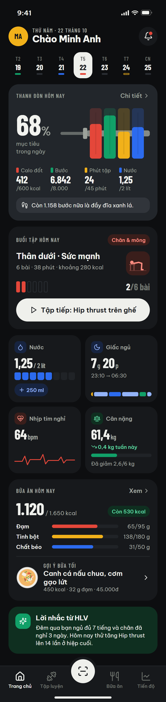
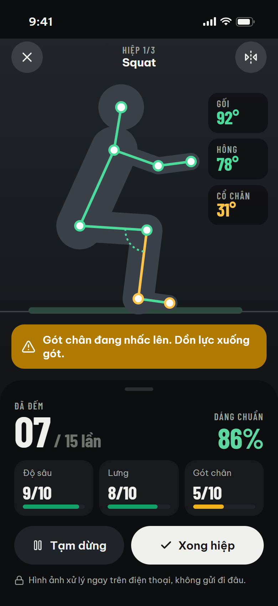
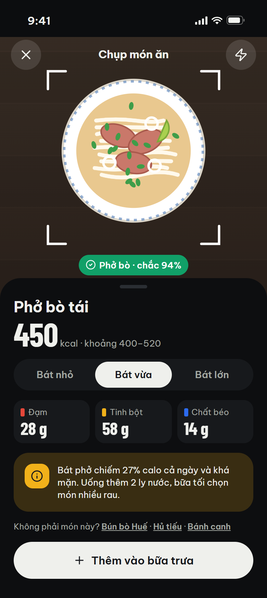
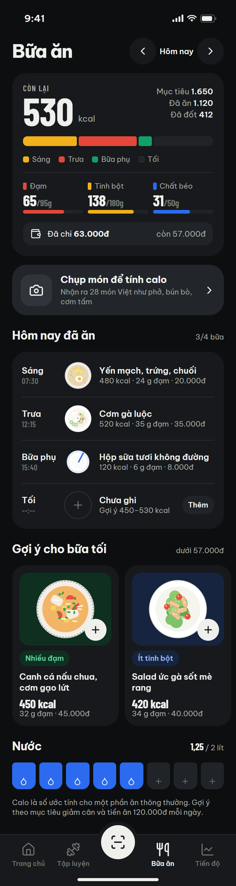
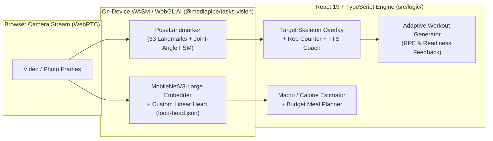

# FitCoach — On-Device AI Pose Correction & Food Classifier Web App

<div align="center">
  <p align="center">
    
    
    
    
  </p>

  <p align="center">
    
    
    
    
    
    
  </p>
</div>

---

## ✨ Overview

**FitCoach (`fitness-app`)** is an offline-first, privacy-preserving fitness and nutrition web application running **two real-time computer vision pipelines directly in the browser via WebAssembly & WebGL (`@mediapipe/tasks-vision`)** with zero cloud GPU cost.

### Three Core Engineering Pillars
1. **Real-Time AI Pose Coach (`src/ai/pose/`):**
   - Extracts **33 3D body landmarks** at 30 FPS via `PoseLandmarker`, automatically detects the side of the body facing the camera (`nearSide`), computes joint angles and torso inclination, and overlays a proportional target skeleton calibrated to the user's exact limb lengths.
   - Runs per-exercise state machines to count repetitions (`reps`) or isometric holds (`hold`), detects form faults (rounded back, knee valgus/over-toe, heel lift, hip sag), and speaks real-time voice corrections via the **Web Speech API (`speechSynthesis`)**.
2. **In-Browser Food Classifier & Budget Meal Planner (`src/ai/food/` & `training/food/`):**
   - Uses transfer learning on **`MobileNetV3-Large`** (1,280-D feature embeddings extracted in-browser via `ImageEmbedder` + a custom-trained multinomial logistic regression head exported to `public/models/food-head.json` from the `30VNFoods` dataset) to classify **28 Vietnamese dishes** from camera photos.
   - Pairs visual recognition with a 50-item nutrition & price database to recommend daily meals within the user's exact daily food budget and generate a one-tap grocery checklist.
3. **Adaptive Workout Generator & Readiness Engine (`src/logic/`):**
   - Generates personalized weekly training splits across **120 exercises** (complete with custom-rendered CC0 3D MakeHuman/Blender pose illustrations in `public/poses/`) based on goal (`lose`, `muscle`, `gain`, `health`), experience level, session duration (`15`/`30`/`45`/`60` min), equipment, and post-workout **RPE (`0..3`)** + bio-readiness score (`0..100`).

---

## 🏗️ On-Device AI & Application Architecture



---

## 🚀 Quickstart

**Prerequisites:** Node.js **20+** and `npm`.

```powershell
git clone https://github.com/Tthanh2k6/fitness-app.git
cd fitness-app
npm install
npm run dev
```

| Command | Description |
| :--- | :--- |
| `npm run dev` | Start Vite development server (`http://localhost:5173`) |
| `npm run build` | Type-check and build production bundle (`dist/`) |
| `npm test` | Run **53 unit tests** (Vitest) covering pose grading, workout scheduling, readiness, nutrition & food classification |
| `npm run lint` | Run ESLint static analysis |

### Retraining the Custom Food Classifier Head (`training/food/`)
```powershell
cd training/food
pip install -r requirements.txt
python train.py
```

---

## 📂 Repository Structure

| Path | Description |
| :--- | :--- |
| [`src/ai/pose/`](src/ai/pose/) | 33-keypoint MediaPipe Pose wrapper, joint-angle geometry, fault detectors & proportional target skeleton renderer |
| [`src/ai/food/`](src/ai/food/) | In-browser `MobileNetV3-Large` feature extractor + dot-product softmax classifier (`public/models/food-head.json`) |
| [`src/logic/`](src/logic/) | Workout split generator, RPE auto-progression (`adjust.ts`), readiness score (`health.ts`), budget meal planner (`meals.ts`) |
| [`src/data/`](src/data/) | 120 exercises, muscle heatmaps, warm-up/stretch routines & 50-item nutrition/price catalog |
| [`src/pages/`](src/pages/) | 16 application routes (`/home`, `/train`, `/workout`, `/coach`, `/meals`, `/scan`, `/progress`, `/health`, `/challenges`, `/profile`) |
| [`training/food/`](training/food/) | Python pipeline to download `30VNFoods`, extract embeddings, train the classifier & export `food-head.json` |
| [`tools/human/`](tools/human/) | Blender Cycles + MakeHuman (MPFB) automation scripts that render 72 `.webp` 3D exercise illustrations |
| [`redesign/`](redesign/) | Complete light & dark UI design system (`Chalk, Rubber & Iron Plates`), HTML prototypes, Figma SVGs & PNG screens |

---

**Author:** **Trung Thanh Tran** (*Trần Trung Thành*) · [GitHub `@Tthanh2k6`](https://github.com/Tthanh2k6) · [Upwork Profile](https://www.upwork.com/freelancers/~01ee7c2348cb4b62fe)
